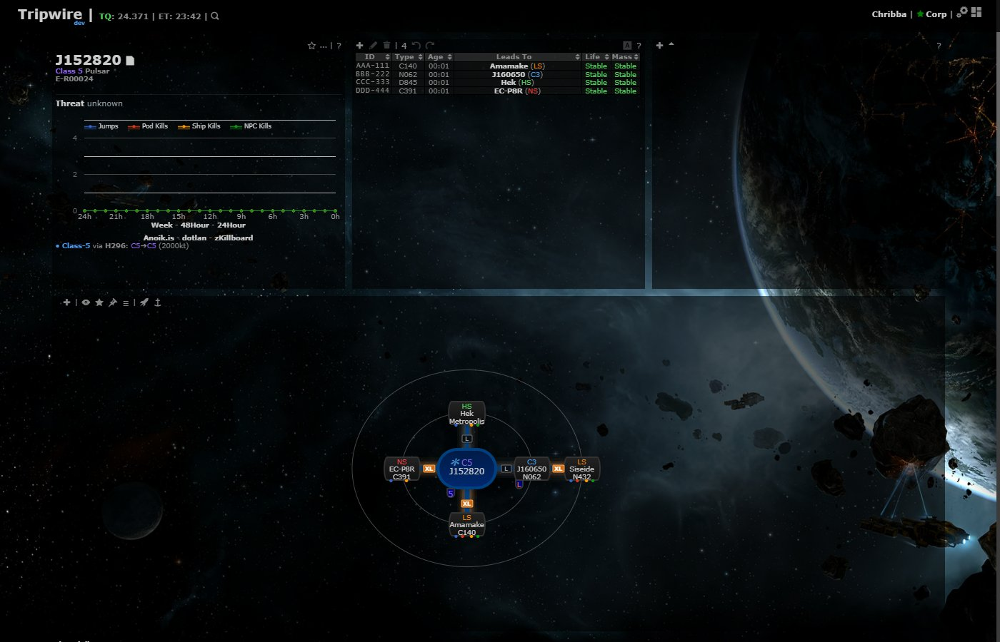
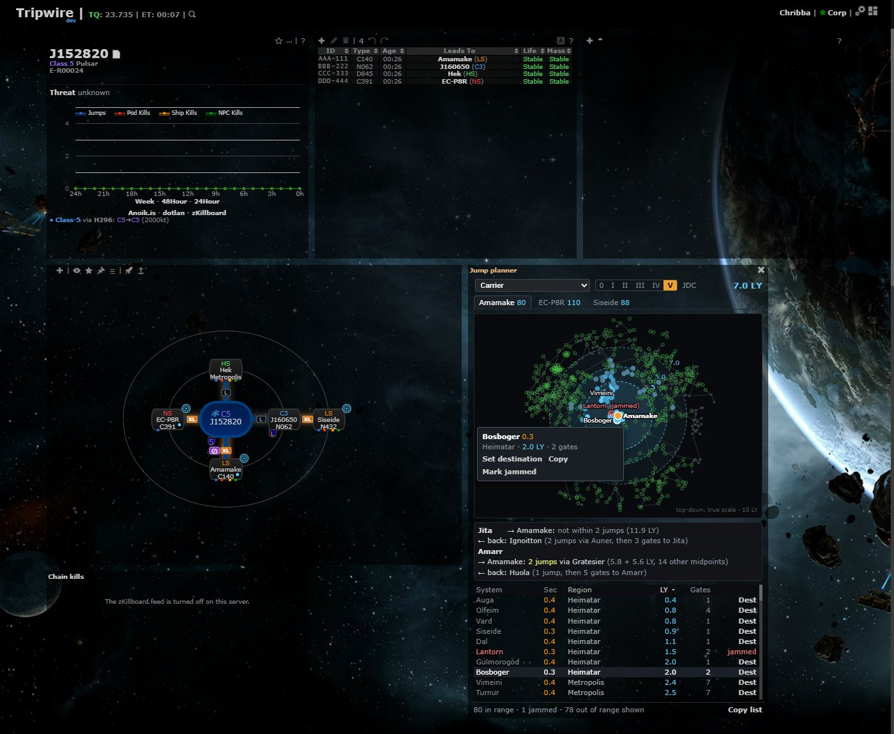
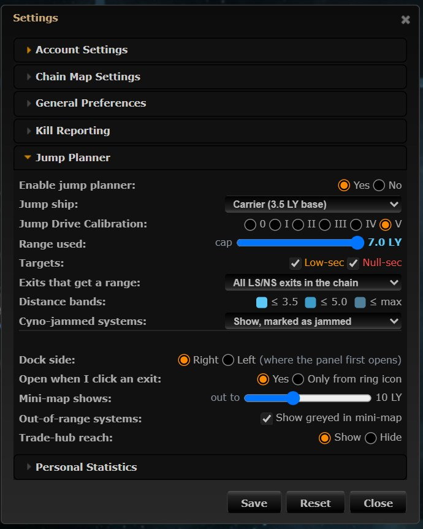

# Jump planner

**Date:** 2026-10-11

## Description

When a wormhole drops us into low-sec or null-sec, which systems can a capital, Black Ops or jump freighter reach from
that exit in one jump, and can it get there from Jita or Amarr? Each LS/NS exit on the chain map gets a small range-ring
icon; clicking it opens the **Jump planner** panel (design B) with a top-down mini-map, distance bands, gate jumps,
trade-hub reach, cyno-jammed marks and a "Dest" button.

## Before / After

| Before | After |
| --- | --- |
|  |  |

Settings > Jump Planner:

## Settings

Toggle: Settings > **Jump Planner** (new section, on by default) > Enable jump planner. Off removes the icons and the
panel. Settings live in `options.jumpRange` (a missing key means the default) and survive Settings > Reset (back to
the defaults, panel closed). Ship and JDC changed in the panel header write the same keys.

Rows: Enable · Jump ship (presets from the SDE) · Jump Drive Calibration 0-V · Range used (cap slider 1 LY to the ship's
range) · Targets (low-sec, null-sec) · Exits that get a range (all LS/NS exits in the chain / only the system I'm viewing)
· Distance bands (display: ≤ 3.5, ≤ 5.0, ≤ max) · Cyno-jammed systems (show marked / hide / treat as in range) ·
Dock side · Open when I click an exit (yes / only from ring icon) · Mini-map shows out to 7-15 LY (default 10) ·
Out-of-range systems shown greyed · Trade-hub reach (show / hide).

"Panel position" from the design is not a choice here: the panel is always a gridster layout widget (like the Kills and
Favourites panels: moved and resized with Customize layout, position remembered while closed or turned off). The row is
**Dock side: Right / Left** instead, i.e. where the panel first opens when it has no saved position (first open, after
Settings > Reset): Right = the highest free spot against the right edge of the window (beside the chain map in the usual
layout, else under everything at the right); Left = the top-left corner (the widgets there move down).

## Change

- **Chain map**: a 14 px ring icon (dashed `#5cc8f5` ring + dot) on the top-right corner, outside the node, of every
  low-sec / null-sec k-space system on the chain. None on high-sec, W-space, Thera, Pochven or Zarzakh. Checked with
  every other mark present (threat badge top-left, intel dot bottom-right, watchlist eye and pilots marker in the icon
  row, size tags and preserve-mass marker on the line); when the pilots count shows, the icon moves up clear of it.
  Hooked by wrapping `chain.nodes` (no upstream edit). Clicking the icon opens the panel on that exit; clicking the
  exit's name does too (it still views the system, as before) unless "Only from ring icon" is chosen.
- **Panel** (`#jumpPlannerWidget`): ship select, JDC segmented control and range in the header; one tab per exit with
  its in-range count; SVG mini-map (true scale, top-down x/z with north up and east right like Dotlan, centred on the
  exit) with filled dashed range rings per band, ring labels, gate lines between shown systems, in-range systems by band,
  high-sec as hollow green non-targets, jammed systems with a red ring and slash, out-of-range greyed; labels for the exit,
  the hovered / pinned system, jammed ones and the 8 nearest that fit without overlapping. Hover or click a point or row
  for a tooltip (name, sec, region, LY, gate jumps, Set destination, Copy, Mark jammed / Unmark with who and when).
  Sortable list (System, Sec, Region, LY, Gates, Dest); "Dest" uses the existing "Set route in game" character picker
  (`autopilotRoute.push`, ESI waypoint; no ESI login gives the same message as there). Footer counts and "Copy list".
- **Trade-hub reach**: for Jita and Amarr, whether the ship reaches the exit from the hub in 1 jump, 2 jumps (best
  midpoint, both legs, how many other midpoints) or not within 2; and back: the hub is high-sec (no cyno), so the closest
  low/null-sec system within 5 gates of it that the ship reaches from the exit in 1-2 jumps.
- **Range engine** `app/js/fork/jump-range.js` (pure, no DOM; for the future JF / Black Ops bridge logistics feature
  too): decode, distance, `maxRange` (base × (1 + 0.2 × JDC), cap), target / origin rules, bands, a spatial grid,
  `inRange`, `reach` (≤ 2 jumps, best midpoint first, under 20 ms) and presets.
- **Static data** `public/jumprange/systems.json` (86 kB: 5,255 systems, positions in 0.001 LY, delta-encoded) and
  `ships.json` (56 hulls), generated by `jumprange/tools/generate-coords.js` from CCP's Static Data Export build
  **3586130** (released 2026-10-07, developers.eveonline.com JSON Lines zip): `mapSolarSystems` positions,
  `mapStargates` (to drop the Jove regions 10000004, 10000017 and 10000019, which have no gates in or out), and
  `types` / `groups` / `typeDogma` attribute 867 `jumpDriveRange` for the hull ranges. Loaded on first panel open,
  cached, `?v=<SDE build>`. No runtime calls to any third party; gate jumps come from `appData.map.shortest`.
- **Cyno-jammed marks**: new table `fork_jump_jammed` (maskID, systemID, setBy, setAt; created on first use, reference
  DDL `docker/sql/jump-jammed.sql`) and endpoint `public/jump_jammed.php` with rally.php's access rules (session with a
  mask, changes POSTed with `X-Requested-With`), only systems in `systems.json`, at most 500 per mask. Refreshed every
  60 s while the panel is open.
- Tests: `app/js-test/fork/jump-range.test.js`, `app/js-test/fork/jump-planner.test.js` (mocha) and
  `jumprange/tests/jammed_endpoint_test.php` (PHP, dev database).
- Upstream files touched: none. Fork files touched: `docker/Dockerfile` (leave `jumprange/tests`, `jumprange/tools` out
  of the image), `docker/README.md`.

### Game rules used (checked 2026-10-11)

- Range = straight-line LY between system positions; JDC adds 20% of base per level; no cyno in high-sec; jump drives
  can't target W-space; a cyno-jammed system blocks normal cynos but not covert ones; only Black Ops jump to covert
  cynos ([EVE University: Jump drives](https://wiki.eveuniversity.org/Jump_drives)).
- Pochven: region-wide cyno jammer, so never a target, but jump drives can leave it, so it is a valid origin
  ([EVE University: Pochven](https://wiki.eveuniversity.org/Pochven)).
- Zarzakh: no source says a cyno can be lit there (capitals can't take its gates,
  [EVE University: Zarzakh](https://wiki.eveuniversity.org/Zarzakh)); treated as neither target nor origin.
- Hull ranges from the SDE: Carrier, Dreadnought, FAX 3.5; Command Carrier 3.75; Lancer, Black Ops 4.0; Supercarrier,
  Titan 3.0; Jump Freighter, Rorqual 5.0.
- Distances match [Dotlan's range page](https://evemaps.dotlan.net/range/Archon,5/Amamake) (Amamake, Archon, JDC V)
  to 0.001 LY; our list is Dotlan's less the two Pochven systems (Archee, Krirald), which Dotlan lists.

### Follow-ups (out of scope)

Jump fatigue, fuel (isotopes), Black Ops bridge range for the fleet, routes of more than 2 jumps, the separate
JF / Black Ops bridge logistics module (the engine is ready for it), expiry of jammed marks.
