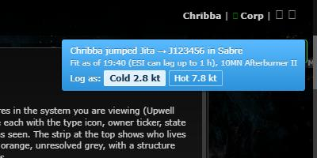
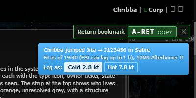

# Jump mass prompt no longer covers the return bookmark

**Date:** 2026-10-11

## Description

After a jump, the blue "Log as: Cold / Hot" jump mass prompt opened in the same top-right spot as the
Return bookmark panel and covered its copy button. While the panel is open, notices now move down below it.

## Before / After

| Before | After |
| --- | --- |
|  |  |

## Settings

No toggle, because this is a layout bug fix.

## Change

`app/js/fork/jump-return.js` sets a `jump-return-open` class on `body` (and the panel's height in
`--jump-return-height`) while the panel is shown; `app/css/fork/jump-return.css` then shifts every jBox notice
down by that height with the CSS `translate` property (jBox stacks notices with an inline `margin-top`, and its flip
animation runs `transform` keyframes on the same element, so neither margin nor transform can be used).
Applies to all notices in that corner, not only the jump mass prompt. No upstream files touched.
