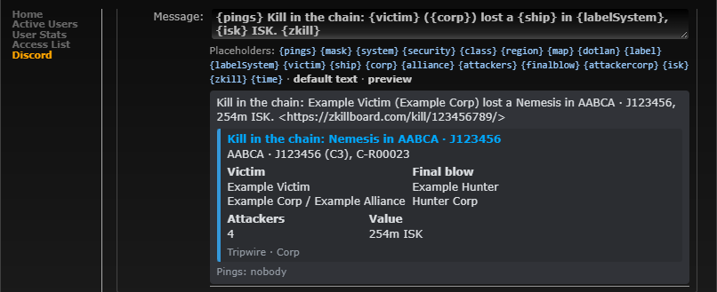

# Kill messages: chain label

**Date:** 2026-10-11

## Description

User request: "For the kill mails in chain can we add the system name i.e. AABCA to the killmail message in Discord
too?" Discord kill messages (chain kills, corp kills, corp losses) now name the system with its chain label, the name
of the hole leading into it on the mask's chain map, like the rally point message already does: **AABCA · J105246**.

## Before / After

Before (the user's message in Discord):

```
Kill in the chain: Voidlord Pandora (All You Can Eat Holes) lost a Coercer Navy Issue in J105246, 44.07m ISK. <zkill link>
embed: Kill in the chain: Coercer Navy Issue in J105246
       J105246 (C5), E-R00028
```

After (same kill, system labelled AABCA on the mask):

```
Kill in the chain: Voidlord Pandora (All You Can Eat Holes) lost a Coercer Navy Issue in AABCA · J105246, 44.07m ISK. <zkill link>
embed: Kill in the chain: Coercer Navy Issue in AABCA · J105246
       AABCA · J105246 (C5), E-R00028
```

Mask Admin > Discord preview of "Any kill in our chain" (sample label AABCA):



No "before" screenshot: the settings page only differs in the preview and the default text above.

## Settings

No toggle. This adds context to an existing message whose text corp admins already control in Mask Admin > Discord:
they can leave the label out by writing `{system}` instead of `{labelSystem}`. Without a label (system not on the
mask's chain map, home, or the hole unnamed) the message is exactly as before.

## Change

- **Same label as the rally point.** `discord_chain_label()` and its rule (`discord_chain_label_pick`) moved from
  `discord/rally.php` to the new `discord/chain_label.php`, unchanged, plus `discord_chain_labels()`: every labelled
  system of several masks in one query (each wormhole of the masks once, both directions, the same rows and pick as the
  one-system lookup; a test checks they agree).
- **No per-kill query.** `discord_kill_state` (the 60 s settings/chain refresh) also loads the labels of every mask with
  a kill type on. `discord_on_killmail` still only queues: it takes the label from that state and stores it in the
  outbox row (`label`), so the label is the one at the time of the kill (at most a minute old). Rows queued before this
  version have none and render as before.
- **Templates** (`discord/template.php`): `{label}` and `{labelSystem}` for the three kill types. New defaults use
  `{labelSystem}` (`... lost a {ship} in {labelSystem}, {isk} ISK ...`); texts saved with the earlier default are read
  as today's (`discord_retired_templates`, on load and for queued rows), edited texts are kept. The embed title and
  system line use the labelled system. The label is a signature name (user text): escaped like game data (markdown,
  `@`, `<`, `:`) in the text, the system line and the embed title (titles render bold, spoilers, code and emoji, so an
  unescaped hole name could restyle or hide the system); `allowed_mentions` unchanged (admin texts only).
- **Preview** (`public/discord.php`): the kill sample has the label AABCA.
- Tests: `discord/tests/discord_test.php` (+19: batch equals single lookup, kill state loads labels, kill data/context
  carry them, default texts of all three types with and without a label, `{label}` alone, escaping in text, system line and title, upgrade of the
  earlier defaults). All PHP and mocha tests pass.
- Checked end to end on the dev stack: home J115405 -A-> J160650 -AB-> J151733 on the corp mask, chain kills and a
  corp loss on one webhook (chain kill text stored as the earlier default), `docker/dev/discord-fake-kill.php`, sent by
  the notify worker to `discord-mock`:

  ```
  Kill in the chain: @​everyone Fake \*Victim\* (Victim Corp) lost a Nemesis in A · J160650, 254m ISK. <https://zkillboard.com/kill/997718970/>
    title: Kill in the chain: Nemesis in A · J160650 / A · J160650 (C3), C\-R00009
  Kill in the chain: ... lost a Nemesis in AB · J151733, 254m ISK. ...     (title/line: AB · J151733)
  Kill in the chain: ... lost a Nemesis in J115405, 254m ISK. ...          (home: no label)
  Corp loss: @​everyone Fake \*Victim\* lost a Nemesis in AB · J151733, 254m ISK. <https://zkillboard.com/kill/944109536/>
  Corp loss: ... lost a Nemesis in Jita, 254m ISK. ...                     (not on the chain: no label)
  ```

  Full payload of the labelled corp loss: `{"username":"Tripwire","content":"Corp loss: @​everyone Fake \\*Victim\\* lost
  a Nemesis in AB · J151733, 254m ISK. <https://zkillboard.com/kill/944109536/>","embeds":[{"color":15158332,
  "title":"Corp loss: Nemesis in AB · J151733","description":"AB · J151733 (C3), C\\-R00013","fields":[Victim, Final
  blow, Attackers 2, Value 254m ISK],"footer":{"text":"Tripwire · Corp"}, ...}],"allowed_mentions":{"parse":[]}}`
- Docs: `docker/README.md#discord-notifications`.
- **Follow-up:** `discord/chain.php` (chain kills' home BFS) and `discord_chain_labels` each read the mask's
  wormholes once a minute; one query could feed both. The labels can't come from the BFS itself: they follow the
  rally point's no-home rule (the chain map's per-user walk can't be repeated on the server), which also covers masks
  without a home.

Files: `discord/chain_label.php` (new), `discord/rally.php` (functions moved out), `discord/kills.php`,
`discord/template.php`, `discord/discord.inc.php`, `public/discord.php`, `rally_discord.inc.php` (comment),
`discord/tests/discord_test.php`, `docker/README.md`. Upstream files touched: none.
