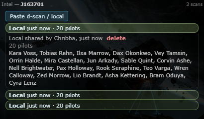
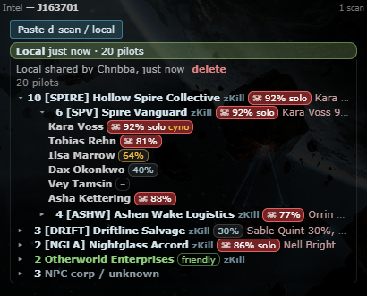
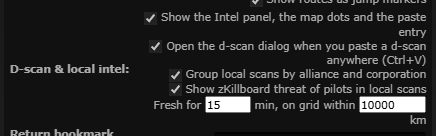

# Local scans: corporations, alliances and threat

**Date:** 2026-10-11

## Description

A shared local scan used to be a plain list of names. The Intel panel now groups its pilots by alliance and
corporation (count, ticker, name, zKillboard link; your own corp/alliance marked "friendly"; NPC corps and unknown
names in their own bucket) and shows a zKillboard threat badge per pilot and per group, so you can tell at a glance
who is in local and who is dangerous.

## Before / After

| Before | After |
| --- | --- |
|  |  |

The "after" screenshot uses fictional pilots and groups seeded into the dev database (the dev stack runs without the
zKillboard worker, `ZKILL_FEED_ENABLED=false`, so the page was told the lookups are on).

## Settings

Two toggles under Settings > General Preferences > "D-scan & local intel", both on by default:
`options.intelScans.affiliation` (group local scans by alliance and corporation) and `options.intelScans.threat`
(zKillboard threat badges). They are display settings: the lookups themselves happen on the server when a local scan
is shared. Save applies them, Settings > Reset turns them back on. Server-wide, `INTEL_ZKILL_THREAT_ENABLED=false`
stops the zKillboard step (corporations / alliances from ESI still work).

## Change

- New `intel/pilots.inc.php` (fork-owned) and tables `fork_pilot_affiliation` (name → character → corporation /
  alliance, also the ESI queue), `fork_pilot_entities` (corporation / alliance names and tickers), `fork_intel_lookups`
  (one job per shared local scan) and `fork_pilot_threat` (compact zKillboard character stats, 24 h), created on first
  use.
- Sharing a local scan queues its names (caps: 20,000 queued names overall, 6,000 per user). The zKillboard worker
  resolves them with ESI `POST /universe/ids`, `POST /characters/affiliation` and `GET /corporations/<id>`,
  `/alliances/<id>` (8 requests per pass, tiered retries like the name cache, affiliations refreshed after an hour when
  viewed). Then it picks at most 20 new pilots per scan (not friendly; player corps before NPC corps) and fetches
  `https://zkillboard.com/api/stats/characterID/<id>/` for them at the lowest priority of its zKillboard API queue
  (after back-fills and System Threat stats, same `ZKILL_API_INTERVAL`). Web requests never call ESI or zKillboard.
  **Third-party calls:** ESI and zKillboard, from the worker only (AGENTS.md section 6).
- `public/intel_scans.php?pilots=<scanID>` returns the open local scan's pilots; the panel polls every 5 s while the
  server is still looking up ("looking up…", "Threat loading…"), pilots past the 20-pilot cap show "–" (not looked
  up). If a d-scan of the system was shared within 3 minutes, the scan shows "N pilots · M ships on scan".
- Browser: new `app/js/fork/intel-pilots.js` (grouping, threat levels, markup; mocha tests) and
  `app/css/fork/intel-pilots.css`; `app/js/fork/intel-scans.js` fetches and renders it and has the two new settings.
  Threat badges: danger ratio, ☠ for 75 %+ with 10+ kills, "solo" for 30 %+ solo kills, "cyno" when a top ship can fit
  a cyno (from `public/intel/types.json`).
- Fork-owned files changed: `public/intel_scans.php`, `zkill_feed.worker.php` (one call for the zKillboard API priority
  chain, ESI pass for local pilots), `docker/config.php`, `.env.example`, `docker-compose.dev.yml`,
  `docker-compose.prod.yml`, `docker/README.md`. No upstream files touched.
- Tests: `php intel/tests/pilots_test.php` (90 checks: grouping inputs, caps, worker steps against a fake ESI /
  zKillboard transport, expiry, NPC corps, the 20-pilot cap, priority order) and new checks in
  `intel/tests/intel_endpoint_test.php`; mocha `app/js-test/fork/intel-pilots.test.js`.
