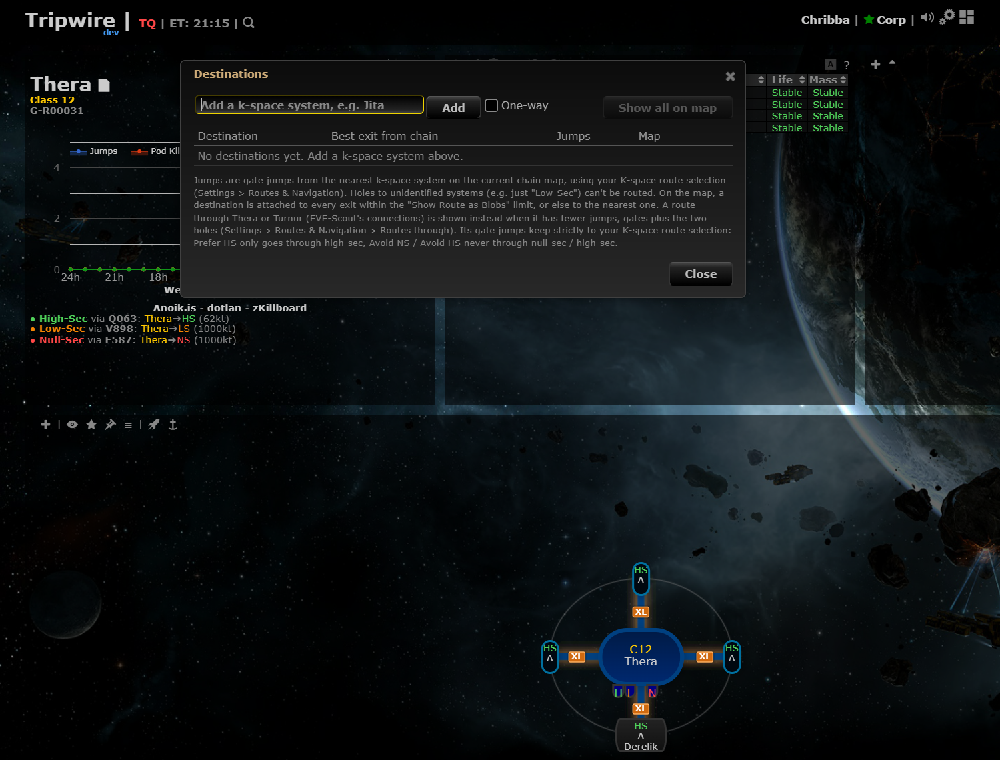
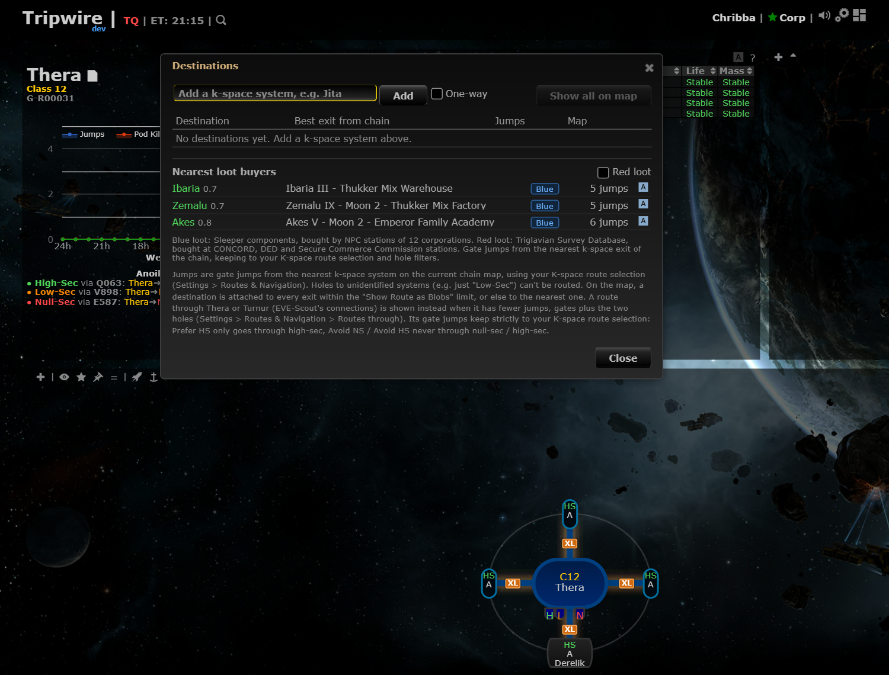

# Nearest loot buyers

**Date:** 2026-10-11

## Description

The Destinations window has a new "Nearest loot buyers" section: the three NPC stations nearest to the chain's k-space exits (by gate jumps, with your route preferences and hole filters) that buy blue loot (Sleeper components), each with its security, station name, jumps and "Set route in game". A "Red loot" checkbox adds the buyers of the Triglavian Survey Database.

## Before / After

| Before | After |
| --- | --- |
|  |  |

(Dev stack: a chain with Thera as the only system and one k-space exit, Ibaria's neighbourhood; Red loot ticked gives the DED stations of Maspah and Asghatil.)

## Settings

Toggle: Settings > Routes & Navigation > "Loot buyers" (on by default) and "Red loot" (off by default). Both survive Settings > Reset (back to on / off).

## Change

- New fork-owned files: `app/js/fork/loot-buyers.js`, `app/css/fork/loot-buyers.css`, `app/js-test/fork/loot-buyers.test.js`, `public/loot-buyers/stations.json` (generated), `tools/fork/build-loot-buyers.mjs` (generator).
- Search: `skyhooksPanel.distances` (one multi-source Dijkstra from all exits, same costs / avoid list / route security as guidance). Exits are chosen like Destinations does: `routeHoleFilters.pickRoutes` keeps the exits whose way home avoids the filtered holes (all of them when none does). "Set route in game" uses `routeDestinations.route` + `autopilotRoute.push`.
- No upstream file is edited. No third-party call at runtime (the list is a static file); the generator makes one read-only pass over public ESI market orders when run by hand.
- Related upstream code, untouched: the system panel's "Blue loot buyer: Nj from X" line uses the hard-coded `guidance_profiles.blueLootSystems` (182 systems). Every one of them is in the new file; the new file has 3 more (Yulai, Tar, Adaz), so the upstream list is slightly stale.
- Not built: routing from the tracked pilot's location (only chain exits); one row per system (extra stations in the same system are shown as "+N more here").

## Notes: research (2026-10-11)

**Where blue loot sells.** Sleeper components are not used in production, they are sold to NPC buy orders at stations. EVE University: "The blue loot can be sold to some NPC Stations" and some regions have none ([Sleepers](https://wiki.eveuniversity.org/Sleepers)); the Neural Network Analyzer / Sleeper Data Library / Ancient Coordinates Database / Sleeper Drone AI Nexus orders are standing 365-day buy orders ([forum note](https://forums.eveonline.com/t/i-keep-hearing-about-npcs/302800/3)). No wiki page lists the stations, and the SDE has no market data (grepping every SDE file for type 30744 finds only `types.jsonl`). So the buyer list was derived from the public ESI regional market (`GET /markets/{region}/orders/?order_type=buy&type_id=...`, no token, all 70 k-space regions, types 30744, 30745, 30746, 30747, 48121), joined with the SDE for station, system and corporation. Orders seeded by CCP are unmistakable: duration 365 days, 999,999 / 1,000,000 units, at an NPC station, prices 200k / 500k / 1.5M / 5M ISK. Result:

- Blue: 241 stations of 12 corporations: Zainou, Eifyr and Co., Emperor Family, CreoDron, Secure Commerce Commission, Dominations, Guristas Production, Intaki Syndicate, Serpentis Inquest, The Sanctuary (only 1 of its 5 stations), Thukker Mix, True Creations. It is "all stations of the corporation" for 11 of them, which is why a generated list from the market (not just corporation IDs) is needed. Not ORE / Sisters of EVE as older guides said.
- Red (Triglavian Survey Database, type 48121): 139 stations of CONCORD, DED and Secure Commerce Commission (100,000 ISK standing orders). Same 365-day / ~1M-unit pattern. EVE University's Overseer's Personal Effects page describes the same kind of CONCORD station buy orders ([page](https://wiki.eveuniversity.org/Overseer%27s_Personal_Effects)).
- Cross-check: upstream Tripwire's hard-coded `blueLootSystems` (182 systems) is a subset of the 185 systems found. 43 station names were compared with ESI `/universe/stations/{id}` and all match.

**How players find buyers today.** Mappers: Tripwire's system panel line "Blue loot buyer: Nj from ..." (upstream); Wanderer / Pathfinder style tools have no documented blue/red-loot routing in what could be found (searched, nothing sourced), so the request's "Routes By" could not be verified. Otherwise players use the in-game market (filter buy orders by 365-day expiry) or sites such as EVE Ref.

**Staleness.** CCP adds or moves NPC stations rarely; re-run the generator after an SDE release or when a station is added: `node tools/fork/build-loot-buyers.mjs fetch <sdeDir> orders.json` then `node tools/fork/build-loot-buyers.mjs build <sdeDir> orders.json <sdeBuild> <YYYY-MM-DD> > public/loot-buyers/stations.json`. This file: SDE build 3586130 (2026-10-07), orders read 2026-10-11.
