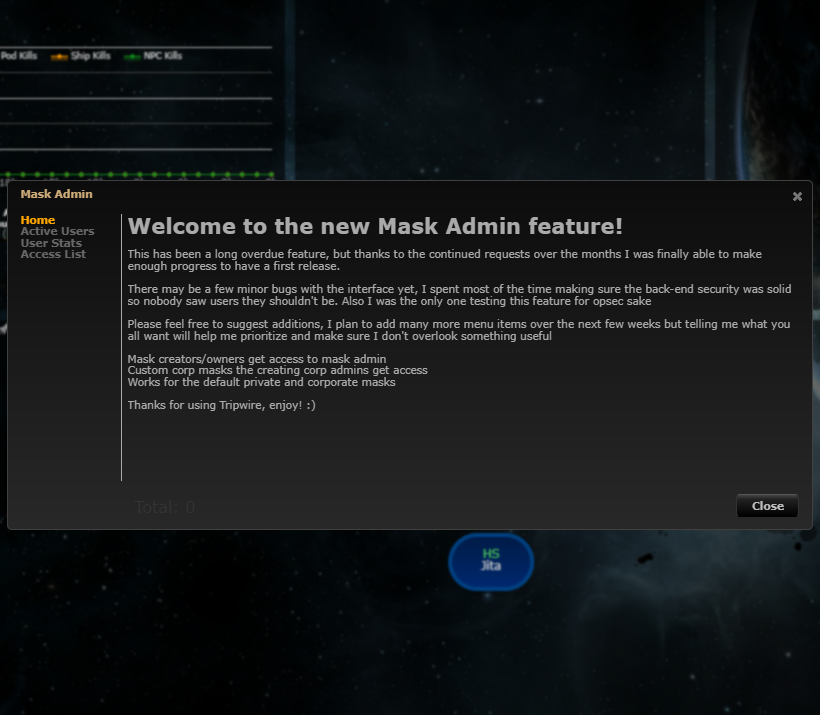
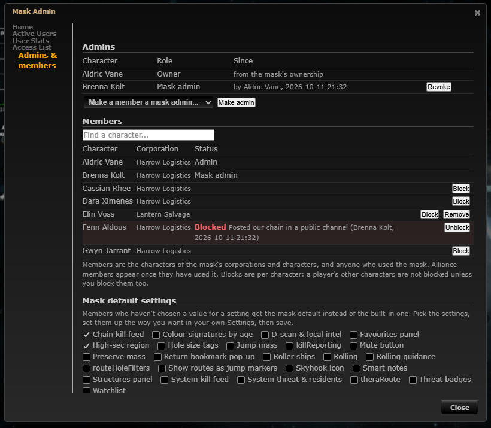

# Mask admins: several admins, block members, mask default settings

**Date:** 2026-10-11

## Description

Mask Admin has a new "Admins & members" tab. The mask owner (or the owning corporation's admins) can make any member
a mask admin, admins can remove or block a member (with a reason) even when their corporation or alliance has access,
and admins can save their own settings as the mask's defaults, which members who haven't chosen otherwise get.
Requests: Tripwire #441 "allow to set mask admins", forum requests to remove/block members, Wanderer-style admin defaults.

## Before / After

| Before | After |
| --- | --- |
|  |  |

More: [block form](after-block.png), [mask default badge in Settings](settings.png). "Before" is the same dialog with the
new tab hidden (the tab is the only difference).

## Settings

No toggle. It is an admin feature (Mask Admin, mask-wide per AGENTS.md); members keep full control: any setting they
change themselves overrides the mask default, and Settings > Reset goes back to the mask default. The "mask default"
badge only appears on settings an admin chose.

## Change

- New: `maskadmin/maskadmin.inc.php` (levels, grant/revoke/block/unblock/remove, defaults, audit), `public/mask_admins.php`
  (JSON endpoint with the fork's CSRF pattern; the mask is always the session's), `app/js/fork/mask-admin-tab.js`,
  `app/js/fork/mask-defaults.js`, `app/css/fork/mask-admin-tab.css`, `docker/sql/mask-admins.sql`, tests
  (`tests/mask_admins_test.php`, `app/js-test/fork/mask-defaults.test.js`), docs in `docker/README.md#mask-admins`.
- Tables created on first use: `fork_mask_admins`, `fork_mask_blocks`, `fork_mask_defaults`, `fork_mask_audit`.
- Enforcement of blocks: `docker/db.inc.php` (fork-owned, loaded by every endpoint) drops a blocked character's session
  to their corp mask before any endpoint reads `$_SESSION['mask']`.
- **Upstream files touched (one line each):** `lib.inc.php` (`checkAdmin()` also accepts granted admins),
  `masks.inc.php` (blocked masks are left out of the mask list), `public/masks.php` (deleting a mask stays with the
  owner / corp admins, via `maskadmin_corp_admin()`).
- **Security review fixes (same entry):**
  - Mask ids are canonicalised and access-checked on every request by the hotfix guard (`mask-guard.inc.php`, from
    `docker/db.inc.php` and `login.php`); `maskadmin_enforce_session` runs right after it and only does the block check
    (`maskadmin_canonical_mask` reuses `tripwire_mask_canonical` for direct callers). That guard also closes an **upstream** hole that exists on `origin/main`: `verifyMask()` lets
    `"12.0abc"` through on PHP 8, so any logged-in user could put it in their session through `options.php` and read or
    write mask 12.0 (MySQL casts it to 12.0). Reproduced on the dev stack (a character without access wrote a note into
    another mask) and verified closed.
  - `api/auth.php` (REST API) refuses blocked characters (upstream file, one guarded condition).
  - A grant counts only while the character still has access to the mask (verifyMask's rule, including alliance).
  - `public/masks.php` `save` and `edit` (access list) are owner / corp admins only; Discord, Fight here and Watchlist
    stay corp-admin only (`maskadmin_corp_admin`), so granted admins see them read-only.
  - Mask defaults are checked against an allow-list of the keys the Settings rows store (server and browser; a mocha test
    keeps both equal to the `forkSettings.register` keys); prototype names are rejected.
  - Help text: blocks are per character.
  - Upstream files now also touched: `api/auth.php`, `public/login.php`, `public/masks.php` (save/edit lines).
    `public/discord.php`, `public/fight.php`, `public/watchlist.php` (fork files) call `maskadmin_corp_admin()`.
- Defaults are applied in the browser by wrapping `options.get` / `options.apply`; inherited values are not saved
  as personal choices.
