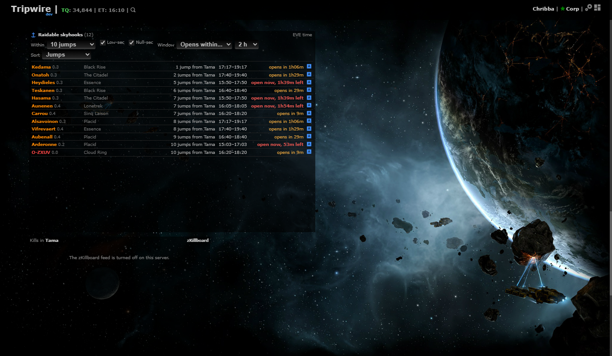

# Raidable skyhooks panel

**Date:** 2026-10-11

## Description

A new movable panel, "Raidable skyhooks", lists the skyhooks that can be raided (their theft window is open or opens
soon) within a number of gate jumps of the k-space systems on your chain, with the window in EVE time, a countdown, and
a "Set route in game" button. The data is ESI's public `GET /skyhooks/raidable`.

## Before / After

| Before | After |
| --- | --- |
|  |  |

(Before: the layout without the panel. After: the new panel, scrolled into view.)

## Settings

Toggle: Settings > Routes & Navigation > "Raidable skyhooks" (on by default; `options.skyhooksPanel.enabled`) and
"Skyhooks within" (the default maximum number of jumps, 10). The panel's own header has the other options, saved per user
in the same `options.skyhooksPanel`: max jumps (3 to 30 or any distance), low-sec / null-sec, window (vulnerable now,
opens within 1/2/4/8/24 h, all) and sort (jumps or window start). Settings > Reset puts them all back.

## Change

- **Server** (fork-owned): `skyhooks.inc.php` and `public/skyhooks.php` (session required, GET only). One cached copy for
  the whole server in `cache/skyhooks.json`, refreshed from ESI at most every 5 minutes under an exclusive `flock` (others
  get the old copy; a request with no copy at all waits up to 10 s for it). On an ESI error, a 404 or one of our rate-limit
  pauses (`esi/esi.inc.php`), the old copy is served (`stale` once it is over 10 minutes old, `error` says why) and ESI is
  not asked again for 60 s. ESI's route is in a rate-limit group of only 30 requests per 15 minutes per IP, so browsers
  never call it. It needs `X-Compatibility-Date: 2026-10-01` (the pinned `2025-12-16` answers 404): `esi_request()` already
  leaves a date header the caller sets alone, so `esi/esi.inc.php` is unchanged and only this one call uses the newer date.
  The route's `theft_vulnerability.start/end` are turned into unix seconds. Verified once against live ESI from the dev stack
  (200, 170-odd skyhooks).
- **Client** (fork-owned): `app/js/fork/skyhooks-panel.js` + `app/css/fork/skyhooks-panel.css`. Built like the Favourites
  panel (a gridster widget, placed below the other panels until moved, position remembered when switched off). Region,
  security and system name come from the static system data already in the page (`appData.systems`/`regions`), so the server
  sends only IDs and times. Jumps use `guidance.findShortestPath` (the same gate routing as the Destinations window, so
  the route-security preference and avoid list count) from `routeDestinations.lastExits`, the chain's k-space exits, with the
  maximum as the search limit; the nearest exit is shown per row. The panel asks our server every 5 minutes and redraws the
  countdowns every 30 s (sooner when the chain's exits change). The button calls the existing `autopilotRoute.push` with the
  gate path from the nearest exit (character picker as elsewhere). Empty states: nothing from the server, no k-space exit
  on the chain, or nothing matching the options; an error line when the server can't be reached or ESI is stale. High-sec
  or unknown-security systems are never hidden by the low/null checkboxes (the data should not have any).
- **Planet names**: not shown. The repo has no planet data (SDE planets), and the name (system + roman numeral) can't be
  derived from the planet ID, so rows say only the system.
- **Tests**: `app/js-test/fork/skyhooks-panel.test.js` (settings, window status and countdown, EVE-time text, security
  filter, window filter, nearest exit, filtering, sorting, empty states); `tests/skyhooks_test.php` (parsing, 5 minute
  cache, 60 s retry, stale copy, lock held by another request, paused ESI, the date header on the request).
- **Upstream files touched**: none (`docker/README.md` is fork-owned and has a new short section).

No new third-party hosts (`esi.evetech.net` is already used), analytics or tracking.
