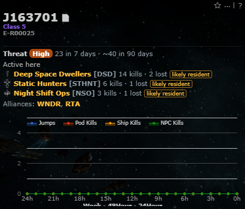
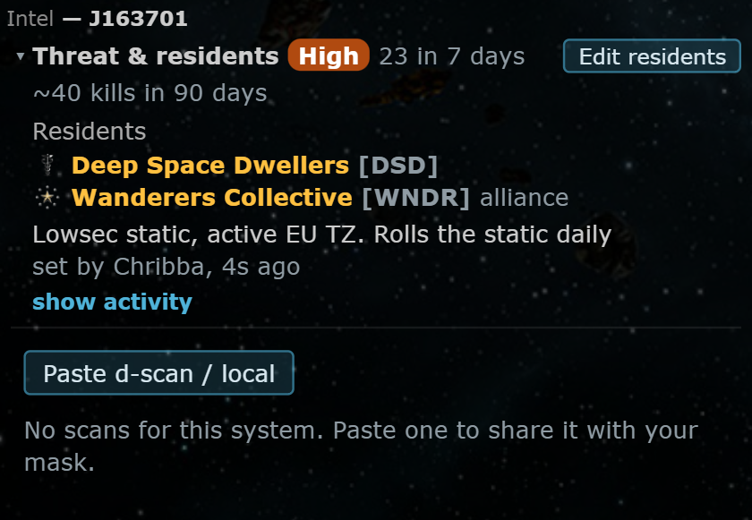
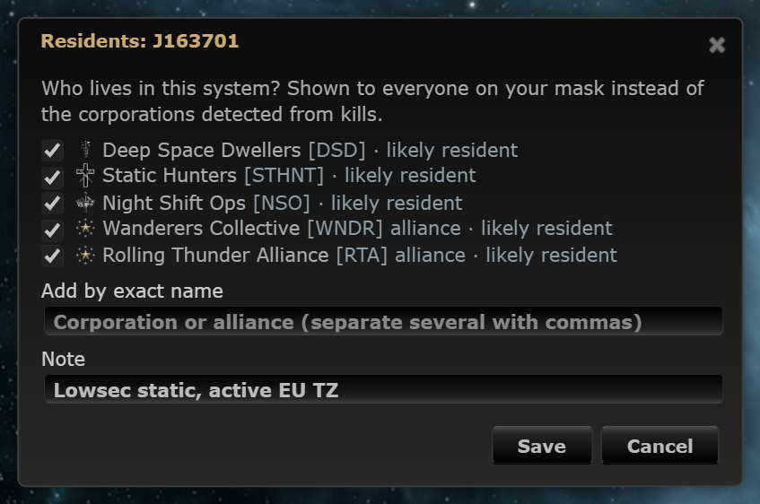

# Threat & residents in the Intel panel, Set residents

**Date:** 2026-10-11

## Description

The Threat / Active here block moved out of the system info panel (next to the signatures) into the Intel panel as a
collapsible "Threat & residents" section; the threat level stays visible in its header when collapsed. A new
**Set residents** button lets pilots record who lives in a hole (corporations / alliances plus a note), shared with
the mask and shown instead of the corporations detected from kills.

## Before / After

| Before | After |
| --- | --- |
|  |  |

Set residents dialog: 

## Settings

No new toggle: the existing Settings > Kills & Intel > "System threat & residents" toggle (on by default) hides the
whole section wherever it is, including Set residents. Its text now says the Intel panel.

## Change

- `app/js/fork/system-threat.js`: the section renders before `.intel-body` in the Intel panel (`#intelScansWidget`), so
  the panel's own re-renders don't touch it; when the Intel panel is off it goes back above the activity graph of the
  system info panel, and it moves without a reload when the panel is turned on or off in Settings (same data, same
  polling). Collapsed / expanded is remembered per browser (`localStorage`, default expanded). New pure builders
  (`headHtml`, `activityHtml`, `setResidentsHtml`, `sectionHtml`, `quickPicks`, `parseNames`, `dialogHtml`) and the Set
  residents dialog: quick picks from "Active here" (likely residents pre-ticked when nothing is set), exact names typed
  in, a note (200 characters), Save / Clear residents / Cancel. When residents are set, the body lists them with logo,
  [ticker], zKillboard link, note and "set by X, 3d ago"; "show activity" reveals the detected list. Residents are
  read with the viewed system and re-read with its detail polls (every 5 minutes; while stats are
  pending, not more than once a minute) so other mask members' changes show.
- New `public/system_residents.php` + `system_residents.inc.php`: per mask and system, table `fork_system_residents`
  (created on first use, reference DDL `docker/sql/system-residents.sql`), session check, POST needs
  `X-Requested-With`, everything validated server-side (system IDs, entity kinds and IDs, at most 10, note cleaned).
  Names and tickers never come from the browser: names are resolved with ESI's public `POST /universe/ids`; names and
  tickers come from the stored row, the server's caches (`zkill_names`, the system's zKillboard top lists) or ESI's
  public `GET /corporations/{id}` / `/alliances/{id}` (via `esi/esi.inc.php`, only on Save). Everything is escaped on
  render. No new third-party hosts (ESI and images.evetech.net were already used).
- Tests: `app/js-test/fork/system-threat.test.js` (collapsed / expanded markup, residents replacing the list, escaping,
  pre-ticks) and `tests/system_residents_test.php` (validation, ESI lookups with a fake transport, storage).
- Docs: `docker/README.md`. No upstream files touched.
