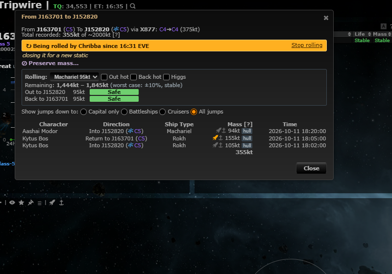
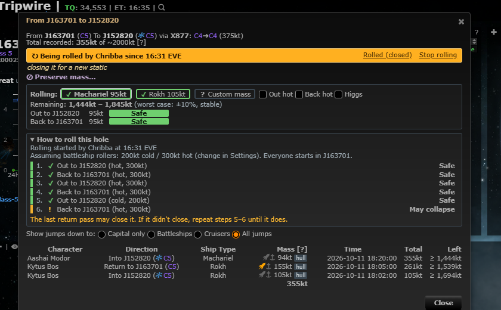

# Rolling follow-ups: how to roll this hole, passes, live mass, Discord "Rolled"

**Date:** 2026-10-11

## Description

Builds on the rolling calculator, auto mass logging and hole rolling (#63): the mass dialog now says *how* to
roll a hole (a numbered, colour-coded step list), shows a running total in the jump log, stays current while open, and
the rolling Discord message says "Rolled by X" for Rolled (closed), "Hole closed (rolling by X)" when it vanishes.

## Before / After

| Before | After |
| --- | --- |
|  |  |

## Settings

Toggle: Settings > Wormhole Jumps & Mass > **Roller ships** (`options.rollPlan`, registered with `forkSettings.register`,
order 21, removed by Settings > Reset): "Show How to roll this hole" (on by default) plus the roller ships' masses in kt
(battleships 200 cold / 300 hot; medium holes 15 / 60; blank = default). The recommendation, ship-button colours, the
jump-log columns and the live refresh also follow the existing "Rolling guidance" toggle (order 20). The marker
tooltip's passes line is part of the rolling markers (Settings > Map Markers > Rolling). The Discord text needs no
toggle: it is the existing mask-wide Rolling type (Mask Admin > Discord).

## Change

- **How to roll this hole** (`rollingCalc.recommend`, pure, mocha-tested): below the rolling calculator, a numbered list
  of out/back passes for a battleship roller crew (medium roller on holes under 300 kt jump mass; hot clamped to the
  hole's jump limit), each step coloured and labelled safe / may collapse / will collapse (icon + text, not colour only).
  Never recommends an outbound pass that may collapse the hole; hot round trips while a whole one is safe, then a cold
  out and a hot return; "closes on the way back", "may close: repeat steps N-M", or a "too little mass left, use a lighter
  ship" warning; capped at 12 steps with "N more hot round trips". Collapsed with a warning on top when the hole is marked
  preserve mass; shows "Rolling started by X at HH:MM EVE" when it is flagged rolling.
- **Pass buttons**: the ship `<select>` became one button per ship (plus Custom), each coloured and marked (✓ ! ✕ ⊘) by
  the verdict of an out-and-back with that ship.
- **Jump log**: pilot, direction, ship, hot/cold and time were already there; added "Total" (running total through each
  pass) and "Left" (worst case: the hole at -10% minus that total). Rolling marker tooltip: "N passes, X kt through".
- **Live mass**: while the dialog is open it re-reads `mass.php` every 10 s and redraws the log and recommendation when
  the log changed (new pass by someone else, a hot/cold correction). Stops when the dialog closes.
- **Higgs**: checked, nothing to add. Every manual mass entry (ship buttons, Custom mass) has a Higgs toggle that doubles
  the pass, and fitted ships carry their Higgs rig (`x: 2` in `fit-mass-data.js`).
- **Discord**: new `mode=rolled` on `public/rolling.php` ("Stop rolling" link now has a second link, "Rolled (closed)").
  The rolling message is struck through + "Rolled by X at HH:MM EVE" for the explicit "Rolled (closed)" button only. A hole that
  vanishes while flagged (rolled, collapsed or expired: we cannot tell) now says "Hole closed at HH:MM EVE (rolling by <who started it>)"
  instead of "Hole collapsed"; plain "Stop rolling" is unchanged ("Done"). No new table or template.

Tests: `app/js-test/fork/rolling-calculator.test.js`, `rolling.test.js`, `discord/tests/rolling_test.php`,
`tests/rolling_discord_flow_test.php` (end to end).

Upstream files touched: none. Fork files: `app/js/fork/rolling-calculator.js`, `app/js/fork/rolling.js`,
`app/css/fork/rolling-calculator.css`, `public/rolling.php`, `discord/rolling.php`, tests.
