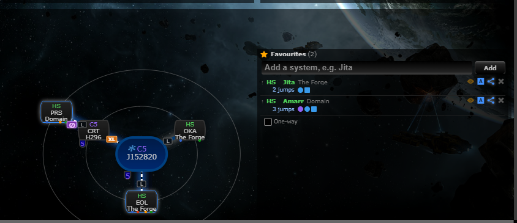
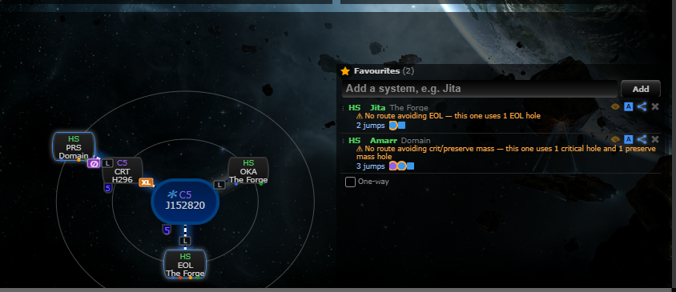
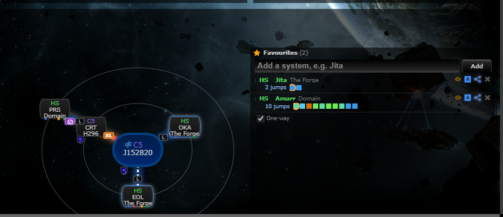
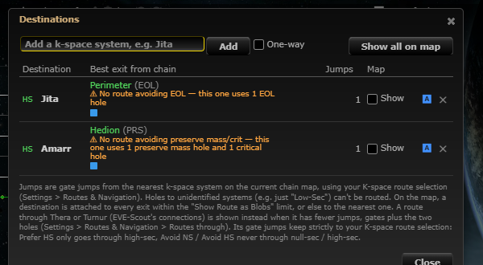
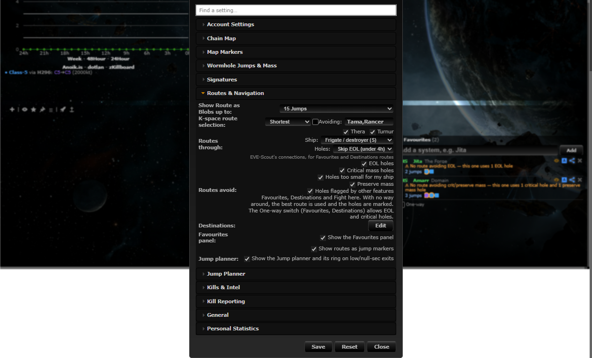

# Route filters on hole state

**Date:** 2026-10-11

## Description

Routes through the chain's wormholes (Favourites panel, Destinations, Fight here) now avoid holes that are EOL, at critical mass, too small for your ship, preserve-mass flagged, or flagged by another feature. They never dead-end: with no way round, the best route is used anyway, its offending hops are marked and a one-line note says so. A per-session "One-way" switch allows EOL and critical holes (still marked).

## Before / After

Same chain (EOL hole to Perimeter, a critical hole into J135100, a preserve-mass hole out of it).

| Before | After |
| --- | --- |
|  |  |

Before: Jita goes through the EOL hole (2 jumps). After: it goes the long way through the stable hole (5 jumps).

With no way round (both holes to the Jita side are EOL), the best route is used and says so; the jump marker of the offending hop gets an orange ring and a tooltip ("Warning: EOL hole"):

One-way on: EOL holes are allowed (Jita via the EOL hole again, no note) but still ringed:

Destinations window (note and its own One-way switch) and the Settings row:

 

## Settings

Toggle: Settings > Routes & Navigation > "Routes avoid" (on by default): EOL holes, critical mass holes, holes too small for my ship, preserve mass holes, holes flagged by other features. Stored in `options.routeHoleFilters.{eol,crit,small,preserve,flagged}`; a missing key means on; Reset deletes the key. "Too small" uses the ship chosen under Routes through (`options.theraRoute.shipSize`); unknown hole sizes are allowed. The One-way switch is not a setting: it is remembered per browser session (sessionStorage).

## Change

- New `app/js/fork/route-hole-filters.js` (global `routeHoleFilters`, pure logic + Settings row + One-way handler) and `app/css/fork/route-hole-filters.css`; tests in `app/js-test/fork/route-hole-filters.test.js`.
- `routeHoleFilters.registerFlag(key, label, isFlagged(hole), {own, short})` lets other features add a hole flag (documented at the top of the file). Preserve mass registers with its own row; rolling (`holeRolling.flags`, already on main) registers under "flagged by other features" from the same file while it does not register itself.
- Applied to: Favourites panel plans (also the strip's hop markers and the note line; a clean route beats a dirty one, then fewest jumps), Fight here (route, banner text, dashed line), Destinations (exits whose way home through the chain avoids the holes come first; the note shows in the table).
- Fork-owned files touched, no upstream files: `favourites-panel.js`, `favourites-route-strip.js`, `rally.js`, `route-destinations.js`.
- Not changed: Jump planner Get home (the way home is the chain's one path, with no alternative to choose; it already warns about EOL, critical, too-small and preserve-mass holes) and the Thera/Turnur route (it already filters EVE-Scout links itself; its legs through chain holes are not filtered). Upstream gate routing (`guidance.js`) is gates only and untouched.
- Not included: a "bubbled" flag. Tripwire has no such hole state, so there is nothing to filter on.
