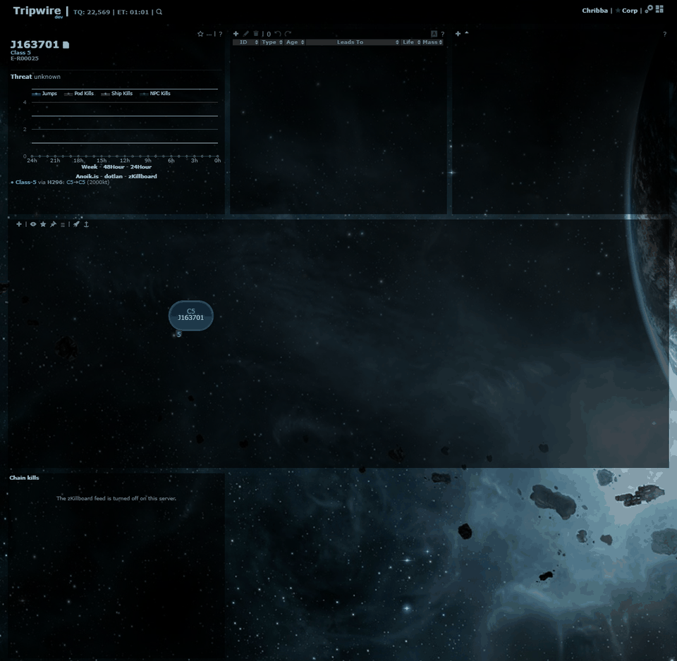
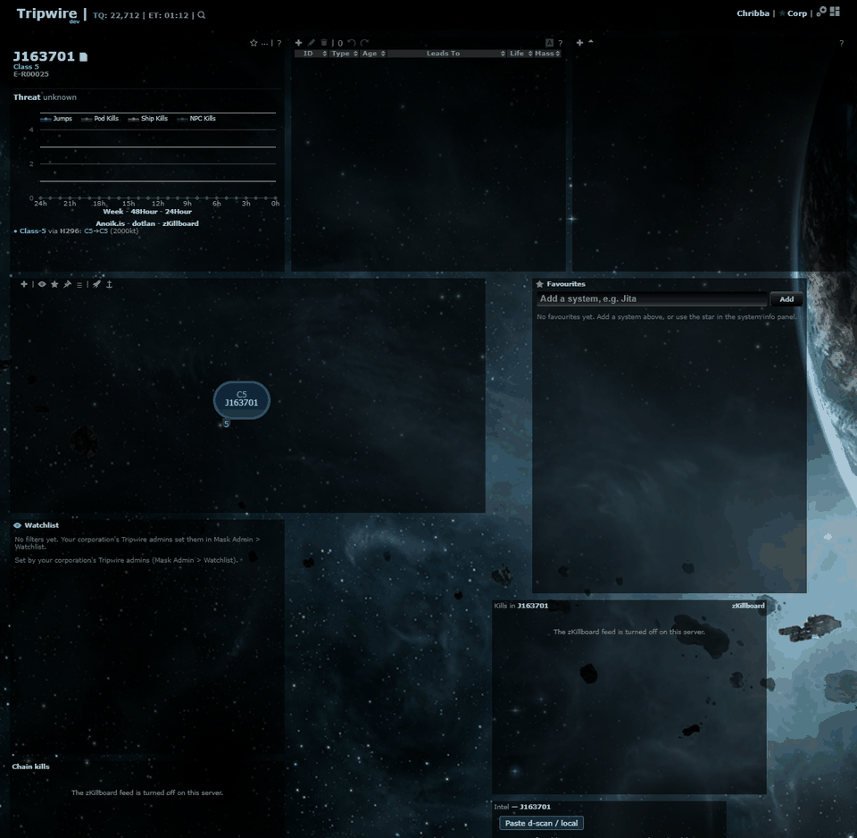

# Settings Save no longer moves the panels back

**Date:** 2026-10-11

## Description

Fix: after moving or resizing panels with Customize layout, a Settings Save (or Reset) put every panel back where it
was when the page loaded, and saved that old layout. Upstream's `options.apply()` restores `options.grid` from the
browser's copy of the options read at page load (`localStorage` "tripwire_options"); it now uses the layout on screen.

## Before / After

Customize layout: chain map made smaller, the Kills, Intel and Favourites panels moved next to it, then Settings > Save.

| Before (Save moves everything back) | After (Save keeps the layout, also after a reload) |
| --- | --- |
|  |  |

## Settings

No toggle: bug fix (nobody wants their layout undone by a Settings Save).

## Change

- New `app/js/fork/layout-grid.js` (`layoutGrid`): `live(gridster, saved)` is the layout gridster has on screen plus
  the saved places of panels that aren't on the page (so a panel turned off comes back where it was); `merge()` /
  `entries()` read the array, object and old `{oog}` layout forms and drop widgets being removed.
- `options.apply()` (Settings Save and Reset, plus every fork panel's apply hook) uses that layout instead of the
  page-load copy once gridster is up. Page load is unchanged (the browser copy still places the panels).
- `options.save()` is wrapped once (`layoutGrid.wrapSave`, installed by layout-grid.js, which runs after options.js) to
  store the layout on screen too: a fork panel turned back on is added by its apply hook after `apply()` took the
  layout, and pushes its neighbours down; without this the pre-push layout was saved (two panels on one spot, swapped
  after a reload). Server save and localStorage are otherwise unchanged.
- Settings > Reset still resets the settings but leaves the layout as it is on screen (it used to restore the
  page-load layout; the layout is a per-browser override that Reset was never meant to touch). The Jump planner still
  forgets its own place on Reset.
- Customize layout's save (`layout.js`) keeps the saved places of panels that are turned off, so turning e.g. the
  Kills panel off, rearranging, and turning it on again puts it back where it was.
- The Intel panel's `options.intelScans.position` and the Favourites/Jump planner `position` fallbacks are no longer
  needed for this, but are left in place: they are harmless fallbacks and existing users have them stored.
- Checked in the browser (own headless Chrome, port 8162): move/resize Kills, Intel, Favourites, chain map, Settings
  Save, reload — same layout; Jump planner resized then Save — kept; Kills, Chain kills, Intel, Favourites, Watchlist
  each off, Save, Save, on — back in the same place; Reset — layout unchanged, settings reset.
  Kills directly above Watchlist: Kills off, Save, reload (Watchlist floats up), Kills on, Save — stored layout matches
  the screen (Kills, Watchlist under it), and the same after a reload.
- Tests: `app/js-test/fork/layout-grid.test.js` (19), including upstream `options.js` loaded with a stand-in jQuery
  (Save keeps moved panels, a second Save, panel turned off, Reset, a panel added by an apply hook after the inner
  apply, the rest of the options and the server save unchanged, no gridster yet, empty `{}` / `[]` / missing browser
  layout).
- Upstream files touched: `app/js/options.js` (2 lines in `apply()`), `app/js/layout.js` (1 line), both marked
  `// fork`.
