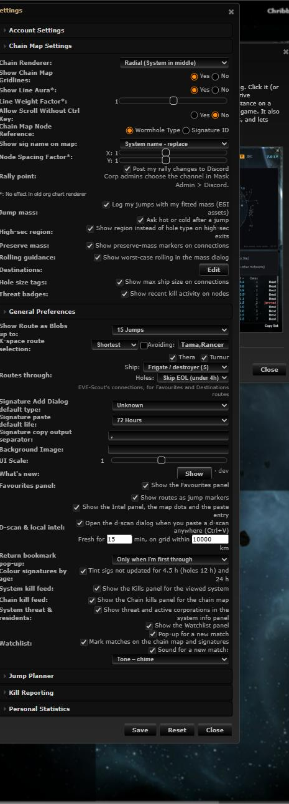
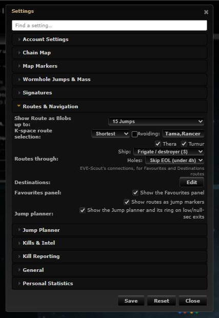
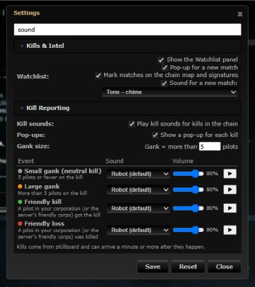

# Settings grouped into sections

**Date:** 2026-10-11

## Description

Chain Map Settings and General Preferences had grown into two long mixed lists of ~25 fork rows, each
feature copying the same row/open/Save/Reset boilerplate. Settings are now grouped by what you are doing,
with a "Find a setting…" filter, and every fork setting is added through one shared helper.

## Before / After

| Before | After | Filter |
| --- | --- | --- |
|  |  |  |

## Settings

No toggle: this reorganises Settings itself.

## Change

- New `app/js/fork/settings-sections.js` (`forkSettings`): `section()` adds a section in a fixed order,
  `register()` adds a row and handles fill on open, Save (one capture-phase listener, before upstream's Save
  applies and persists) and Settings > Reset (one wrapper around `options.reset`). Tests in
  `app/js-test/fork/settings-sections.test.js`, styles in `app/css/fork/settings-sections.css`.
- Sections: Account Settings, Chain Map (was "Chain Map Settings", renamed from JS), Map Markers, Wormhole
  Jumps & Mass, Signatures, Routes & Navigation, Jump Planner, Kills & Intel, Kill Reporting, General (was
  "General Preferences"), Personal Statistics. Upstream's signature and route rows are moved into Signatures
  and Routes & Navigation as DOM nodes (upstream still reads them by id).
- Every fork setting migrated, including those merged from main meanwhile (Fight here, Smart notes, the Jump
  planner's System search and its on/off row, now in Routes & Navigation); option keys, defaults and Save behaviour
  unchanged. Hole size tags now
  also go back to on with Settings > Reset (before, Reset left them as they were).
- "Find a setting…" box: shows only matching rows, with their sections opened.
- AGENTS.md section 2 and the tripwire-feature skill now say where a setting goes and how to add one.
- No upstream file touched.
