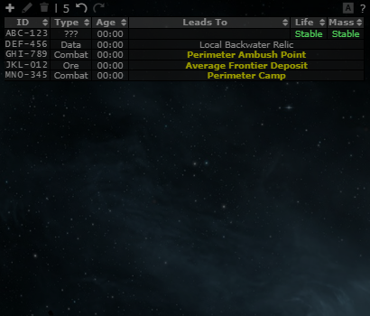
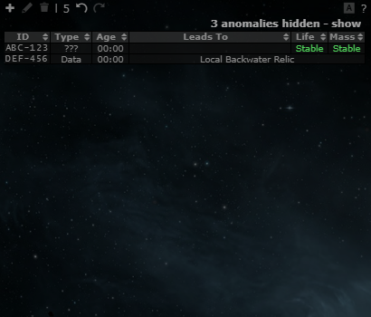

# Hide cosmic anomalies; game data refresh (Drifter holes, life wording)

**Date:** 2026-10-11

## Description

Two small signature-list changes. (1) A Settings row lets you show, hide or not import cosmic anomalies that come in with a
scanner paste (Tripwire Bitbucket #488). (2) Game data after the Catalyst update (patch 23.02, 2026-03-18; 24.01):
Drifter holes are now offered when the signature dialog knows the target Drifter system, and the Stable / EOL buttons say
which in-game wording they mean.

## Before / After

Paste of 2 signatures and 3 anomalies in a wormhole system, Settings > Signatures > "Anomalies in the signature list":

| Before (Show) | After (Hide) |
| --- | --- |
|  |  |

## Settings

Toggle: **Settings > Signatures > Anomalies in the signature list** (`options.sigAnomalies.mode`): Show (default, as before),
Hide, Don't import. Missing key = Show; Settings > Reset deletes it. The Drifter data and the wording tooltips are data
corrections / pure improvements and have no toggle.

## Change

**Anomalies.** `paste.js` already recognised the "Cosmic Anomaly" group in every language but threw it away. Pasted anomalies
are now marked with `signatures.bookmark = "anomaly"` (an upstream column nothing uses; the server keeps it when a sig is
edited, so no schema change). Hide folds them away with an "N anomalies hidden - show" line above the list (rows stay in the
data). Don't import: paste does not add anomaly rows (rows already in the list are only marked), and "Click to delete missing sigs" never deletes a
marked anomaly. In Show and Hide mode anomalies in the paste count as present, so they are not deleted as missing; a sig
that was imported before this change gets the marker the next time it appears in a paste. New files:
`app/js/fork/sig-anomalies.js`, `app/css/fork/sig-anomalies.css`, tests `sig-anomalies.test.js`.

**Drifter holes.** S877, B735, V928, C414, R259 led to the J-code strings of the Drifter systems, which match no system, so the
dialog never offered them for a hole into Sentinel, Barbican, Vidette, Conflux or Redoubt. They now lead to Class-14 .. 18
(the classes `appData.systems` gives those systems; the watchlist already maps Class-14..18 to Drifter). Done in
`tools/wormholes.json` and regenerated into `public/js/combine.js` with `node tools/fork/splice-combine.js`. Test:
`drifter-holes.test.js`.

**Life wording.** The game now says "Reliable Lifetime" and has an "Expired" state (the guaranteed lifespan has ended, the hole
can close at any moment; 23.02, 2026-03-18). Tripwire keeps its stored Stable / EOL values; `app/js/fork/life-wording.js` adds
tooltips to the two buttons in the wormhole dialog. The "1 hour remaining" wording could not be confirmed in the patch notes,
so it is not used.

**Not done.** Warpath: Intelligence Cache / Strategic Infiltration (2026-04-30) and Rampant Drone Fabricator: the only site
name list (`linkSig` in `app/js/global-hooks.js`) exists to link eve-survival wiki pages, which do not exist for these
sites, so nothing was added.

Upstream files touched: `app/js/tripwire/paste.js` (5 small lines), `tools/wormholes.json`, `public/js/combine.js`
(`appData.wormholes` only, five leadsTo values).
