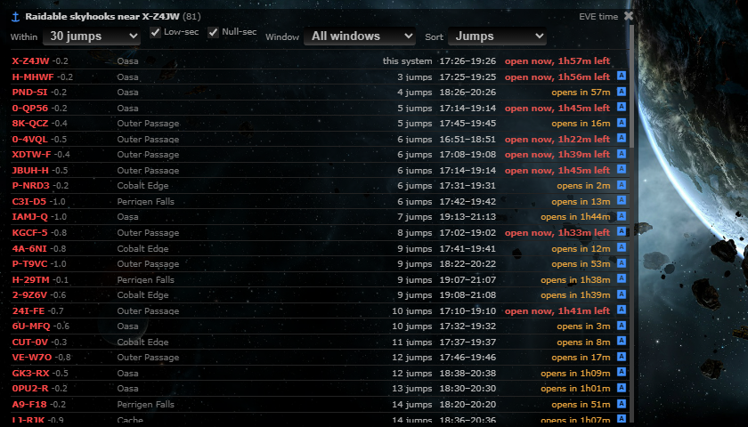
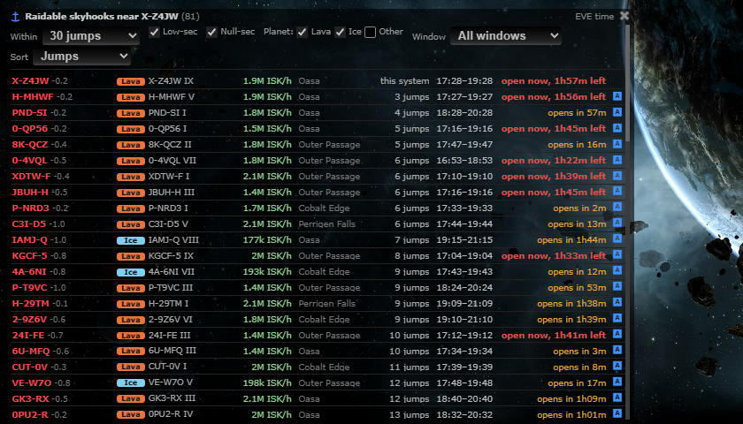

# Skyhooks: lava / ice and what a raid is worth

**Date:** 2026-10-11

## Description

Each row of the Raidable skyhooks box now says whether the planet is lava or ice (a coloured badge with the word in it),
shows the planet's name, and an estimated value in ISK per hour of what the planet produces. New "Planet" checkboxes
(Lava, Ice, Other) filter the list and "Value" is a new sort. Stacked on PR #67 (`feature/rolling-followups`).

## Before / After

| Before | After |
| --- | --- |
|  |  |

(Same stubbed list of 81 live skyhooks, 30 jumps from X-Z4JW, sorted by jumps. After: Lava / Ice badge, planet name and
ISK/h on every row, and the Planet checkboxes and Value sort in the box header.)

## Settings

No new Settings row: the box's existing Settings > Routes & Navigation toggle ("Skyhook icon") still switches the whole
feature. The new options live in the box header like the others and are saved in `options.skyhooksPanel` (`lava`, `ice`
default on, `other` default off; `sort: "value"`); Reset deletes them with the rest.

## Change

- **Static planet data, no ESI calls**: the SDE (CCP's static data export) has `planetResources.jsonl`, which lists every
  planet that can produce reagents and how many units per hour. Together with `mapPlanets.jsonl` (planet type and number)
  this gives lava/ice, the name and the yield for every planet, so no `/universe/planets/{id}` fetch or server cache is
  needed (planet data never changes; ESI and the SDE agree, spot-checked on 4 planets). `tools/fork/build-skyhook-planets.mjs`
  generates `public/skyhooks-data/planets.json` (3,462 planets, 72 KB): `{planetID: [1 lava | 2 ice, units per hour,
  planet number]}` plus the two reagents with a rough ISK price. The panel loads it once when the box opens.
  Planet name = system name + roman planet number (so "K4YZ-Y IV", as ESI gives).
- **Panel** (`app/js/fork/skyhooks-panel.js`, `.css`): planet badge (Lava orange / Ice blue, text as well as colour),
  planet name, `X ISK/h` (hover: reagent, units per hour, price). Planet filter checkboxes, sort "Value" (highest first).
  A planet missing from the file shows as "Other" (hidden by default: it produces no reagents, so there is nothing to
  steal). While the file isn't loaded rows show no planet details and the planet filter is skipped.
- **Value = units per hour x price**, the planet's whole production; only half of it goes to the raidable surplus bay.
  The price is a fixed rough number baked into the file (CCP's `average_price` from `GET /markets/prices` on 2026-10-11:
  Magmatic Gas 2,032 ISK, Superionic Ice 5,208 ISK). Regenerate the file to refresh.
- **Tests**: `app/js-test/fork/skyhooks-panel.test.js` (planet info, roman numerals, filters, defaults, value sort, data
  not loaded, ISK format), `app/js-test/fork/skyhooks-planets-data.test.js` (the generated file's shape and a known planet).
  No PHP change, so no PHP test.
- **Upstream files touched**: none.

## Notes (research, 2026-10-11)

- Raids steal reagents only: lava planets give Magmatic Gas, ice planets Superionic Ice. Magmatic Gas fuels the Metenox
  moon drill, Pharolux cyno beacon and Tenebrex cyno jammer; Superionic Ice fuels the Ansiblex jump bridge and supercapital
  construction upgrades. https://wiki.eveuniversity.org/Skyhook
- Production splits evenly between a Secure bay (never raidable) and a Surplus bay; a successful theft takes the entire
  surplus bay contents (100% drop). Raid windows are visible to everyone (about 2 hours every 3-4 days, owner's preferred
  time plus a random offset); if a window passes unraided the surplus rolls over, so a hook holds roughly 6-8 days of
  surplus at its next window. https://www.eveonline.com/news/view/equinox-update-enhanced-skyhooks and the wiki page above.
  So the haul does not depend on "time since last harvest" except through that accumulation, and ESI's
  `GET /skyhooks/raidable` returns only planet, system and window: no amount or fill level.
- Yield differs a lot per planet and per type. The SDE `planetResources` (schema:
  https://sde.riftforeve.online/schema/planetResources/ ; download
  https://developers.eveonline.com/static-data/eve-online-static-data-latest-jsonl.zip) has per planet either power or
  workforce, or `reagent {type_id, amount_per_cycle, cycle_period 3600 s, secured_capacity, unsecured_capacity}`. 3,462
  planets have reagents: 2,337 lava (type 81143 Magmatic Gas, 625-1,110 units/hour, median 857) and 1,125 ice (type 81144
  Superionic Ice, 31-43 units/hour, median 37). So a lava hook yields about 25 times the units of an ice hook; at the average
  prices that is roughly 1.4-2.2M ISK/h for lava against 160-225k ISK/h for ice. Other planet types (temperate, barren,
  etc.) produce only power / workforce.
- Checked against the live raidable list (202 skyhooks on 2026-10-11): all 202 are on planets in the reagent list (131 lava,
  71 ice), none "other".
- Open: the price is a rough CCP average (Superionic Ice's market is thin), and whether the SDE's `amount_per_cycle` is the
  full-rate yield or before the maturation ramp CCP describes in the Enhanced Skyhooks post is not documented; treat the ISK
  figure as a ranking aid, not a promise.

No new third-party hosts (the static file is served by us), analytics or tracking.
