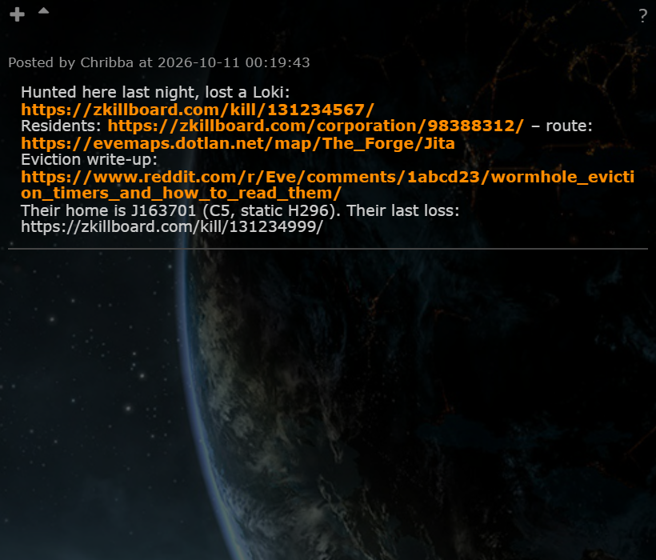
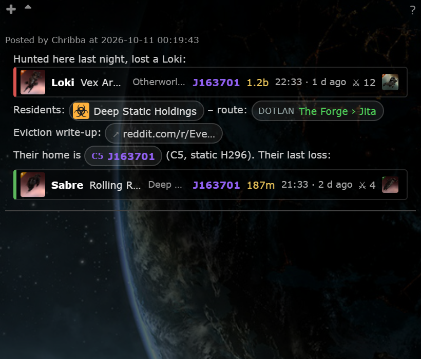

# Smart notes (zKillboard and EVE link cards)

**Date:** 2026-10-11

## Description

Links in system notes now render as compact cards and chips: a zKillboard kill link becomes a one-line kill card
(victim ship, pilot and corporation, system with class colour, ISK value, EVE time and age, attackers, final blow ship;
red edge for our loss, green for our kill), zKillboard character / corporation / alliance / system links, Dotlan and
EveWho links become chips, other long links are shortened, bare https URLs in plain text become links (or cards), and
system names written in the text (`J163701`, `Jita`) become system chips. The stored note is never changed: editing
shows the raw link again, old notes get the upgrade for free.

## Before / After

| Before | After |
| --- | --- |
|  |  |

The "after" shot uses two kills seeded into the dev database (`zkill_killmails`, `zkill_names`); nothing was fetched
from zKillboard.

## Settings

Toggle: Settings > General Preferences > Smart notes (on by default): "Kill cards and link chips in notes"
(`options.smartNotes.enabled`; off = notes exactly as before and no `zkill_kill.php` requests) and "System names in
notes as chips" (`options.smartNotes.systemNames`). Applied on Save, back on after Reset.

## Change

- `app/js/fork/smart-notes.js`, `app/css/fork/smart-notes.css`: render-time DOM enhancement of `.commentBody`. Hooked
  with a MutationObserver on the notes list, no upstream file edited. CKEditor's `instanceCreated` event (fires before
  the editor reads the element) puts the original nodes back, so the editor and the saved note only ever see the stored
  HTML. Everything is built with `createElement` / `textContent` / `setAttribute`; only `https://` links to an exact
  host allow-list (`zkillboard.com`, `evemaps.dotlan.net`, `evewho.com`, with or without `www.` where it exists) are
  recognised; image URLs only from numeric IDs. Long links elsewhere: domain + first path segment, full URL in the
  tooltip. System names: single-word names from the static data (J-codes in any case, other names exactly), whole words
  only, not inside links, code or URLs, minus a few everyday words (`Exit`, `Jan`, `Half` ...); a click views the
  system in Tripwire. A zKillboard system chip views the system in Tripwire when it is on the chain map, else opens
  zKillboard.
- `public/zkill_kill.php` (new): `?ids=` (max 20) and `?names=` (max 20), session + mask required, GET only. Reads
  `zkill_killmails` / `zkill_names`; kills that are not stored are queued in the new `zkill_kill_lookup` table
  (`zkill/lookup.php`, caps 200 per user / 2000 overall) and answered `queued`. The browser asks again after 3 s, 10 s
  and 30 s, then shows the plain link. With `ZKILL_FEED_ENABLED=false` nothing is queued.
- Worker (`zkill_feed.worker.php`): `zk_lookup_run_one()` runs first in each idle pass (before back-fills), within the
  same `ZKILL_API_INTERVAL` budget: zKillboard `/api/killID/<id>/` for the hash, ESI `/killmails/<id>/<hash>/`, stored
  with source `lookup`. Retried after 10 minutes, at most 3 attempts. `zk_prune()` keeps looked-up kills 7 days after
  they arrived (they are usually older than the retention) and prunes finished lookups after 7 days.
- Tests: `app/js-test/fork/smart-notes.test.js` (URL recognition incl. look-alike hosts, DOM replacement, escaping,
  system-name matching, loading / loaded / fallback states; small DOM in `app/js-test/helpers/mini-dom.js`),
  `zkill/tests/lookup_test.php` (queue and worker step on SQLite against stubbed HTTP), `zkill/tests/zkill_kill_endpoint_test.php`.
- Docs: `docker/README.md` (zKillboard integration, Smart notes), DDL in `zkill/schema.php` and `docker/sql/zkill.sql`.
- Upstream files touched: none. Third-party hosts: no new calls; the browser loads images from `images.evetech.net`
  (already used) and only links to zKillboard, Dotlan and EveWho.
