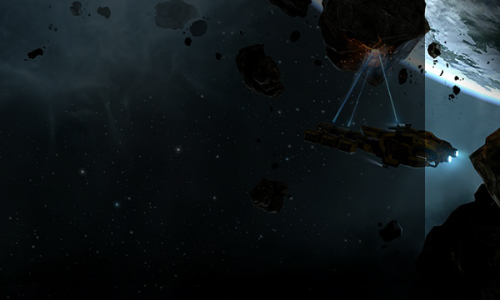
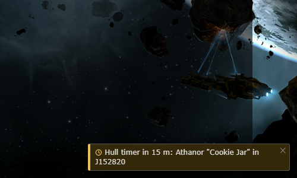
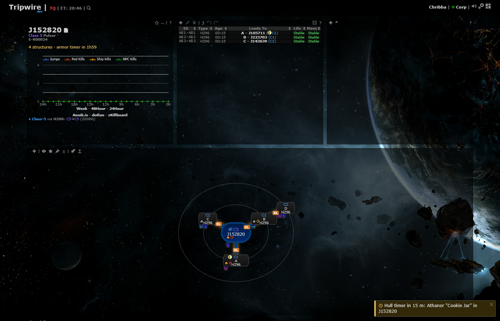
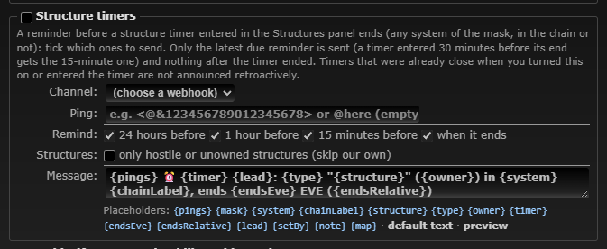
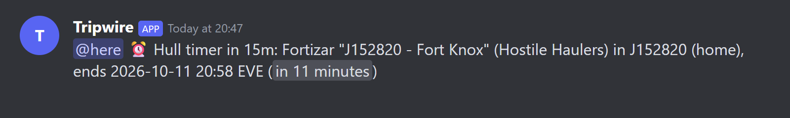

# Structure timer reminders

**Date:** 2026-10-11

## Description

Phase 3 of `reports/Structures and timers spec.md`: Discord reminders before a structure timer ends (new notification type 9,
"Structure timers", configured in Mask Admin > Discord) and an in-app pop-up with a sound when a timer is 15 minutes away and
when it ends (Settings > Kills & Intel > Timer alerts). Builds on the Timers view and the `markers` data of the previous change
(`2026-10-11-structures-timers`).

## Before / After

Before: nothing tells you a timer is close unless you look at the panel. After: the pop-up (bottom right; click it to open the
Timers view), the Mask Admin row and the Discord message.

| Before | After |
| --- | --- |
|  |  |

The whole page after (the pop-up is bottom right):

Mask Admin > Discord > Structure timers (reminders to tick, "only hostile" box, message text, placeholders):

The message the Discord mock received from the real worker (`tests/structure_timers_discord_flow_test.php`); the picture is
drawn from the mock's JSON by a script, so it is what the worker sent, shown the way Discord renders it (@here is a real ping,
`<t:...:R>` becomes a live countdown):

## Settings

- **Discord (mask-wide):** Mask Admin > Discord > "Structure timers". Off by default, like every type: pick a channel, tick the
  leads (24 h, 1 h, 15 m, at the end: all on by default), optionally "only hostile or unowned structures". Settings shape
  `types.structureTimer = {enabled, webhookID, template, ping, enabledAt, leads: [1440, 60, 15, 0], hostileOnly}`.
- **In-app (per user):** Settings > Kills & Intel > "Timer alerts" (on by default), `options.structures.alerts` (missing = on);
  Settings > Reset removes it. Off: no pop-up, no sound. The Mute button silences the sound, the pop-up stays.

## Change

- **Type 9 `structureTimer`** (`discord/structure_timers.php`, wired into `discord/discord.inc.php`, `settings.php`, `template.php`,
  `public/discord.php` preview sample, `discord_notify.worker.php` one poll call next to the watchlist's, same leader and 15 s
  cadence). Rules: one message per (structure, timer end, lead) via `discord_sent` kind `stimer`; a changed `timerAt` fires afresh;
  of several due leads only the most recent fires, only until 5 minutes after the end (a timer entered 30 minutes before its end
  sends the 15 m reminder); leads that fell due before the type was turned on or before the timer was set are skipped; gone
  structures never; all systems of the mask whether in the chain or not (`{chainLabel}` says "(AB)", "(home)", "(in chain)" or
  "(not in chain)"); `hostileOnly` skips structures of the mask's own corporations / alliances (the list in Mask Admin > Discord);
  priority 14 (after preserve mass and rolling, before kills). Game text is escaped like every type, pings come only from the
  template / ping field.
- **In-app alerts** (`app/js/fork/structure-timers.js`): the markers poll (now also run without a chain, every 60 s) returns the
  mask's next 20 timers; every 10 s the browser checks them: at 15 minutes and at the end it shows a pop-up ("Hull timer in 15 m:
  Fortizar "Fort Knox" in J163701"; the kill pop-up container and style, amber / red) and plays a tone through the kill-reporting
  sound helper (`killReporting.play`, `tone-chime` / `tone-klaxon`, no new audio files; honours the Mute button). One alert per
  timer + lead per browser (memory + `localStorage`, in try/catch). Clicking the pop-up opens the Timers view.
- `docker/README.md`: Discord types table and test commands. Tests: `discord/tests/structure_timers_test.php` (49 checks: settings,
  lead rules incl. missed leads / enabledAt / timerSetAt / grace, message and escaping, the poll against MySQL with its own mask:
  dedupe, changed timer, hostile only, gone, other masks, no table), `tests/structure_timers_discord_flow_test.php` (worker +
  Discord mock end to end), mocha for the settings page rows and the alert logic. `discord/tests/rolling_test.php` and
  `app/js-test/fork/discord-notifications.test.js` had "rolling is the last type" assertions: updated.
- Upstream files touched: none. No new third-party hosts.
- Deploy note: no new env vars or tables (reads `fork_structures`); the worker restarts with the image.
