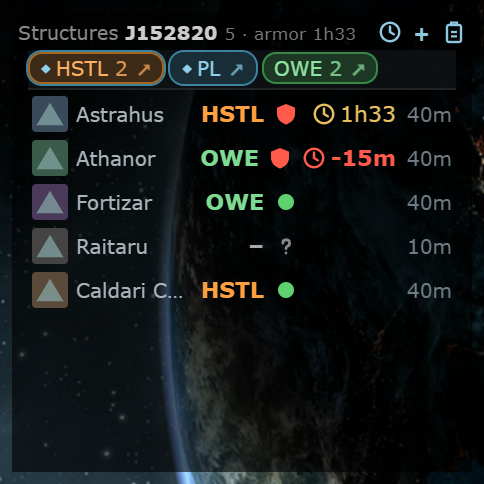
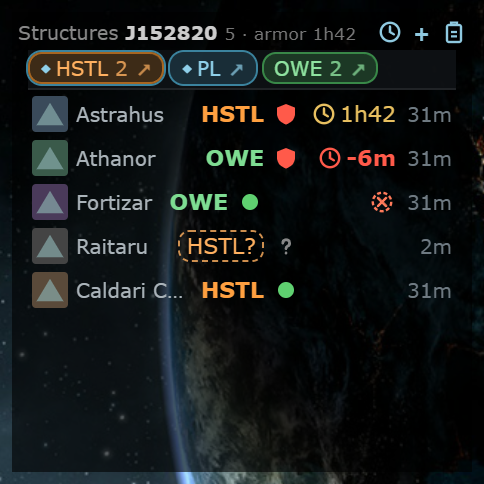
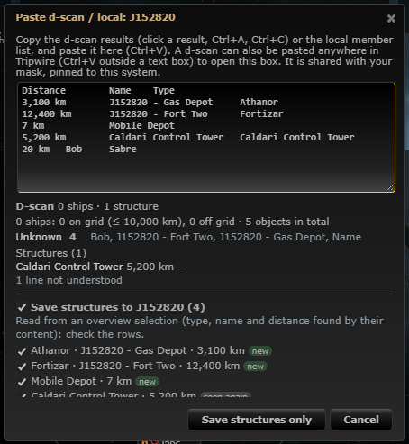

# Smarter structure input: owner lookups, hints from kills, overview paste

**Date:** 2026-10-11

## Description

Phase 4 of `reports/Structures and timers spec.md`. Owner names the cache does not know are resolved by the zKillboard
worker through ESI instead of staying "unresolved"; the Structures panel shows hints from the kills the feed already stored
("possible owner: HSTL?" and "destroyed?"), which are never applied unless someone clicks them; and a copied overview
selection can be saved like a d-scan.

## Before / After

| Before | After |
| --- | --- |
|  |  |

After: the Raitaru has no owner, but Hostile Haulers lost Raitarus here (dashed chip "HSTL?", click sets the owner); the
Fortizar of ours has the dashed "destroyed?" icon because a Fortizar of our corporation was killed here after it was
first seen (click marks it destroyed, undo for 30 days; the kill link is under the row's "..." menu).

The d-scan dialog with an overview selection pasted (columns Distance, Name, Type; type, name and distance are found by
their content; the preview, merge tags and "Save structures only" are the same as for a d-scan, Share is hidden because an
overview is not a d-scan):

## Settings

No new setting: the hints and the overview paste are part of the Structures panel (Settings > Kills & Intel > Structures
panel, off removes them with the panel); the owner lookups are server-side and mask-neutral (no UI).

## Change

- **Owner resolution** (`structures/owners.inc.php`, new): an owner text that `fork_pilot_entities` does not know is queued in
  `fork_structure_owner_lookups(name PK, status, entityID, entityType, entityName, requestedAt, resolvedAt, attempts)` by
  `structures.php` (add / update; texts under 3 characters and a full queue of 500 are not queued). Only the worker resolves:
  `zkill_feed.worker.php` calls `structures_owner_run()` right after `intel_affiliation_run()` in the same tick: one ESI
  `POST /universe/ids` for up to 100 names through `zkill/http.php` (one User-Agent, ESI error limits, the shared request
  budget `intel_esi_take`), the matched corporations / alliances go to `intel_queue_entities` (name and ticker, filled by
  the worker's own `intel_entities_step`), and the answer is written into every unresolved row of every mask (case-insensitive
  match; a corporation wins over an alliance of the same name). The ticker is added once the entity cache has it. A name ESI
  does not know is remembered for 7 days (a retype does not ask again); a 4xx counts attempts and fails after 3; 5xx, 420 and
  429 keep everything queued. ESI knows names, not tickers: a typed ticker the cache does not know stays as typed. No web
  request calls ESI or zKillboard.
- **Hints from kills** (`structures_suggestions()` in `structures/structures.inc.php`, returned as `suggestions` by
  `structures.php?action=list`, part of the poll hash): from `zkill_killmails` of the last 30 days in the system (only the
  database is read). "Destroyed?" for a structure when a kill of its type happened here after it was first seen (and, when
  the owner is known, of that owner). "Possible owner" for an ownerless structure: the corporations that lost that type here,
  most losses first (2), only those whose name the entity cache knows (the others are queued for the worker and appear on a
  later poll). Both are clickable chips / icons in the row (`app/js/fork/structures.js`), never applied by themselves; the
  owner chip sends the same request as picking the owner in the edit form.
- **Overview paste** (spec 3.3): `structures_parse_overview()` (PHP) and `structures.parseOverview()` (JS, shared fixtures in
  `structures/tests/fixtures.json` `overview`): per tab-separated row the first cell that is exactly a structure type name
  is the type, the first cell that reads as a distance (`intel_parse_distance_km`) the distance, the name is the longest
  other cell, preferring those with " - "; a name equal to the type is no name; POS modules are folded; the "named for
  another J-system" warning works. The dialog uses the overview reading when it gives more structures than the d-scan reading;
  `structures.php?action=scan&format=overview` repeats it on the server (the browser parse is only the preview).
- Files: new `structures/owners.inc.php`, `structures/tests/owners_test.php`; changed `structures/structures.inc.php`,
  `public/structures.php`, `app/js/fork/structures.js`, `app/css/fork/structures.css`, `zkill_feed.worker.php` (two lines: require
  and one more step in the names tick), tests (`app/js-test/fork/structures.test.js`, `structures/tests/`). Upstream files touched: none.
- Tests: mocha (overview parity, hint rendering), `structures/tests/owners_test.php` (23 checks: queue rules, the worker pass with
  ESI replaced by a fake transport, ticker fill, 5xx / 4xx handling, hints against stored kills), structures tests (overview
  parity, endpoint: overview scan, owner queue, suggestions in the list).
- Not done: dismissing a hint (a wrong one stays until the data changes), overview rows of probe scanner pastes or show-info (out of scope).
