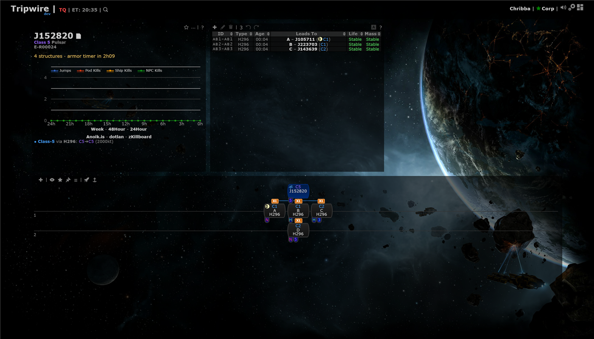
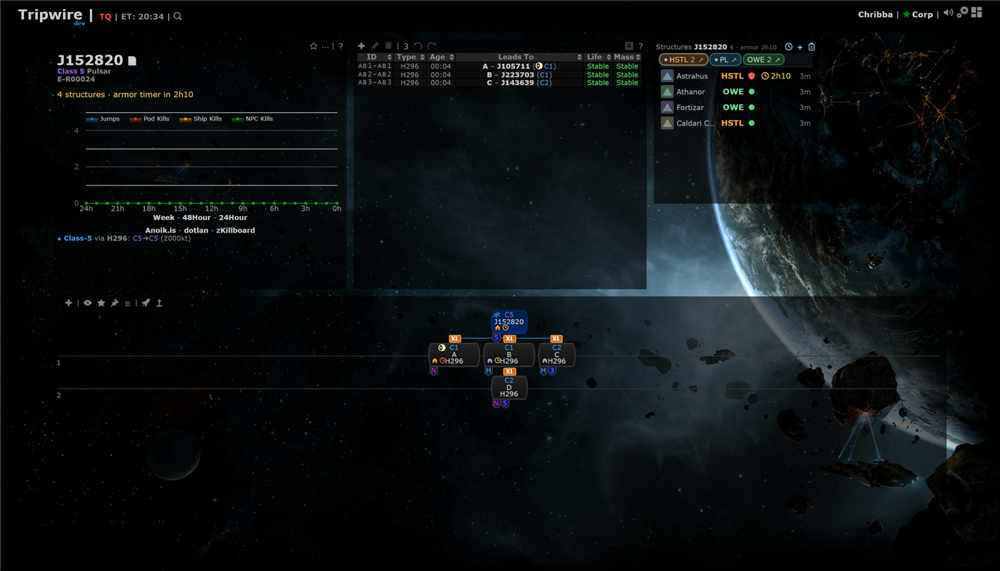
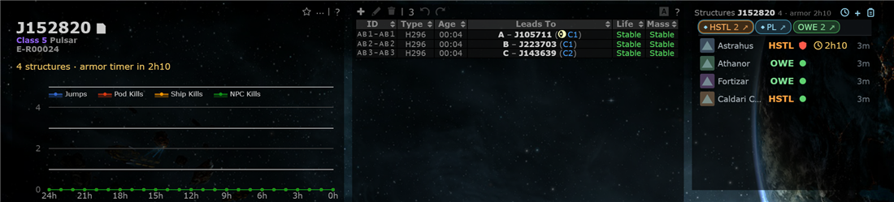
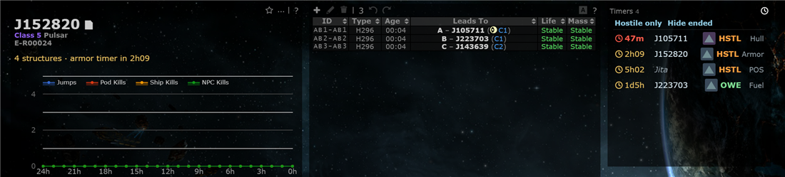
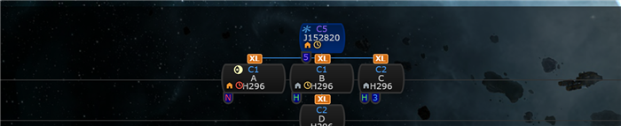
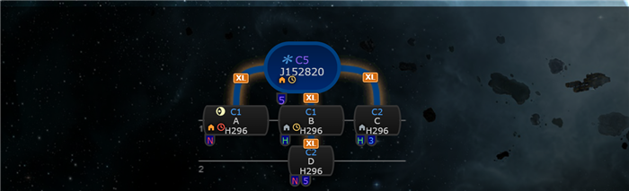
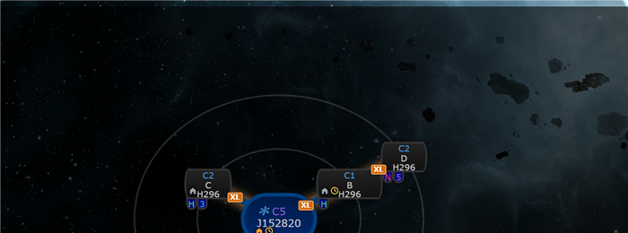
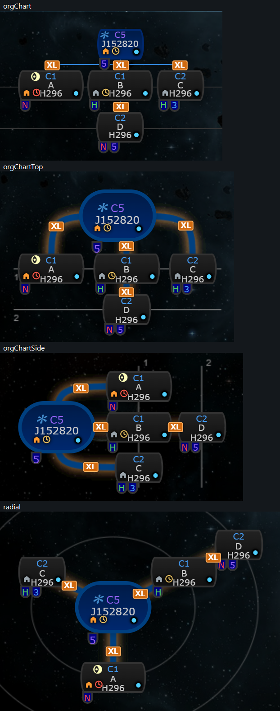

# Structure timers, map markers and set residents

**Date:** 2026-10-11

## Description

Phase 2 of `reports/Structures and timers spec.md`: the Structures panel gets a Timers view (every active timer of the
mask), structures and timers show as small glyphs on chain map nodes, the system info panel gets a one-line summary and
the chain context menu gets two entries. Plus a residents follow-up: the residents set by hand (Intel panel > Set
residents, PR #69) now also show first in the Structures residents strip.

## Before / After

"Before" has no panel and no node glyphs (what the map looked like with both settings off). The info line, the glyphs and
the residents strip are in "After".

| Before | After |
| --- | --- |
|  |  |

Panel, system view (residents strip: the blue diamond chips are set by hand, HSTL is both set and an owner) and Timers view:

Node glyphs in the org chart, org chart top and radial renderers (the org chart side renderer uses the same node markup):

## Settings

- Settings > Map Markers > "Structure & timer icons" (on by default): the glyphs on nodes. Stored as
  `options.structures.mapMarker` (missing = on); Settings > Reset removes it.
- Everything else follows the existing Settings > Kills & Intel > "Structures panel" toggle (`options.structures.enabled`):
  off removes the Timers view, the info line, the context menu entries and the markers poll. Both settings now live
  side by side in `options.structures`; Save of one keeps the other and the remembered panel position.

## Change

- **Timers board = a second view of the Structures panel** (clock icon in its header, click again to go back), not a
  window: no new widget or dialog, so it is the smaller UI, it inherits the panel's size/position/toggle and works on
  any layout. One ~22 px row per timer: countdown (amber, red under 1 h, ticking every second), system (italic grey when
  not in the chain), type icon, owner ticker, kind. Tooltip: EVE and local time, structure, owner, who set it, note.
  Click a row to view that system. Filters "Hostile only" (hides our own; unknown owners stay) and "Hide ended"
  (hides timers that already ran out, they stay listed 2 hours); remembered in the browser.
- **Map markers** (bottom-left corner of the node, inside it; threat badge top-left, pilots / jump-planner ring /
  skyhook icon top-right, intel dot bottom-right, size tags on the connections, watchlist eye in the icon row): a
  structure glyph (orange when any owner is hostile, else grey) for systems with Upwell/POS structures and a clock glyph
  when a timer ends within 48 hours or ended under 2 hours ago (amber, red under 1 h or elapsed). Tooltip: "2 Fortizar,
  1 Athanor, TICK, seen 3d ago" and "Hull timer in 52m (18:30 EVE)". Checked in all four renderers; adding or removing a
  marker redraws the chain like the intel dot does.
- **System info line** under the system name: "3 structures · armor timer in 4h12"; click to flash the panel.
- **Context menu**: "Structures..." (view that system, panel in system view) and "Structure timers..." (Timers view).
- **Residents follow-up**: residents set by hand (shared with the mask, `system_residents.php`) come first in the strip,
  blue chips with a diamond ("set as a resident by X" in the tooltip, alliances included). One that also owns structures
  here is merged into that owner's chip (keeps ours/hostile colour, count and click-to-highlight); kill-seen corporations
  that are already set or owners are not repeated.
- Server: `structures.php?action=markers&systemIDs=...&have=` (per-system summary + the mask's next 20 timers, which phase 3
  uses for alerts) and `?action=timers` (active timers, at most 200). GET only, mask-scoped, `have=<hash>` short polling,
  400 over 500 systems. No ESI or zKillboard calls.
- Files: new `app/js/fork/structure-timers.js`, `app/css/fork/structure-timers.css`,
  `app/js-test/fork/structure-timers.test.js`; changed (all fork-owned) `app/js/fork/structures.js`,
  `app/css/fork/structures.css`, `public/structures.php`, `structures/structures.inc.php`, tests in
  `app/js-test/fork/structures.test.js`, `structures/tests/`. Upstream files touched: none.
- Notes: ended means timerAt + 2 h (spec 2.2). The dev stack ran on port 8251 because 8250 was taken by another stack.
- Review round 1: the markers poll runs only while the node icons are on; set residents are fetched on system change and every 5 minutes (not every poll); the board sends `have=` and says "Showing the first N timers" when the server capped it (200); node markers are swapped in place (a redraw only when one is added or removed); the 1 s tick skips hidden tabs and writes only changed text; the info line is anchored after `#infoFaction`; test time tolerances widened (the "flaky" checks compared a time within 2 s and failed under load). All four renderers with structure glyph, clock and intel dot together: 
