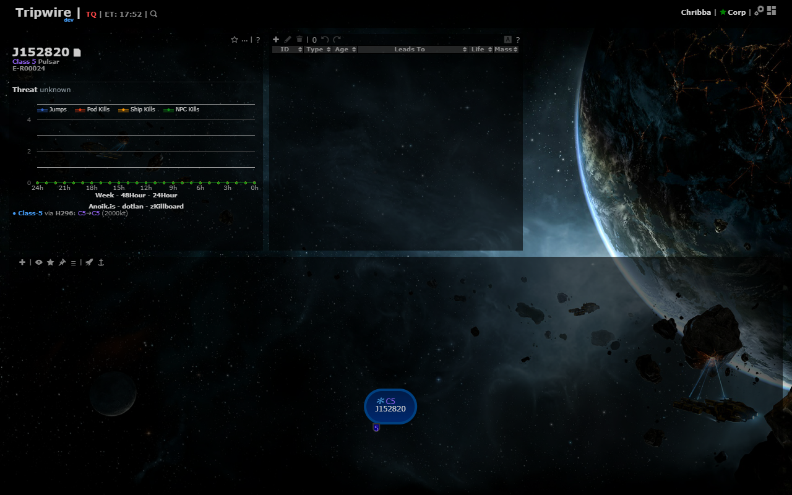
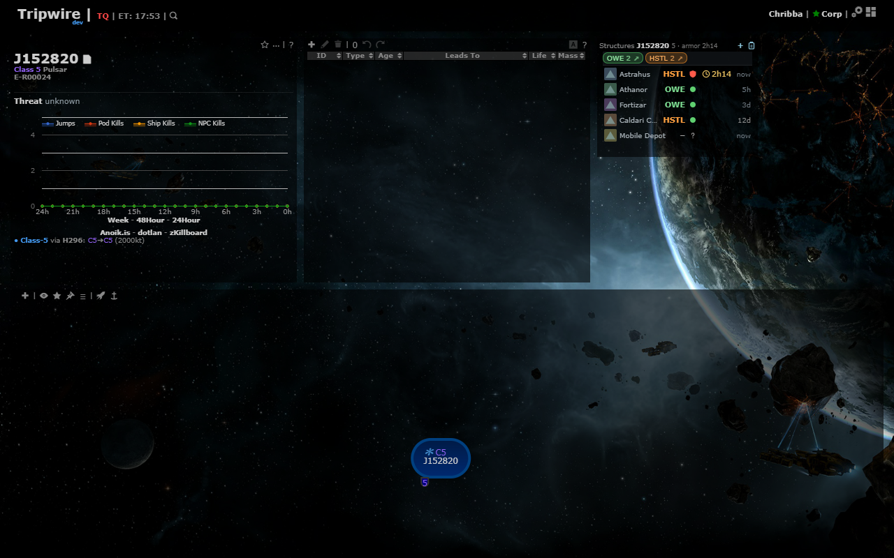
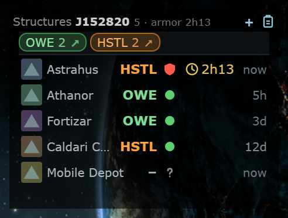
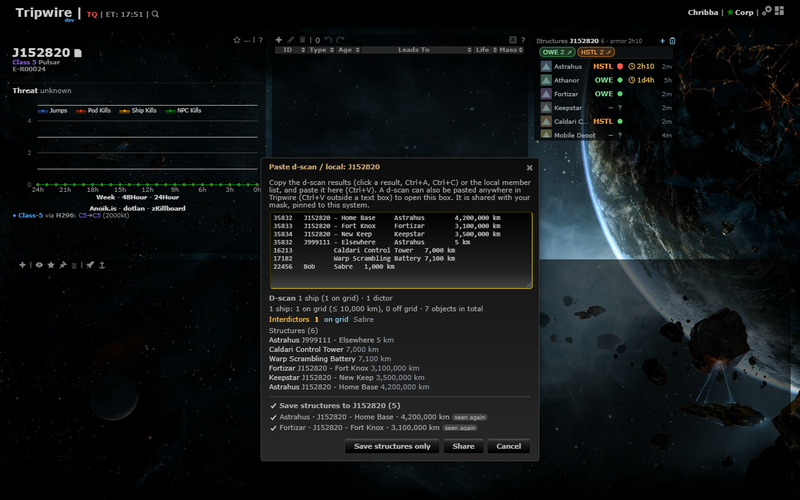
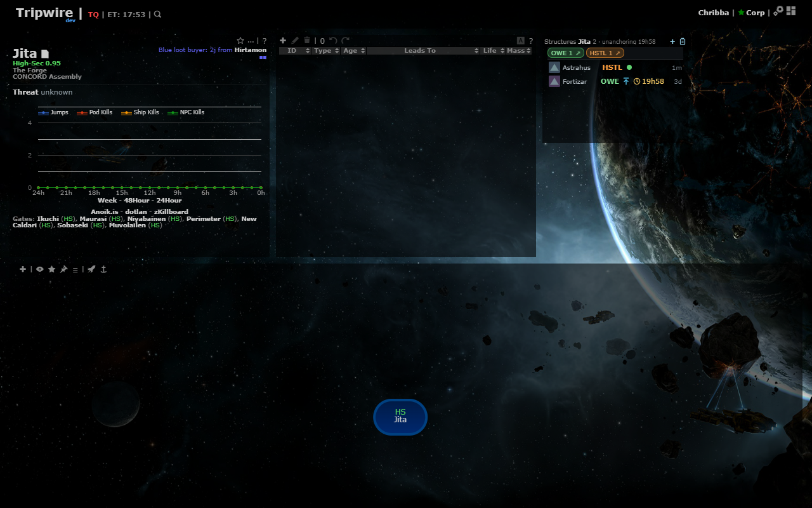

# Structures

**Date:** 2026-10-11

## Description

A small Structures panel lists the structures of the viewed system (Upwell, POS towers, deployables) with owner,
state and one timer each, plus a residents strip showing who owns them. Structures are saved from the d-scan dialog or
added by hand, so a mask remembers what is in a system and when a timer ends. Phase 1 of `reports/Structures and
timers spec.md` (section 0 decisions: own compact panel, residents strip).

## Before / After

| Before | After |
| --- | --- |
|  |  |

Close-up of the panel (type icon, owner ticker, state icon, timer, "seen" age; residents strip on top). The type icons
are stand-in pictures in these screenshots because the dev browser had no access to images.evetech.net:

The d-scan dialog with the new "Save structures to ..." section, and a k-space system:

## Settings

Toggle: Settings > Kills & Intel > Structures panel (on by default). Off removes the panel and the d-scan save option
and stops polling; the panel's position is remembered while it is off. Stored as `options.structures.enabled`
(missing = on); Settings > Reset deletes the key.

## Change

- New: `structures/structures.inc.php` (schema, classify / parse / merge, owner cache lookup, timers, prune),
  `public/structures.php` (`list`, `scan`, `add`, `update`, `gone`), `docker/sql/structures.sql`,
  `app/js/fork/structures.js`, `app/css/fork/structures.css`, tests (`app/js-test/fork/structures.test.js`,
  `structures/tests/`), a Docker README section.
- One line per structure (about 22 px): type icon, owner ticker, state icon, timer countdown, "seen" age; name, full
  owner, note and who/when in the tooltip; hover actions: edit, seen now, destroyed, more (remove). Gone rows sit under
  "Gone (n)" with Undo for 30 days. The panel with 5 structures is 170 px tall (3 grid rows).
- Residents strip: one chip per owner (ours green, hostile orange, unresolved grey, with a structure count and a
  zKillboard link); clicking a chip highlights that owner's structures. Corporations System Threat saw in kills here
  appear as outlined chips.
- D-scan dialog: structures in the pasted scan are listed with checkboxes (new / seen again / restored), a master
  "Save structures to <system>" checkbox, a warning for Upwell named for another J-system, and a "Save structures only"
  button (no 24 h scan). Share saves the checked structures too. POS modules are not stored.
- Owners: a ticker or name typed in the edit form is looked up in the cache of the pilot lookups
  (`fork_pilot_entities`); several matches ask which one; none is stored as typed and shown in italics. No ESI or
  zKillboard calls.
- Timers: EVE time (`2026.10.12 18:30`), ISO, or a countdown (`1d 4h 20m`, `4:20:00`, `2h14`); from 2 hours past to
  30 days ahead; a timer stays "elapsed" for 2 hours, then "ended", and an edit clears it.
- Data is per mask and system (it stays when a system leaves the chain). Anyone on the mask may add, edit, mark gone
  and restore; every write records who and when; 20 writes per user per minute; 200 live rows per mask and system.
- Not in this phase (spec phases 2-4): timers board, map markers, system info line, context menu, Discord reminders,
  in-app alerts, ESI owner resolution, overview paste.
- Upstream files touched: none (`app/js/fork/intel-scans.js` is fork-owned and unchanged; the dialog is extended by
  wrapping `intelScans.renderPreview` / `share` / `openDialog` from `structures.js`).
