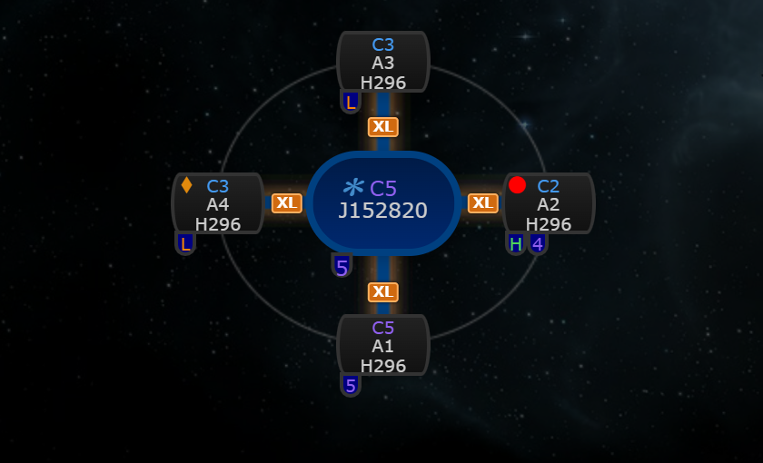
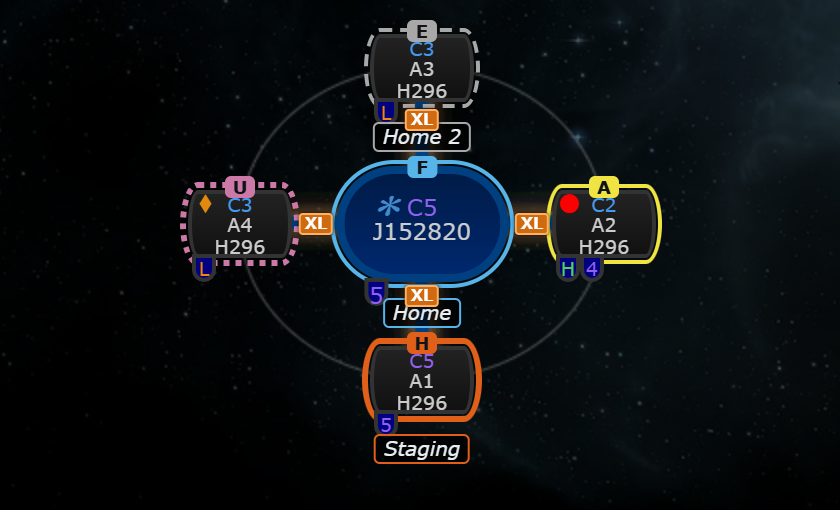
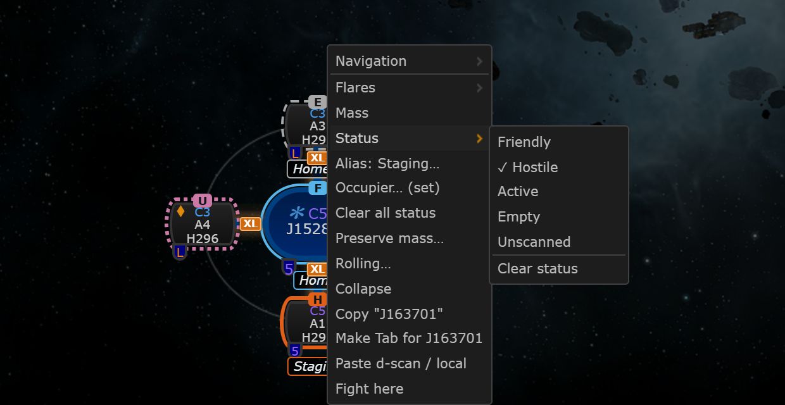
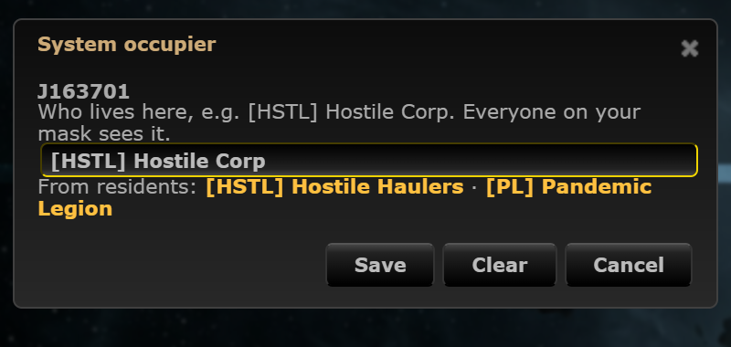
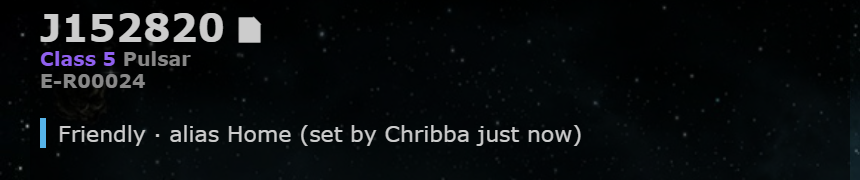

# System status colour, occupier and alias

**Date:** 2026-10-11

## Description

Anyone on the mask can mark a system on the chain map as Friendly, Hostile, Active, Empty or Unscanned, give it a short alias
("Staging", "Home 2") and note who occupies it. The node gets a coloured outline plus a letter, the alias shows under it, and the
system info panel gets a one-line summary. It belongs to the system, not to a hole, so it stays when the system leaves the chain
and comes back. Inspired by WormholeSystems' system status and Pathfinder's persistent aliases.

## Before / After

| Before | After |
| --- | --- |
|  |  |

Right-click menu (Status, Alias, Occupier) and the occupier dialog, which suggests the residents already set for the system:

| Menu | Occupier dialog |
| --- | --- |
|  |  |

System info panel: 

## Settings

Toggle: Settings > Map Markers > "System status: Show system status colours and aliases on the map" (on by default,
`options.systemStatus.enabled`). Off hides the outline, letter and alias on the map and the info panel line, and stops the
10 s poll entirely; the right-click entries still work (the menu reads the current data when it opens).

## Change

- New `fork_system_status` table per mask and system (`status`, `alias` <= 24, `occupier` <= 60, who/when), created on first use
  (`system_status.inc.php`, reference DDL `docker/sql/system-status.sql`). A row with nothing left is deleted.
- New endpoint `public/system_status.php`: GET lists the session mask's rows; POST `set` (any of status / alias / occupier) and
  `clear` need `X-Requested-With`; the mask only ever comes from the session. The table is created on the first POST (or a GET
  that finds it missing), not on every poll.
- Polling: every 10 s, only while the setting is on and the tab is visible. Every answer carries a `hash`; the poll sends
  `have=<hash>` and gets `{unchanged: true}` when nothing changed (same pattern as structures.php). Poll answers that arrive
  while a change of ours is in flight (or was answered since) are ignored.
- Cap: 2000 systems per mask. When full, the oldest row (by set time) of a system that has no signature of the mask in it
  (not on the mask's current chain) is dropped to make room; if every row is on the chain, the new one is refused.
- Menu: Status ▸, Alias…, Occupier… and "Clear all status" (status, alias and occupier at once). No Discord notifications for
  status changes (decided).
- Colours are an outline only (no glow), so the Watchlist's box-shadow on nodes and the status outline show together.
- `app/js/fork/system-status.js` (pure logic in `systemStatus`, mocha tests in `app/js-test/fork/system-status.test.js`) and
  `app/css/fork/system-status.css`: context menu entries, dialogs, node decoration after every draw (hooks size-tags'
  `placeOnDrawnMap` / `placeOnOrgChart`, so all renderers), info panel line, Settings row.
- Colour-blind safe: Okabe-Ito colours, a different outline style per status (solid, thick solid, solid, dashed, dotted) and a
  letter F / H / A / E / U. The outline is outside the node, so EVE security colours and the other badges stay as they are.
- The occupier is free text; the dialog offers the corporations / alliances from "Set residents" (`system_residents.php`) as
  one-click suggestions and stores nothing twice.
- Tests: `php tests/system_status_test.php` (validation, storage, mask scoping, the endpoint over HTTP; 51 checks).
- Upstream files touched: none. `docker/README.md` (fork-owned) lists the new table.
