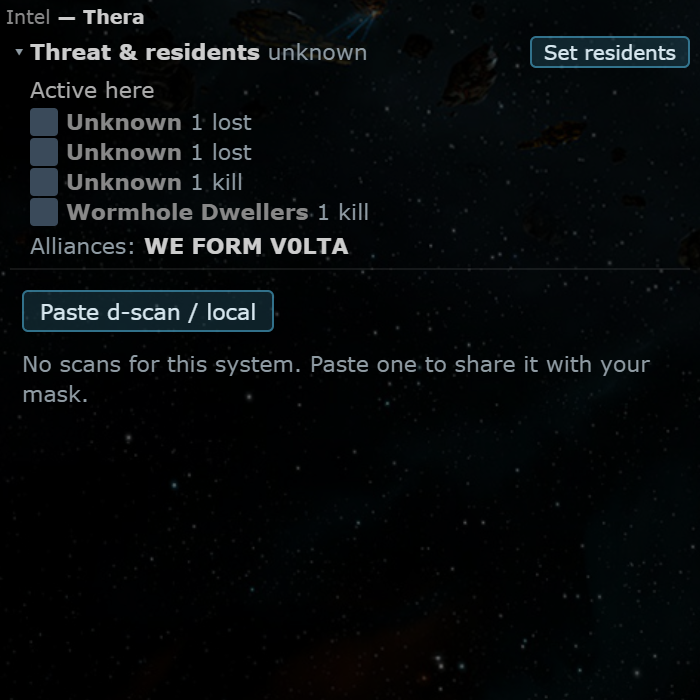
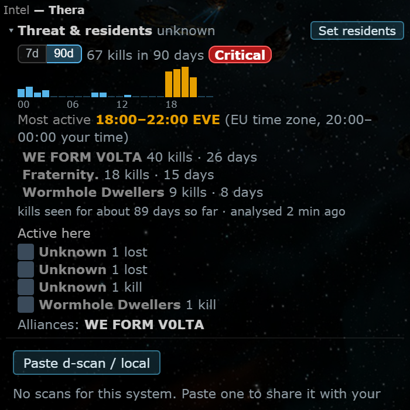
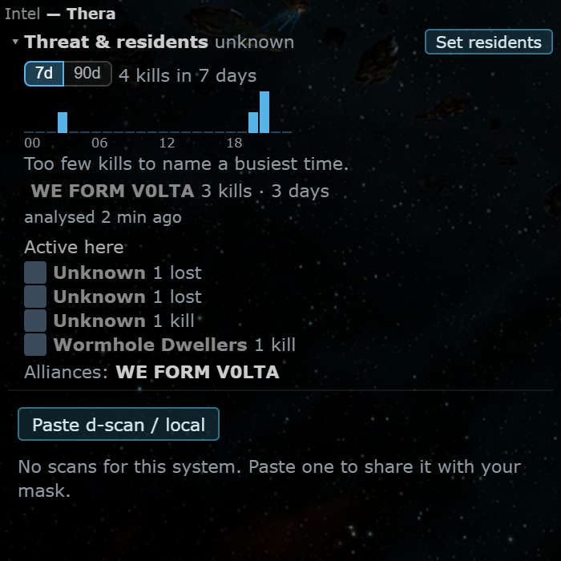

# System Threat: 90 days, top groups and kills by hour

**Date:** 2026-10-11

## Description

The Threat & residents section of the Intel panel now shows, for the viewed system, a 7 d / 90 d profile: kills, a
24-bar kills-by-hour-of-day chart (EVE time) with the busiest window ("Most active 18:00-22:00 EVE", plus the same in
your own clock and a rough AU / EU / US time zone), the top groups with zKillboard links, and how long ago it was
analysed. It answers "who lives here and when are they online?", like WormholeSystems' threat analysis and Wayfinder's
kills-by-hour chart. Fixture data (no zKillboard call): Thera with 67 seeded kills over 88 days.

## Before / After

| Before | After (90 d) | After (7 d) |
| --- | --- | --- |
|  |  |  |

## Settings

No new toggle. The profile is part of the "Threat & residents" section, so Settings > General Preferences > "System
threat & residents" (`options.systemResidents.enabled`, on by default) already turns it off, and the section can be
collapsed. The 7 d / 90 d choice is remembered per browser (localStorage). Server side, `ZKILL_THREAT_KEEP_DAYS`
(default 90, `0` = keep only `ZKILL_RETENTION_HOURS`) controls the longer kill retention.

## Change

- **Worker / storage** (`zkill/profile.php`, new): the profile is computed from `zkill_killmails`, no extra zKillboard
  request. zKillboard's history API is limited to 7 days and the stats endpoint has only 7-day top lists, so 90 days
  cannot be fetched; instead the systems people look at are recorded in the new table `zkill_system_keep` (DDL in
  `zkill/schema.php` and `docker/sql/zkill.sql`, created on first use) and the stream keeps their kills for
  `ZKILL_THREAT_KEEP_DAYS` days: `zk_store_killmail()` (`zkill/killmails.php`) stores older kills of watched systems,
  `zk_prune()` spares them. Watching is added by `public/system_threat.php` (the viewed system plus the chain systems
  of the request, only when the request may queue and the feed is on; at most 500 systems, dropped after 14 days
  unwatched). History therefore builds up from the first view; the profile reports `coveredDays` and the panel says
  "kills seen for about N days so far" until 90 days are covered.
- **zKillboard call budget**: unchanged. No new route, no extra request, the worker's stats / back-fill steps are the
  same. Cost is database storage only (about 0.3 KB per kept kill), bounded by 500 watched systems, 20000 kills read
  per profile and the 90-day cap.
- **Compute** (`zk_profile_compute()`): per period (7 d, 90 d): player kills (NPC kills left out), 24 hour buckets by
  UTC hour, busiest 4-hour window (wraps midnight, needs 8 kills), top 5 groups (alliance, else corporation; NPC
  corporations left out; listed only with final-blow kills on at least 3 different UTC days; also their ships lost
  here), level over 90 days (Critical 50 or more, High 15 or more, Moderate 5 or more, Low 1 or more; WormholeSystems'
  thresholds). Cached per system for an hour in `zkill_system_keep` ("analysed X ago").
- **Review round 1**: the profile is aggregated in SQL (no kills loaded into PHP); at most 5000 kills per watched system
  beyond the retention window (oldest dropped, coverage reported from the oldest kept kill); the watch set is the viewed
  system plus the user's mask chain from `signatures`, with a per-user cap of 200, written by one batched upsert that
  never throws; profiles of unwatched systems are cached (10 minutes) in the new `zkill_profile_cache` table and
  computed under a MySQL `GET_LOCK`.
- **Response**: `detail.profile` in `zk_system_threat()` (`zkill/threat.php`); group IDs go through the existing name
  lookup (names already resolved are returned, others are queued for the worker).
- **UI** (`app/js/fork/system-threat-90d.js`, `app/css/fork/system-threat-90d.css`, new): pure SVG sparkline, blue bars
  with the busiest window in orange (Okabe-Ito pair, safe for colour blindness) and a `<title>` tooltip per hour, a
  7d / 90d toggle, group list linking to zKillboard (names escaped), timezone line. Two small additions in
  `app/js/fork/system-threat.js` (`infoModel` returns `profile` and `names`, `sectionHtml` renders the block).
- **Deviation from the brief**: "kills/losses" is reported as player kills for the system and, per group, kills (final
  blows) and losses; the 7 d and 90 d numbers are limited by how long the system has been watched (shown in the panel).
- **Tests**: `zkill/tests/profile_test.php` (42 checks: levels, busiest window incl. wrap and ties, groups on 3
  distinct days, NPC corporations and kills, UTC day edges, coverage, keep set, cap, profile cache; SQLite fixtures),
  `app/js-test/fork/system-threat-90d.test.js` (windows, local time, sparkline, groups, escaping, toggle, section
  integration). Also checked on the dev MySQL: the prune spares a watched system's old kills and deletes an unwatched one's.
- **Third parties**: none new. Group links go to zkillboard.com like the rest of the section.
- **Docs / config**: `docker/README.md` (90-day profile section, table list, env row), `docker/config.php`,
  `.env.example`, `docker-compose.dev.yml`, `docker-compose.prod.yml` (`ZKILL_THREAT_KEEP_DAYS`).
- **Upstream files touched**: none. Fork files changed: `zkill/zkill.inc.php`, `zkill/killmails.php`, `zkill/schema.php`,
  `zkill/threat.php`, `app/js/fork/system-threat.js`, `docker/*`, compose files. Production needs the new env var only
  if the default (90) is not wanted; the table is created on first use (no manual schema step).
