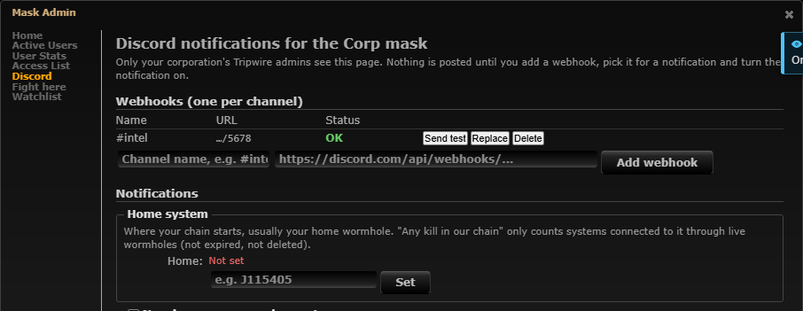
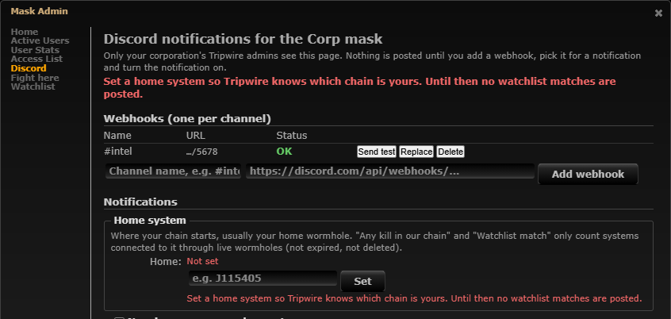
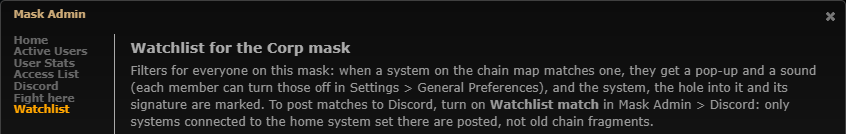

# Watchlist Discord pings: only the chain connected to home

**Date:** 2026-10-11

## Description

The Discord "Watchlist match" type now only posts matches in systems connected to the mask's home system
(Mask Admin > Discord) through live wormholes, the same rule chain kills use since
[#45](../2026-10-10-chain-kills-connected/README.md). Before, a match anywhere on the mask's map pinged, including a
stale fragment of an old chain that nobody had deleted yet.

## Before / After

Mask Admin > Discord with "Watchlist match" on and no home system: before, no warning (and every match on the map
posted); after, the same warning chain kills show, naming what is not posted.

| Before | After |
| --- | --- |
|  |  |

Mask Admin > Watchlist says which matches go to Discord:

## Settings

No new toggle. This is a fix to an admin-configured notification: the Watchlist match type already has its own on/off
per mask (Mask Admin > Discord), and there is no reason to want the old behaviour (pings from a chain you are no
longer in). It reuses the existing Home system setting, required like for chain kills so the result is predictable.

## Change

- **Rule:** a watchlist match is posted only when its system is in "the chain": connected to the mask's home system
  through live wormholes *right now* (`discord_chain_systems` in `discord/chain.php`: breadth-first from home over the
  mask's live holes, through k-space exits too; the liveness rule of #45). The worker walks it on every 15 s poll, one
  query for all masks with the type on and filters (not the 60 s cached copy: a hole mapped from the chain is posted
  on the next poll, as before).
- **How it fits the dedupe** (`discord/watchlist.php`): matches outside the chain are dropped *before* the new/seen
  logic, so they are neither posted nor recorded in `fork_watchlist_seen`. Decisions:
  - A system that gets connected to home later (a fragment joined by a new hole, or reached through k-space), while
    it still matches and its hole is still there, is posted then: it became part of the chain, which is what the
    filter asks about. The baseline only records the chain's matches, so this also holds for fragments that already
    existed when the type or filter was turned on.
  - A match posted once and then cut off and reconnected (e.g. the connecting hole deleted and mapped again) is not
    posted again while its own hole still exists: seen holes are still forgotten only when the hole is gone from the
    mask, as before. This also holds across a re-baseline (filter saved, home moved, the one-time upgrade): a
    re-baseline now adds the chain's current matches to the filter's records instead of replacing them (before, a
    save deleted them first, so a match posted earlier and cut off at that moment was posted again when it came back).
    Records still go when their hole is gone, and all of a filter's go when it is paused or deleted (resuming it starts
    fresh, as before). Saving a filter with changed conditions doesn't re-post systems it already posted while their
    holes exist: the filter is the same filter (same ID) and its channel already heard about them; anything new that
    matches the new conditions after the save is posted.
  - The home system is part of each filter's baseline stamp (`enabledAt:updatedAt:homeSystemID`). Setting, moving or
    clearing home re-baselines like saving a filter: the new chain's current matches are recorded without posting, so
    setting home does not flood the channel with everything already on the chain. Baselines stored before this change
    (`enabledAt:updatedAt`) never equal the new stamp, so every filter re-baselines once, silently, on the first poll
    after the upgrade.
- **Which holes count and which one the message names:** a match in a chain system needs at least one of its holes
  to be a hole of the chain: live by the chain's rule (shared SQL, `discord_chain_live_sql`, now also used by the new
  `discord_watchlist_links` query, which replaces `watchlist_mask_links` and adds a `live` flag per hole) with its far
  side in the chain or not known yet (a scanned hole nobody has been through still counts for hole filters). A hole
  filter matched only by an expired hole or a hole to a fragment is not posted. The message names the oldest such hole
  (before: the oldest hole into the system, which could be expired or come from a fragment). The dedupe still remembers
  all of the match's holes, as before.
- **No home set:** behaves like chain kills: no watchlist messages at all (never "everything"), nothing recorded. Mask
  Admin > Discord warns at the top and under the Home system field, naming the types that are affected: "Until then no
  chain kills are posted." / "... no watchlist matches are posted." / "... no chain kills or watchlist matches are
  posted.". Saving is still allowed. The Home system help and the Watchlist match help now name both types; Mask
  Admin > Watchlist says only systems connected to the home system are posted to Discord.
- **In-app highlight and sound: unchanged** (still everything on the member's chain map). They are for the person
  looking at the map, which is drawn from their chain tab's root and only shows what they choose to see; marking a
  match there costs nothing and the node is right in front of them. Discord is the channel that reaches people who are
  not looking, so it is the one that has to be limited to the chain that matters. Chain kills made the same split in #45.
- Tests: `watchlist/tests/watchlist_test.php` (+24 checks: matches limited to the chain, empty chain, stamp with home,
  baseline records only the chain, fragment hole not posted or recorded, fragment connected later posted once, cut off
  and reconnected not posted again, no home, setting and moving home re-baseline, old stamps re-baseline silently,
  posted / cut off / filter saved / reconnected not posted again, home moved away and back, chain holes, the named
  hole and hole filters made only by dead or fragment holes),
  `discord/tests/discord_test.php` (+13 checks: `discord_watchlist_poll` against SQLite with the real chain query: no
  home, home chain vs detached fragment, fragment joined later, joint hole expiring, the live hole named over an
  expired one, posted / cut off / filter saved / reconnected not posted again), mocha
  `app/js-test/fork/discord-notifications.test.js` (warning per type, page warning, help texts).
- Verified end to end in the dev stack with the worker and `discord-mock` (home J115405 - J150627, old fragment
  J121745 - J141438, filter "Any C2"): no home: a new C2 off J115405 not posted; home set: nothing posted (baseline);
  new C2 in the fragment (J130709) not posted, new C2 on the chain (J103924) posted; fragment connected through
  J103924: J121745, J141438 and J130709 posted once; next poll nothing. Re-run after review round 1, same result;
  plus a direct `discord_watchlist_poll` run against the dev MySQL: posted J214929 and J130709, cut off, filter
  saved, reconnected by a new hole: nothing posted again; home cleared, set again: nothing; a new C2 after: posted.
- Docs: `docker/README.md` (Discord types table, Home system, Watchlist).

Files: `discord/watchlist.php`, `discord/chain.php` (comment, `discord_chain_live_sql`), `watchlist/watchlist.inc.php`
(`watchlist_mask_links` moved to `discord_watchlist_links`), `discord/settings.php` (comment),
`discord_notify.worker.php` (comment), `app/js/fork/discord-notifications.js`, `app/js/fork/watchlist.js` (admin page
note), `app/js-test/fork/discord-notifications.test.js`, `watchlist/tests/watchlist_test.php`,
`discord/tests/discord_test.php`, `docker/README.md`. Upstream files touched: none.
