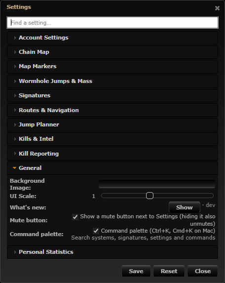
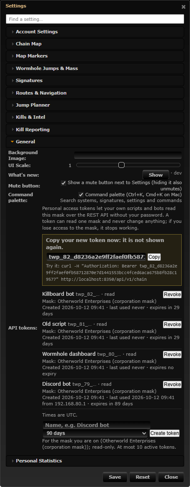
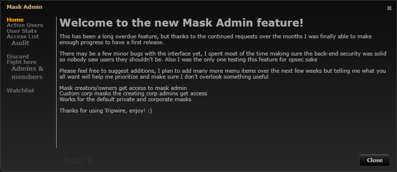
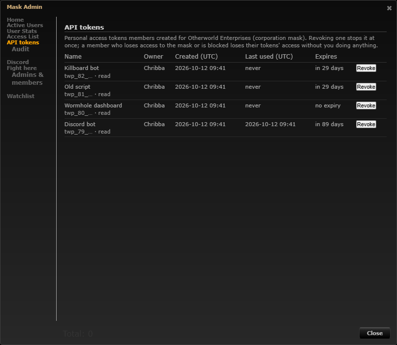

# REST API with personal access tokens

**Date:** 2026-10-12

## Description

The `/api` endpoints could only be used with an account's real username and password (SSO users have none), could not be
revoked without a password change and could not be scoped. Players now create personal access tokens in Settings > General >
API tokens (read only, one mask each, optional expiry, shown once) and use them as `Authorization: Bearer ...` against the
new `/api/v1` endpoints (chain, signatures, structures, timers, notes) and the old read endpoints. Mask admins list and
revoke the tokens of their mask in Mask Admin > API tokens.

## Before / After

Settings > General:

| Before | After |
| --- | --- |
|  |  |

Mask Admin:

| Before | After |
| --- | --- |
|  |  |

The "after" shots are real tokens created on the dev stack through the page itself ("Discord bot" has been used once, from
curl-like `fetch`, so it has a last-used time and address).

## Settings

No toggle. Nothing appears on the map and nothing runs for anyone until they create a token, so there is nothing to opt out
of; the operator switches are `TRIPWIRE_API` (the whole API, existing), `TRIPWIRE_API_PASSWORD_AUTH` and
`TRIPWIRE_API_RATE_LIMIT`. The tokens live on the server, not in `options`, so there is no `forkSettings` key and nothing to
add to the mask-defaults allow-list (the parity test still passes). The Settings row is a `custom` row without `key`/`save`
(it stores nothing in options, so Settings > Reset has nothing to restore).

## Change

- **Tokens.** `fork_api_tokens` (+ `fork_api_rate`, both created on first use, reference `docker/sql/api-tokens.sql`). Token =
  `twp_<id>_<64 hex>` (32 random bytes); only SHA-256 of the secret is stored, the token is shown once. A token is for the
  user's character and exactly one mask (the one they are on), scope `read` (the only scope), at most 10 active (not revoked,
  not expired) per user, optional expiry (1-365 days). `api/tokens.inc.php`.
- **Every request** (`api_token_authenticate`): token valid, constant-time compare, not revoked/expired (401); the character
  still reaches the mask by the session rule `tripwire_mask_allowed`, is not blocked in Mask Admin, not banned (403; so
  leaving a corporation or a block kills the token); rate limit per token (60/min, `TRIPWIRE_API_RATE_LIMIT`, 429 +
  `Retry-After`); `lastUsedAt`/`lastUsedIP` written at most every 5 minutes; only GET/HEAD (405); a `maskID` parameter that is
  not the token's own mask is 403, nothing in the request can pick another mask. A mask reached only through an alliance can not
  hold a token (no alliance is stored per character, so the access could not be re-checked): fails closed.
- **Endpoints.** `GET /api/v1` (whoami), `/chain` (systems + holes with type, size, mass limits, life, mass state, both ends),
  `/signatures[?systemID]`, `/structures[?systemID]`, `/timers`, `/notes[?systemID]` (HTML sanitised again on output). Also
  the old `/api/signatures`, `/wormholes`, `/comments` with a token (not `/statistics`). `api/v1.inc.php`;
  `api/wormhole-types.json` is a copy of `tools/wormholes.json` (not in the image) so holes get a size; a test keeps them equal.
- **Password login.** Still works by default; new env `TRIPWIRE_API_PASSWORD_AUTH` (default `true`, documented as deprecated)
  turns it off (401 pointing at tokens). `/api/v1` never takes passwords.
- **Management.** `public/api_tokens.php`: GET lists yours (and, for mask admins, the mask's); POST create/revoke with the fork's
  CSRF pattern from `public/fight.php` (per-session `X-CSRF-Token`, `X-Requested-With`, JSON only, same-origin Origin check).
  The mask of a new token is the session's, never a request value. Revoke: the owner, or an admin of the token's mask
  (`maskadmin_is_admin`); anybody else gets 404 (same as an unknown id). Create and revoke are written to the mask audit
  (`fork_mask_audit` actions `token-create` / `token-revoke`, shown in Mask Admin > Audit; `audit/audit.inc.php`'s kind list and
  `audit-log-tab.js`'s wording extended).
- **UI.** `app/js/fork/api-tokens.js` (Settings > General row: list, create with name + expiry, one-time token with Copy and a
  curl line, revoke), `app/js/fork/api-tokens-tab.js` (Mask Admin > API tokens), `app/css/fork/api-tokens.css`. The table rows
  carry `data-token`, not `data-id`: upstream's admin window deletes every `tr[data-id]` it has no data for.
- **Docs.** `docker/README.md#rest-api` (endpoints with curl examples, security notes, env vars), `.env.example`, both compose files.
- **Upstream files touched:** `public/api.php` (one line: requires `api/token-auth.php`, which includes upstream's `api/auth.php`
  for password logins, instead of `api/auth.php` directly; CRLF kept). Fork-owned files edited: `audit/audit.inc.php`,
  `app/js/fork/audit-log-tab.js`, `docker/config.php`, `.env.example`, both compose files, `docker/README.md`.
- **Tests:** `php tests/api_tokens_test.php` (223 checks: create/hash/verify, revoked/expired, mask fixed, lost access / blocked /
  banned, write methods, rate limit, lastUsed throttling, every endpoint and mask isolation, CSRF on management, IDOR on
  revoke, mask admins, audit entries, the old Basic login, `/api/v1` over HTTP with curl-style requests),
  `app/js-test/fork/api-tokens.test.js` (formatting, escaping).
- **Security notes.** Tokens are only sent in the `Authorization` header (never a query string, so they stay out of access logs).
  No CORS headers are sent, so browsers on other sites can not read answers. Failed logins write nothing to the database. The
  address stored is `REMOTE_ADDR` (never `X-Forwarded-For`). Not done: per-IP throttling of failed token guesses (the secret is
  256 bits), write scopes, token rotation.
