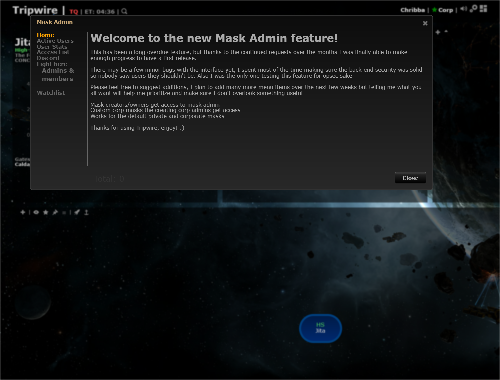
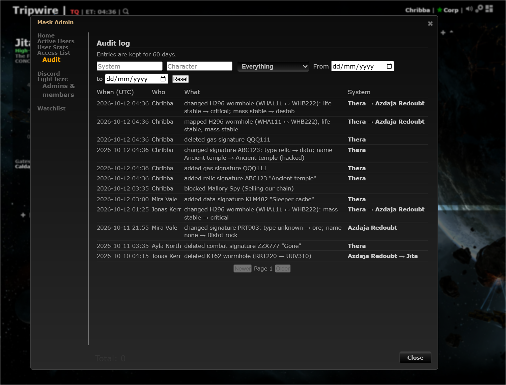

# Audit log of who changed what

**Date:** 2026-10-12

## Description

Mask admins get a new Mask Admin > Audit tab: a filterable, paged list (newest first) of who added, changed or
deleted which signature and wormhole on the mask (life, mass, type, where it leads), with the before and after, plus
the mask-admin actions from Mask Admin > Admins & members. Entries are kept 60 days by default
(`AUDIT_LOG_DAYS`). Asked for in Pathfinder #271 / #547; Wanderer, Nexum and WormholeSystems have similar panels.

## Before / After

| Before | After |
| --- | --- |
|  |  |

The "after" list mixes real saves made in the dev stack (Chribba) with a few older rows by other pilots inserted
directly for the screenshot.

## Settings

No toggle. It is a mask-admin tool (nothing changes for members), recording is server-side and mask-wide, and the
retention is an operator setting (`AUDIT_LOG_DAYS`, 0 = nothing recorded), not a per-user preference. So there is no
`forkSettings` row and nothing to add to the mask-defaults allow-list.

## Change

- **Where it records.** All signature and wormhole writes go through six functions in `signatures.php`
  (`addSignature`, `updateSignature`, `removeSignature`, `addWormhole`, `updateWormhole`, `removeWormhole`); each calls
  one helper in the new `audit/audit.inc.php` after its write succeeded. So dialog adds/edits, inline edits, pasted
  scans, the automapper, undo/redo (they replay the same requests) and deletes are all covered. Updates take a small
  "before" snapshot (one SELECT) and log only the fields that really changed (`lifeLeft` rewrites are not logged).
  Wormhole signatures are logged as part of their wormhole (one "mapped" row, not three), and where a hole leads is a
  change of its far signature's system. The mask is `$_SESSION['mask']` and the actor `$_SESSION['characterID'/'characterName']`;
  no request value is used. Auditing never breaks a save (everything is caught and sent to the PHP error log).
- **Why a table of our own** (`fork_audit_log`, created on first use, reference `docker/sql/audit-log.sql`) and not
  upstream's unused `_history_signatures` / `_history_wormholes`: those are full-row copies (about 400 bytes), have no
  who-changed-what summary, the wormhole one has no actor at all, and upstream may fill them with other semantics one
  day. No MySQL triggers (they would complicate upstream syncs and don't know the session's character).
- **Retention.** `AUDIT_LOG_DAYS` (default 60, 1-3650, 0 = off) in `docker/config.php`, `.env.example`, both
  compose files and `docker/README.md`. Older rows are never shown and are deleted on every 100th write (by row id) and
  when an admin opens the tab.
- **Reading.** `public/audit_log.php` (GET, mask admins only via `maskadmin_is_admin`, i.e. owner / corp admin / granted
  admin; always the session's mask): filters by system (either end of a wormhole), character (substring), kind, date
  range, 50 per page. `fork_mask_audit` rows (PR #87) are merged into the same list. UI: `app/js/fork/audit-log-tab.js`
  + `app/css/fork/audit-log-tab.css`, system names link to `?system=`.
- **Not done:** a "history" link on a signature row (needs a new tooltip hook; skipped); undo/redo show up as the
  inverse action (the server can't tell them from a normal save); a pasted scan is one row per signature.
- **Storage.** About 0.3 KB per row including indexes (one summary JSON of 60-150 bytes). A busy mask doing 1,000
  changes a day holds about 60,000 rows (~18 MB) at 60 days.
- **Upstream files touched:** `signatures.php` (CRLF kept): one `require_once` at the top and one-line calls in the six
  functions (12 added lines, nothing else changed). Also `docker/config.php`, `.env.example`,
  `docker-compose.dev.yml`, `docker-compose.prod.yml`, `docker/README.md` (fork-owned config/docs).
- **Tests:** `php tests/audit_log_test.php` (86 checks: recording per path, mask scoping, retention with a short
  `AUDIT_LOG_DAYS`, prune on write, filters/paging, admin-only HTTP), `app/js-test/fork/audit-log-tab.test.js`.
