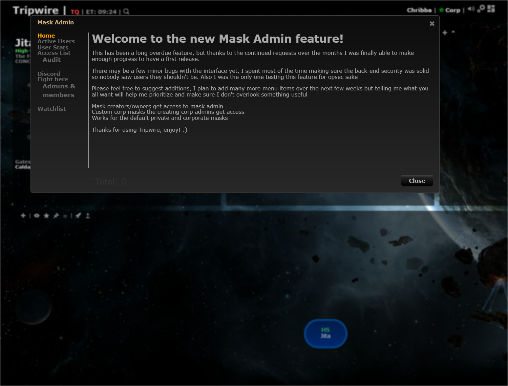
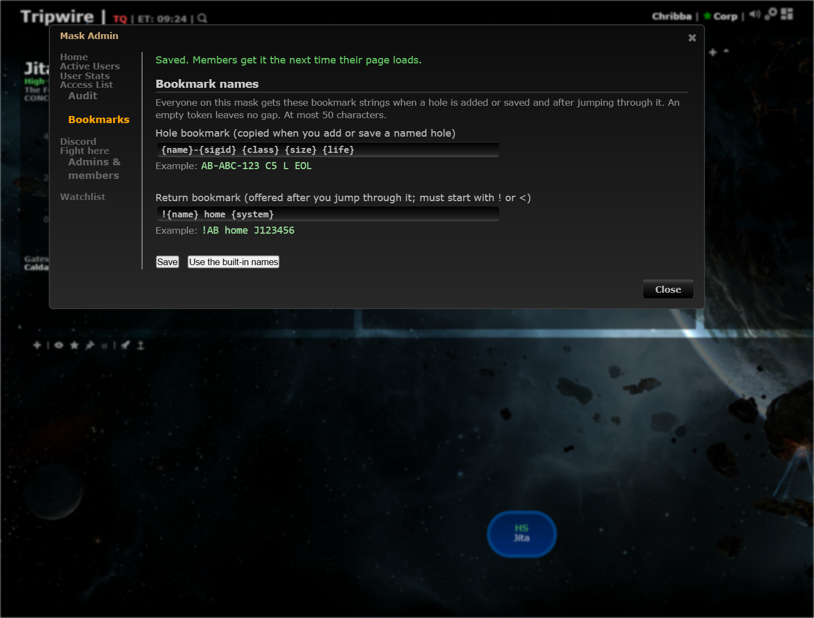
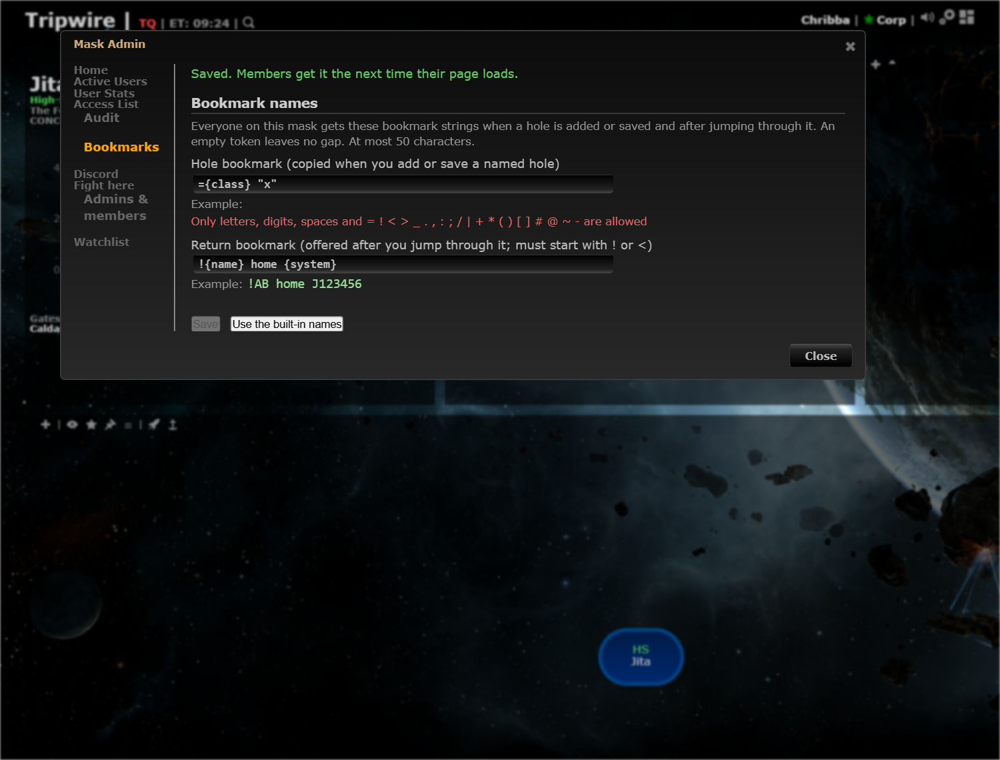
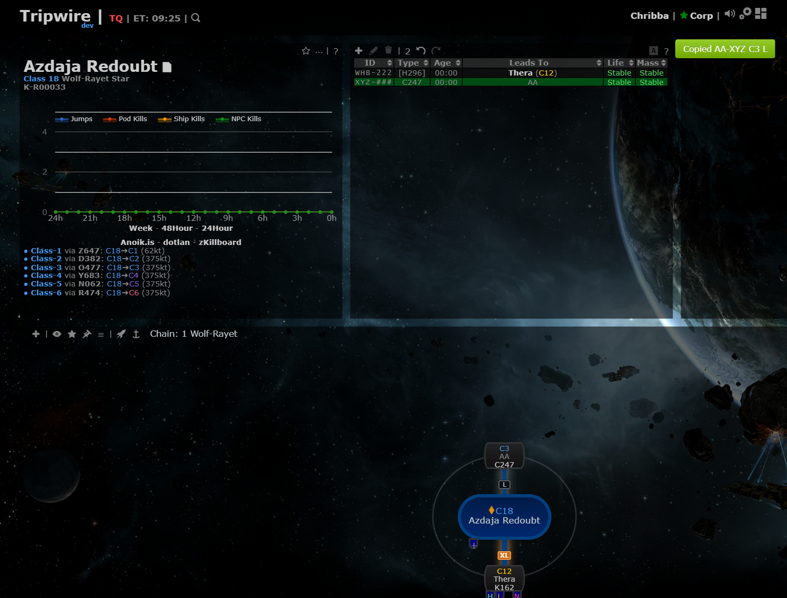

# Mask-wide bookmark templates

**Date:** 2026-10-12

## Description

The bookmark strings Tripwire copies (`=A C5 ABC EOL` when a named hole is added or saved, `!A` after jumping through it) are now
built from two templates that a mask's owner and the owning corporation's Tripwire admins set in Mask Admin > Bookmarks. Everyone on
the mask gets them. The defaults are today's exact strings, so nothing changes until an admin edits them.

## Before / After

| Before | After |
| --- | --- |
|  Mask Admin: no say in how bookmarks are named |  New Bookmarks tab with a live example per template |
| |  Unsafe or unknown input is explained and cannot be saved |
| |  Adding hole AA in Azdaja Redoubt copies `AA-XYZ C3 L` with the mask's template |

## Settings

No per-user toggle: this is a mask-wide setting, so it lives in Mask Admin, not Settings (AGENTS.md section 2). Nothing is stored for a
mask until an admin saves, so the built-in names stay for everyone until then ("Use the built-in names" removes the row again).

## Change

- Tokens: `{name}` (required), `{sig}`, `{sigid}`, `{type}`, `{class}`, `{size}`, `{life}`, `{system}`, `{dir}`; documented in the tab and in
  `docker/README.md#bookmark-names`. Rules (browser and server, same cases in both tests): at most 80 characters, letters, digits, spaces and
  `= ! < > _ . , : ; / | + * ( ) [ ] # @ ~ -`, with the longest values at most 50 characters of output; the return template has to start with `!` or `<`, the hole template must not.
- Stored per mask in the new table `fork_bookmark_templates` (created on first use). `public/bookmark_template.php`: GET for every member of the
  session's mask, POST (`save`, `reset`) for the owner / owning corporation's Tripwire admins with the usual CSRF checks; changes appear in
  Mask Admin's audit list.
- Two places build bookmark strings and now use the templates: `holeNaming.bookmarkString` (copy on Add/Save, also gets `{type}`, `{size}`,
  `{system}` now) and `jumpReturn.returnString` (return pop-up, `{dir}` = in). Nothing else in the fork builds one.
- New files: `app/js/fork/bookmark-template.js`, `app/css/fork/bookmark-template.css`, `bookmark/bookmark.inc.php`, `public/bookmark_template.php`,
  `tests/bookmark_template_test.php`, `app/js-test/fork/bookmark-template.test.js`. Edited fork files: `hole-naming.js`, `jump-return.js`,
  `mask-admin-tab.js` (audit wording), their two tests, `docker/README.md`. No upstream files touched.
- Review fixes: the length check assumes a 12-character `{name}` (a name is cut to 12 only when the finished string would be over 50), a hole template can't start with `!` or `<`
  (that marks a return bookmark), the templates are read when the Add/Edit Signature dialog opens or a jump is seen if they weren't yet (a failed
  read logs a console warning and uses the built-in names), and the Audit tab words the change ("changed the bookmark names"; `audit-log-tab.js`).
- Tests: mocha (defaults reproduce the previous strings exactly, rendering, validation, custom templates) and the PHP test (validation, endpoint
  auth, CSRF, validation errors, storage per session mask, reset, audit row).
