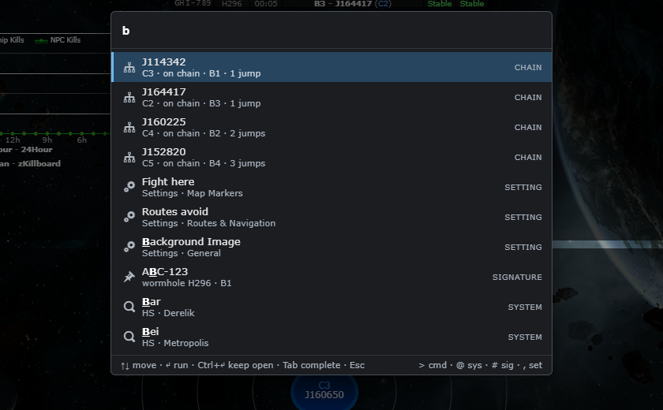
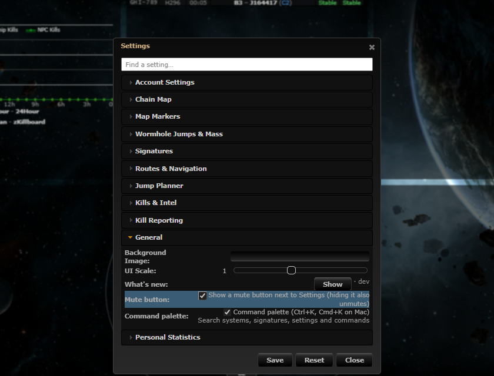

# Command palette (Ctrl+K)

**Date:** 2026-10-12

## Description

Ctrl+K (Cmd+K on Mac) opens a search box over the map: type a system, hole name, signature ID, mask, setting or
command and press Enter. It finds chain systems by name, J-code (with or without the J), hole name ("B2"), class and
static, any other EVE system by name, signatures of the viewed system by ID, masks, Settings rows (Enter opens
Settings at that row and flashes it) and the toolbar/menu commands. Phase 2 of the plan in
`reports/Command palette and inline edits spec.md`: the palette core. Commands with arguments and the fork features'
own commands come in phase 3.

## Before / After

New feature, so there is no before. After: searching "b" lists the chain systems by hole name first, then
settings, a signature and EVE systems.

| After |
| --- |
|  |

Picking a setting opens Settings at that row (section expanded, row flashing):

## Settings

Toggle: Settings > General > Command palette (Ctrl+K, Cmd+K on Mac) (on by default), `options.commandPalette.enabled`.
Off means the shortcut does nothing (the listener stays, the handler checks the option). Reset deletes the key.

## Change

- New files: `app/js/fork/command-registry.js` (`forkCommands.register / provider / invalidate`),
  `app/js/fork/command-palette-index.js` (pure index and scorer), `app/js/fork/command-palette.js` (sources, overlay,
  keyboard, upstream commands, Settings deep link, frecency), `app/css/fork/command-palette.css`, and mocha tests
  `command-palette-index`, `command-registry` and `command-palette` in `app/js-test/fork/`.
- **No upstream files touched.** The palette hooks from outside: a capture-phase `keydown`, the existing globals
  (`tripwire.systemChange`, `maskFunctions.updateActiveMask`, the toolbar buttons, `forkSettings.register`).
- Opens with Ctrl/Cmd+K only (no `/`). Does not open (and does not `preventDefault`) in CKEditor or any
  `[contenteditable]`, over a modal dialog (Settings, What's New), or when switched off. Ctrl/Cmd+K again or Esc closes
  and gives the focus back.
- Ranking follows the spec (exact 1000, prefix, word-start acronym, substring, fuzzy for non-EVE items; kind weights,
  frecency in `localStorage["tw-palette-frecency"]`, context boost, disabled commands greyed with the reason; an exact
  J-code or signature ID is pinned first). Scope prefixes: `>` commands, `@` systems, `#` signatures, `,` settings.
- Deviations from the spec: EVE-system matches carry a -150 weight (spec: 0) so a two-letter query such as "fh" finds
  the command before the 8.4k systems that start with it; Settings rows are read from the Settings dialog's DOM (every
  upstream and fork row, with its `data-fs-keywords`) instead of `forkSettings.items` plus `UPSTREAM_ROWS`, so no row is
  missed. Not built yet: argument commands (phase 3), the action list (`->`) and `Clear palette history` (phase 4). No
  delete commands.
- Performance (Chrome, dev stack, 8,490 systems + 4 chain systems + 96 items): median 0.5 ms and worst 3.1 ms per
  keystroke (score + top 50 + render); 8,490-system EVE index 2.4 ms; open 0.3 to 8 ms (the first is cold). Mocha at
  spec scale (200 chain + 8,500 EVE + 300 commands + 150 settings): median 0.4 ms, worst 2 ms per query.
- Accessibility: `role=dialog aria-modal`, combobox input with `aria-activedescendant`, listbox/option rows,
  `aria-disabled` rows, debounced `aria-live` result count, matched characters bold + underlined.
