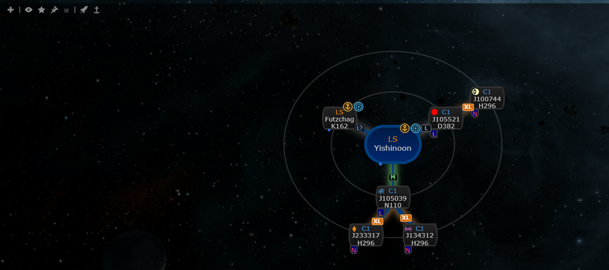
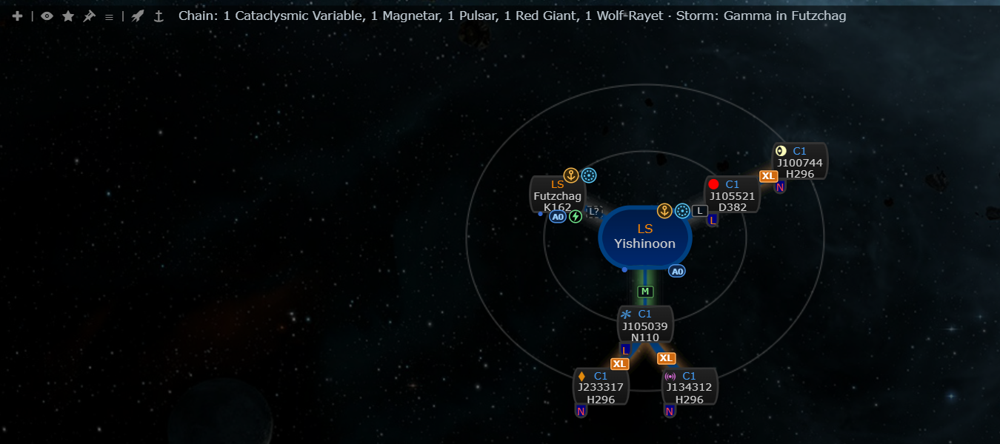

# Environment tags: EVE-Scout storms, A0 suns and a chain effects summary

**Date:** 2026-10-12

## Description

Chain map systems get small tags for things that matter when you pick a route: a storm icon (type colour, tooltip with
the type and how long ago it was reported) on systems with a crowd-reported metaliminal storm, and an "A0" tag on
k-space systems with a blue A0 sun. A one-line summary above the map counts the wormhole effects on the chain and
names the storms. Inspired by Nexum's environment tags.

## Before / After

Before: Settings > Map Markers > Environment tags off. After: on (Futzchag has a reported gamma storm and an A0 sun,
Yishinoon an A0 sun; the summary counts the effects of the five wormholes).

| Before | After |
| --- | --- |
|  |  |

## Settings

Toggles: Settings > Map Markers > **Environment tags** (tags and summary) and **Storm reports** (the EVE-Scout part), both
on by default. `options.environmentTags = {enabled, storms}`, missing = on, mask-default allow-listed (`environmentTags`
in `maskDefaults.ALLOWED` and `MASKADMIN_DEFAULTS_ALLOW`). With Storm reports off the server is not asked for observations.

## Change

- `app/js/fork/environment-tags.js` / `app/css/fork/environment-tags.css`: wraps `chain.nodes()` (like the skyhook icon) to
  insert `.env-tags` into node HTML, so it works in all four renderers; the tags hang just below the node's bottom-right
  corner (top-left is the threat badge, top-right the skyhook icon and jump-planner ring, bottom-right inside the node the
  intel dot, bottom-left statics and structure icons). The summary is a span after the chain toolbar's icons.
- Review round 1: tooltips are built only from our own constants (jBox renders `data-tooltip` as HTML, so no EVE-Scout
  text is used; the feed's `display_name` is dropped); tooltips are attached after each chain draw (checked by hovering a
  storm tag, an A0 tag and the summary, `tooltip.png`); the feed is stripped server-side (`environment_tags.inc.php`) to
  storms with category, type, system, time and hours before it is cached, written atomically, and a stale copy keeps its
  age when a refresh fails (retry at most every 60 s); `orgchart-top.png` shows size tags and environment tags together.
  Tests: `tests/environment_tags_test.php`.
- Storms: EVE-Scout `https://api.eve-scout.com/v2/public/observations` (verified live: `observation_category` "storm" with
  `observation_type` `electric|exotic|gamma|plasma` + `_a`/`_b`, `hours_in_system`, `created_at`, `system_id`; other
  categories such as `space_oddity` are ignored). Fetched by the server only, through the existing
  `public/cached_third_party.php` cache (new key `eve-scout-observations`, 10 minutes, stale copy served when EVE-Scout is
  down); browsers poll that endpoint every 10 minutes while the tab is visible.
- A0 suns: `public/environment-data/a0-suns.json` (167 k-space systems, star type 3801 "Sun A0 (Blue Small)", SDE build
  3586130), built by `tools/fork/build-a0-suns.mjs`. Wormhole systems and the single captured variant (78350) are left out.
- Ice belts are not tagged: the SDE has no ice belts (all 40,928 `mapAsteroidBelts` rows are the ordinary belt type 15; ice
  fields are anomalies that spawn at run time), so there is nothing static to show.
- Wormhole effects come from Tripwire's own system data (`systemAnalysis`); the summary counts unique chain systems and
  leaves out route destination rows.
- Tests: `app/js-test/fork/environment-tags.test.js` (parsing, tagging, summary). The two mask-defaults tests no longer
  hard-code the allow-list length (26).
- Upstream files touched: `public/cached_third_party.php` (one array row and one `if` line), `maskadmin/maskadmin.inc.php` (allow-list);
  fork files: `app/js/fork/mask-defaults.js`, the two mask-defaults tests.
- No new third-party host from the browser; the server calls `api.eve-scout.com`, already used for Thera/Turnur.
