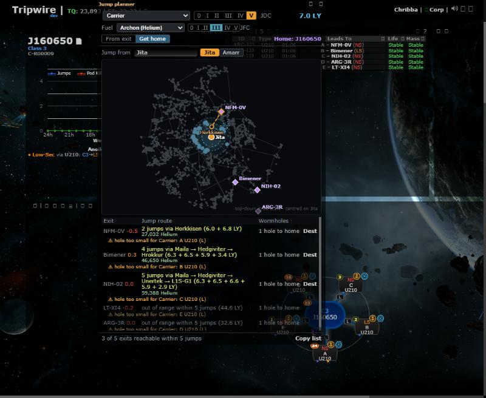
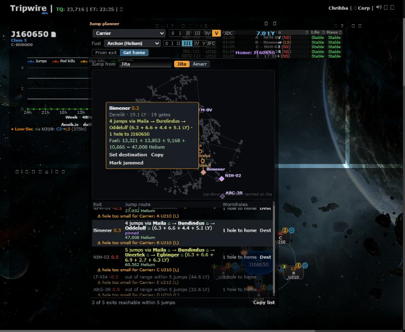
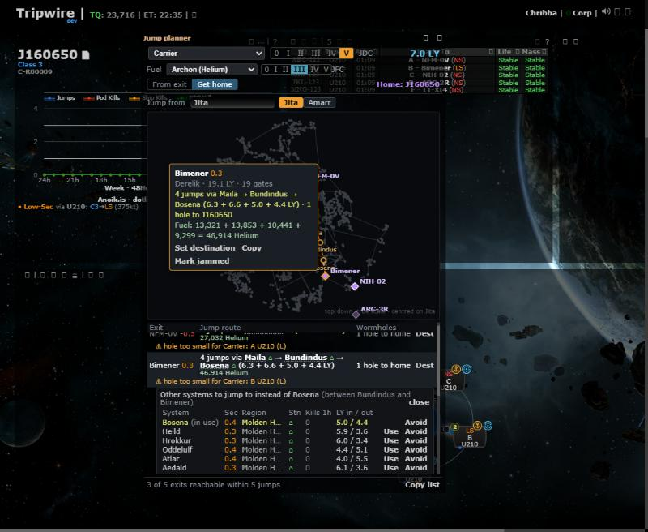
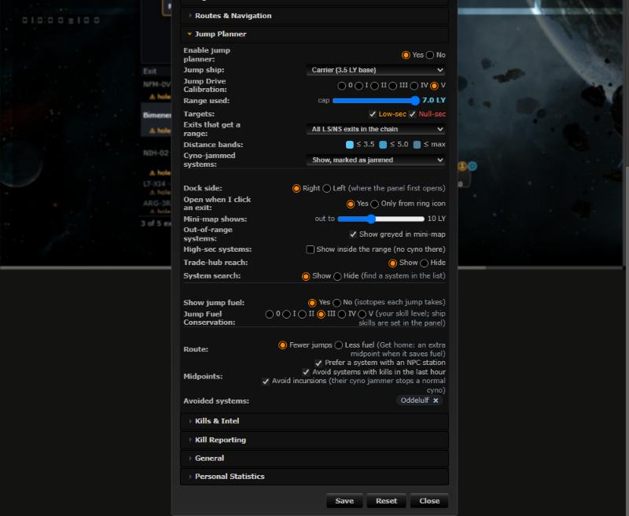

# Jump planner: choosing the midpoints

**Date:** 2026-10-12

## Description

Get home and the trade-hub lines now choose which system to jump through the way Dotlan's jump planner does: by weighted
cost (distance plus NPC station, recent kills, systems you avoid, Sansha incursions) instead of the shortest legs only. A
midpoint's name opens "Other systems to jump to", and routes show the jump fatigue waits.

## Before / After

Before: Get home from Jita, midpoints chosen by distance alone, no way to change one.
After: station midpoints (house icon), kill counts, "pinned" routes, and the other-systems list.

| Before | After |
| --- | --- |
|  |  |

Other systems to jump to (click a midpoint's name in a route), and the new Settings rows:

## Settings

Toggles in Settings > Jump Planner, all on by default (a missing key means the default), stored in `options.jumpRange`:
Route: Fewer jumps (default) / Less fuel (`prefer`); Prefer a system with an NPC station (`preferStations`); Avoid systems
with kills in the last hour (`avoidKills`); Avoid incursions (`avoidIncursions`); Avoided systems (`avoid`, at most 100,
added with Avoid in the other-systems list, removed with the x on its chip in Settings). Settings > Reset deletes them with
the rest of `options.jumpRange`. They stay inside `jumpRange`, so the mask-defaults allow-list is unchanged.

## Change

- **Engine (`app/js/fork/jump-range.js`, pure, DOM-free, origin-agnostic).** `routePlan(start, dests, range, index, systems, opts,
  maxJumps)`: hop-limited layered search, `best[k][v]` = least cost reaching v in exactly k jumps (a state no cheaper than the
  same system reached in fewer jumps is dropped). Cost = sum of legs (LY) + penalty of each midpoint (start and destination
  are never penalised). `prefer: "jumps"`: fewest jumps, then least cost, never an extra jump for a penalty; `prefer: "fuel"`:
  least cost over every jump count up to the limit (ties: fewer jumps). Also `routeVia` (a pinned first part, the rest planned
  again), `alternatives(prev, next, ...)` (every valid midpoint in range of both neighbours, best first), `midpointPenalty`,
  `midpointFacts`, `describeRoute`, `fatigue`, `formatMinutes`; `reach` (the 2-jump hub lines) ranks its midpoints with the
  same scoring when scoring data is passed (legacy order otherwise), and says why an exit is no target (`cause`).
  `routesFrom` is unchanged (kept for its tests and other callers).
- **Weights (LY, `jumpRange.MIDPOINT_WEIGHTS`).** No NPC station: +3 while "Prefer stations"; kills in the last hour: +0.5 each,
  at most +5; avoided system: +50. Why: a station or a quiet system should win over a slightly shorter leg (3 LY is about a
  leg's detour for a 7 LY ship) but not over a clearly shorter route; +50 is more than any detour, so an avoided system is
  used only when nothing else gets there (Dotlan penalises rather than forbids: https://evemaps.dotlan.net/blog, post 1490).
- **Incursions.** A Sansha incursion puts a constellation-wide cynosural jammer on its systems: normal cynos are stopped,
  covert ones are not ([EVE University: Incursions](https://wiki.eveuniversity.org/Incursions)). With "Avoid incursions" an
  incursion system is neither a midpoint nor a target (`isValidCynoTarget` gained `avoidIncursions` + `incursion`); Black Ops
  (covert) are not affected. Row reason "incursion". The From exit list and mini-map treat incursion systems like cyno-jammed
  ones too (marked "incursion" and counted as jammed, or hidden with Cyno-jammed systems: Hide), so the setting does what its
  label says everywhere. A pinned midpoint that stops being a valid target (new incursion, a jam, a changed setting) is dropped
  and the planned route comes back.
- **Jump fatigue (`jumpRange.fatigue`).** Per [EVE University: Jump fatigue](https://wiki.eveuniversity.org/Jump_fatigue)
  (D = LY x (1 - reduction), F = fatigue before the jump): new fatigue = min(5 h, max(10 x (1 + D), F x (1 + D))) minutes,
  wait = min(30 min, max(1 + D, F / 10)) with F the fatigue BEFORE this jump; fatigue decays in real time (1 minute per
  minute), so the route assumes each wait is served and the next jump starts from F less the wait (the wiki's 5 LY carrier
  example gives waits 6, 6, 29.4 min and 5 h fatigue on arrival). Reduction 90% for Jump Freighters and Capital
  Industrial Ships (Rorqual), 75% for Black Ops, 0 for carriers, dreadnoughts, FAX, supers, titans, Lancers. Shown in a route's
  tooltip: "Waits: 8 min, 8 min, 30 min · fatigue on arrival 5 h".
- **Data.** NPC stations: `public/jumprange/stations.json` (1,683 systems of 5,255, 5,210 stations), generated by
  `jumprange/tools/generate-coords.js` from the SDE's `npcStations.jsonl` (same build 3586130 as the other files, so
  `systems.json` / `ships.json` are byte-identical; `jumpPlanner.STATIONS_REV` busts the cache). Kills: what the chain map
  already fetched from ESI `/universe/system_kills/` (`chain.data.activity`, ship + pod kills), no new request. Incursions: CCP's
  public ESI `/incursions/` (`infested_solar_systems`), at most every 10 minutes while the panel is open, through the existing
  ESI prefilter (compatibility date, rate-limit pause). No new third-party host; zKillboard is not called. Missing or failed
  data = no penalty, never an error.
- **Panel.** Get home and hub lines show a house icon for an NPC station and a kill count (> 0) after a midpoint's name; the
  route tooltip has the per-jump fuel and the fatigue line. A midpoint's name opens "Other systems to jump to" under the row
  (System, Sec, Region, Stn, Kills 1h, LY in / out, Use / Avoid-Allow): Use pins that midpoint for this route (this page only,
  not saved; the rest of the route is planned again, tagged "pinned", and the mini-map follows), Avoid adds it to `avoid`.
  Dest still goes to the first cyno. The panel checks for new kills / incursions every 30 s.
- **Performance** (Node, all of k-space from Jita, 5 jumps, with stations, kills and avoid set): Carrier (7 LY) 65 ms, Jump Freighter
  (10 LY) 145 ms, in both modes; cached per start + settings + live data revision.
- Tests: `app/js-test/fork/jump-midpoints.test.js` (engine, incl. a brute-force oracle on random worlds, fatigue, alternatives)
  and `jump-planner-midpoints.test.js` (settings, live data, Get home, HTML escaping). Two existing assertions in
  `jump-planner.test.js` were updated deliberately (the settings defaults gained the new keys; cached routes now carry a
  `fuel: null` field).
- Files: `app/js/fork/jump-range.js`, `app/js/fork/jump-planner.js`, `app/css/fork/jump-planner.css`,
  `jumprange/tools/generate-coords.js`, `public/jumprange/stations.json`, tests, `docker/README.md`. No upstream files touched.
