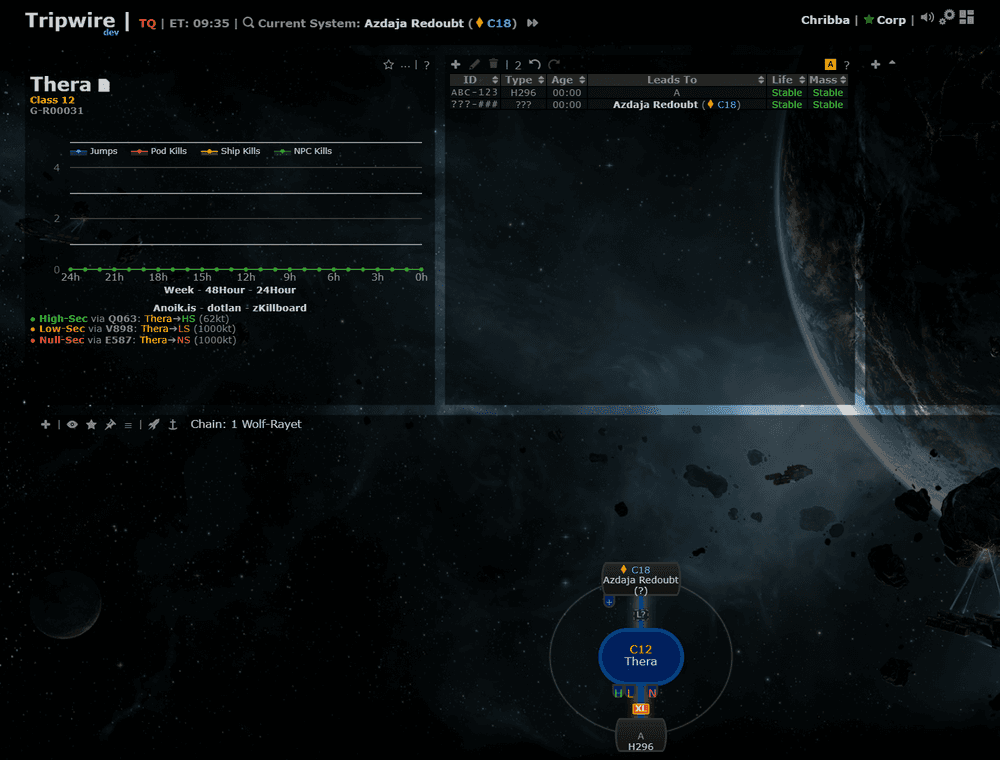
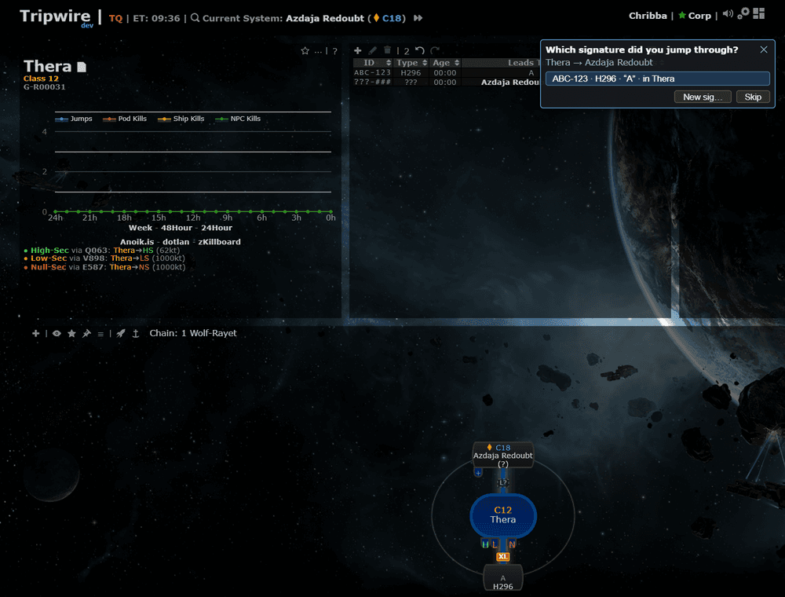
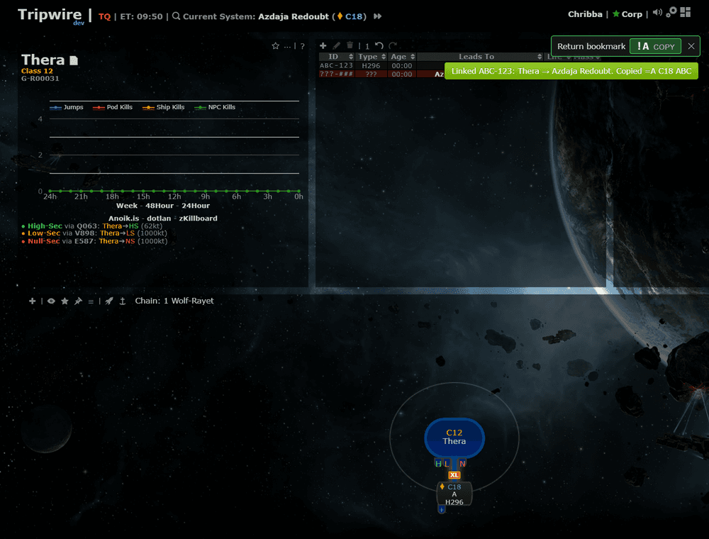
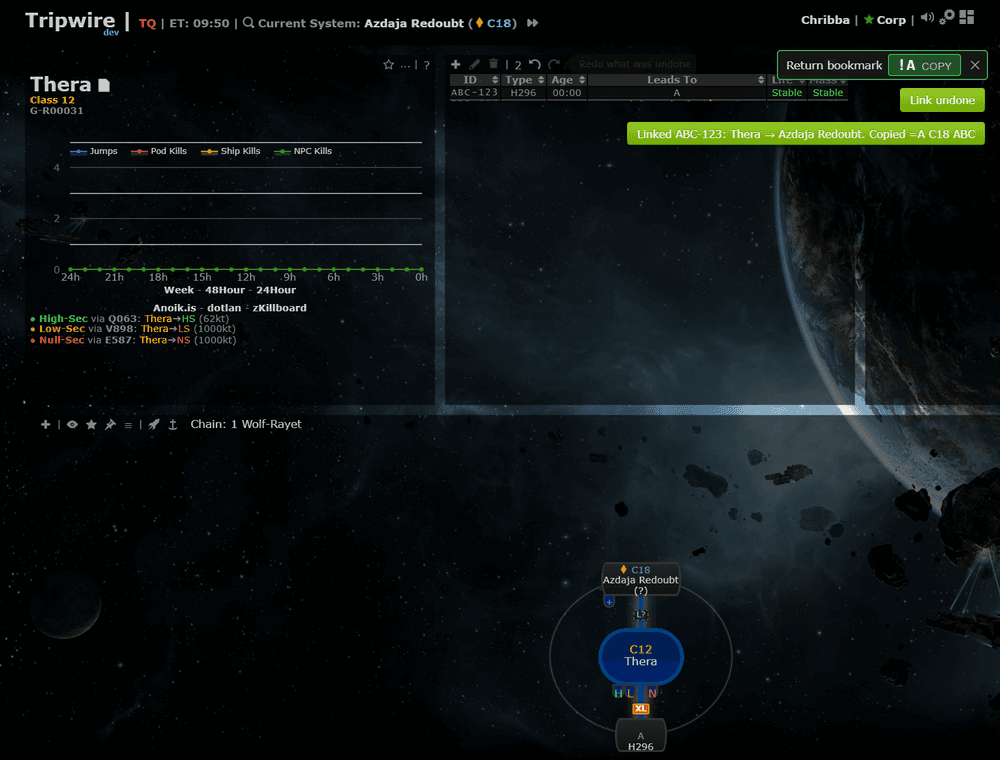
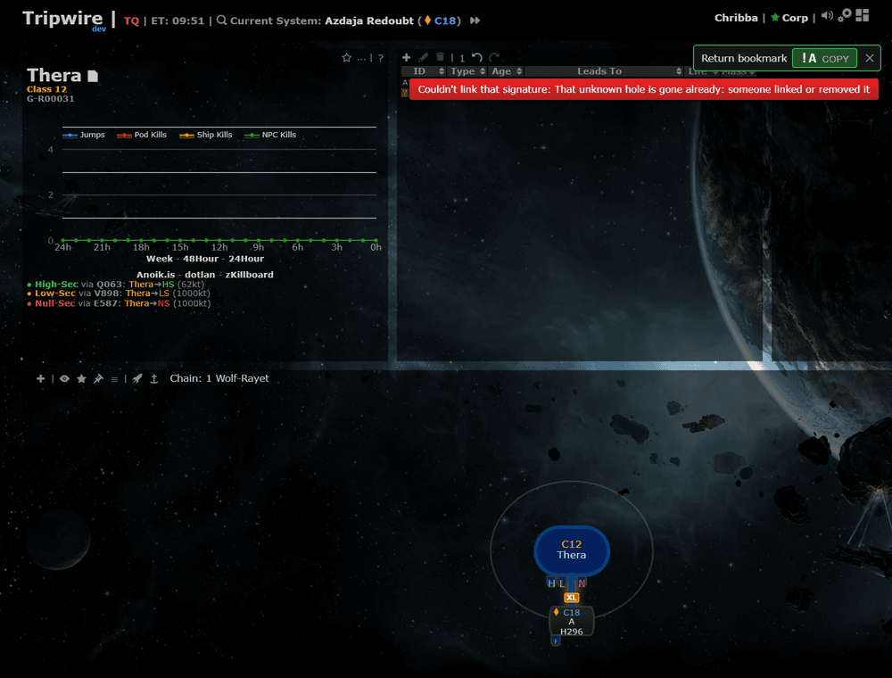
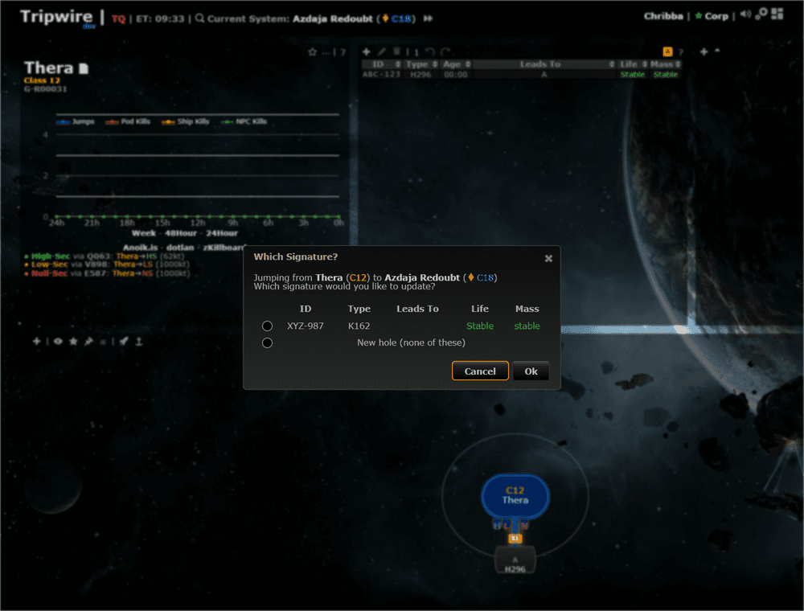
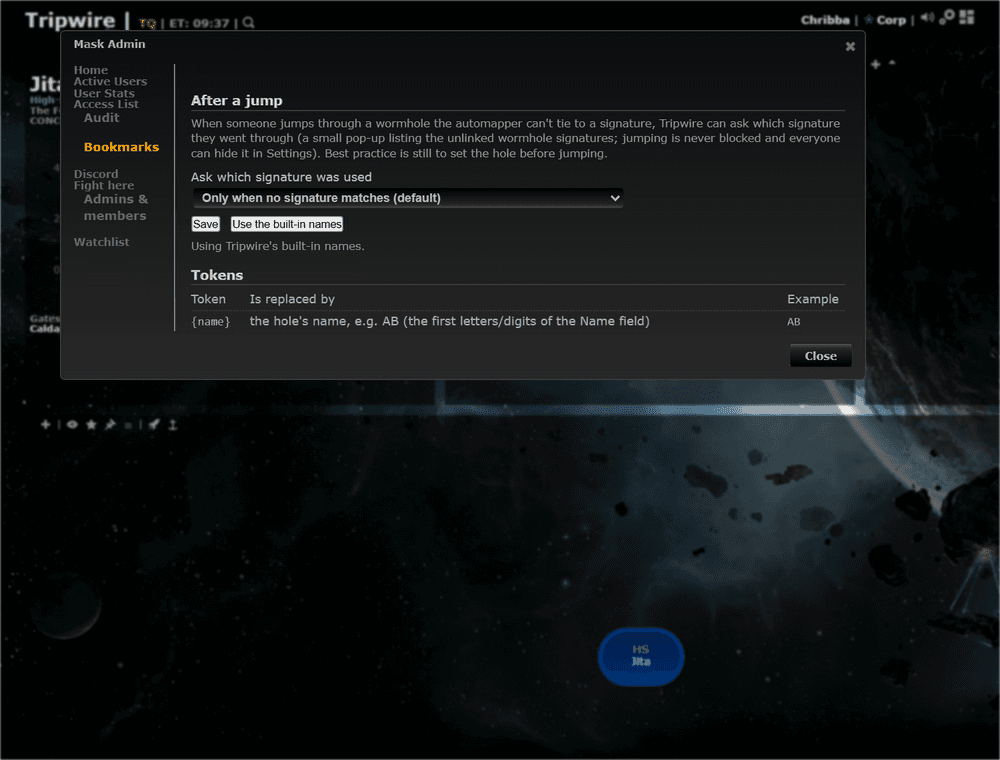
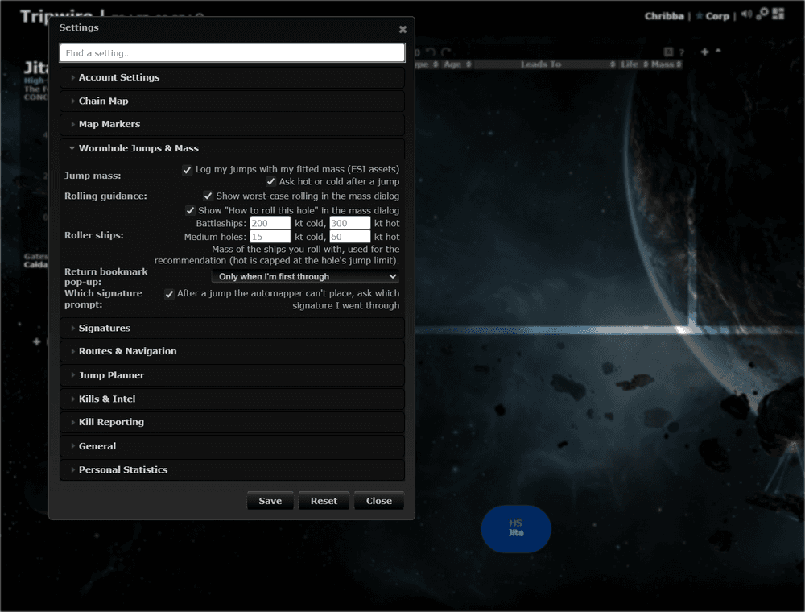

# Which signature did you jump through?

**Date:** 2026-10-12

## Description

When you jump through a wormhole and the automapper can't tie the jump to a scanned signature (it makes a bare `???` hole), a small
pop-up now lists the unlinked wormhole signatures of the two systems. One click links that signature to your jump, removes the bare hole,
and copies the bookmark string from the mask's template. Best practice is still to set the hole before jumping, so the mask's admins can turn
the pop-up off or widen it, and everyone can hide it in Settings. Jumping is never blocked.

## Before / After

| Before | After |
| --- | --- |
|  Thera to Azdaja Redoubt through a hole whose type doesn't match: a bare `???` hole, nothing asked |  Pop-up at the top right: the unlinked signature to pick, New sig..., Skip |
| |  After clicking: linked, bookmark copied (the return bookmark panel from before follows as usual) |
| |  One click on Undo puts everything back (the bare hole returns, the signature is unlinked) |
| |  Another pilot linked the same hole first: refused with a clear message, nothing changed |
| |  When the automapper itself asks "Which Signature?", the pop-up stays away |
| |  Mask Admin > Bookmarks > After a jump |
| |  Settings > Wormhole Jumps & Mass > Which signature prompt |

## Settings

- **Per user:** Settings > Wormhole Jumps & Mass > **Which signature prompt** (on by default; `options.jumpSigPrompt.enabled`, missing = on; added to
  the mask-defaults allow-list in `app/js/fork/mask-defaults.js` and `maskadmin/maskadmin.inc.php`, so an admin can make "off" a mask default).
- **Mask-wide:** Mask Admin > Bookmarks > After a jump: *Only when no signature matches* (default), *Also when someone already named the hole,
  until it has a signature ID*, or *Never*. Stored with the bookmark templates (`fork_bookmark_templates.data`), same admins, CSRF and audit line.
  "Never" wins over a user's "on".

## Change

- New `app/js/fork/jump-sig-prompt.js` (pure `jumpSigPrompt`: which hole to ask about, candidates, which of several holes is this jump's, bookmark; plus the
  panel, the jump hook, the undo hook and the Settings row), `app/css/fork/jump-sig-prompt.css`, and mocha tests.
- **When:** the tracked character changes system (not through a gate, not from a station or in a pod, like the automapper) and, within 2.5 / 6 / 11 s
  (the automapper's hole arrives with the next syncs), a hole between the two systems exists that nobody has filled in: neither side has a signature
  ID or name and no type ("always" mode also accepts a name). A hole that has an ID or a type is tied already: nothing is asked. Once per hole and session.
- **Which hole:** with one candidate hole it is that one. With several unknown holes between the same two systems the one this pilot's jump was logged on (a
  jump of one of this browser's characters, within a minute before the jump was seen or later) is used; if that doesn't single one out, nothing is asked.
- **No double prompt:** if the automapper's own "Which Signature?" picker (PR #80) is open, or was open for this jump, nothing is shown. Choosing in
  the picker (or cancelling it) leaves no bare hole, so there is nothing to ask afterwards either. Turning the setting off in Settings cancels pending checks.
- **Linking is one server operation** (`public/jump_link.php`, `jumplink/jumplink.inc.php`, table `fork_jump_links` created on first use): input is the bare hole
  id and the candidate signature id, the mask is the session's, CSRF/Origin/JSON like the other fork endpoints, one transaction with the rows locked. The
  server re-checks that the bare hole is still bare (no signature ID, bookmark or type, life and mass stable, no rolling / preserve-mass flag, no name in the default mode;
  in "always" mode only names are allowed and they move over, both sides, into unnamed signatures) and that the candidate's far side is still unset; then it
  sets the candidate's far side (the system you left / arrived in), re-points the bare hole's logged jumps (re-run right before the delete) and jump fits (a fit the linked hole already has stays, the bare hole's copy is dropped and kept in the link record; no duplicate-key error) to the linked hole, cleans its `fork_watchlist_seen` rows (the Discord rolling / preserve-mass message rows need none: a flagged hole is never replaced and the worker strikes messages of gone holes itself), locks signatures before wormholes (as `signatures.php` does) and retries the transaction once after a deadlock, deletes the bare
  hole and records the link. Anything else is refused with a message (409), e.g. when another pilot linked first (checked with two simultaneous requests).
  The audit log (Mask Admin > Audit) gets the removed hole and the linked signature's new system.
- **Bookmark:** copied only after the server confirmed (the mask's hole template); a refusal or failure shows a red notice and copies nothing.
- **Undo** is one step, via the same endpoint (`unlink`): the server restores only what the link changed (far side unlinked, carried names removed where still as
  left, the bare hole recreated with its sigs, its jumps and fits moved back) and refuses when the linked hole was edited since (its system, type or signature IDs; the undo entry is then dropped with a notice).
  Redo is not offered for a link.
- **New sig...** opens the Edit Signature dialog of the hole (so naming and the bookmark copy on Save work as usual); **Skip** / Esc / the cross closes the panel.
- **Mask setting:** `bookmark/bookmark.inc.php` and `public/bookmark_template.php` also store/return `jumpPrompt` (`off | nomatch | always`, validated, an omitted
  value keeps the stored one). "Use the built-in names" resets only the two templates and leaves the jump prompt mode alone.
- Tests: mocha `jump-sig-prompt.test.js`; PHP `tests/jump_link_test.php` (preconditions, jumps re-pointed, second and simultaneous links refused, mask scoping, CSRF,
  undo) and `tests/bookmark_template_test.php`. Edited fork files: `bookmark-template.js`, `bookmark.inc.php`, `bookmark_template.php`, `mask-defaults.js`,
  `maskadmin.inc.php` (allow-list), `docker/README.md`. No upstream files touched (the undo hook wraps `tripwire.undo` from the fork file).
