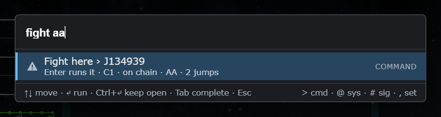
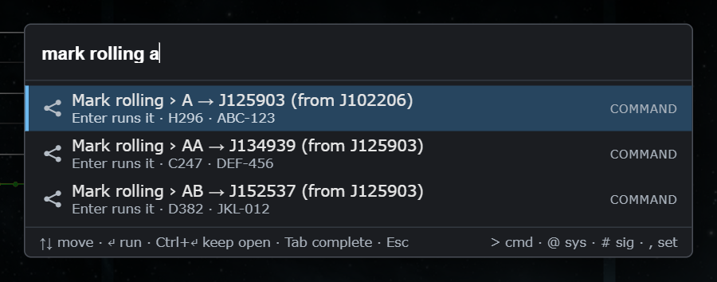
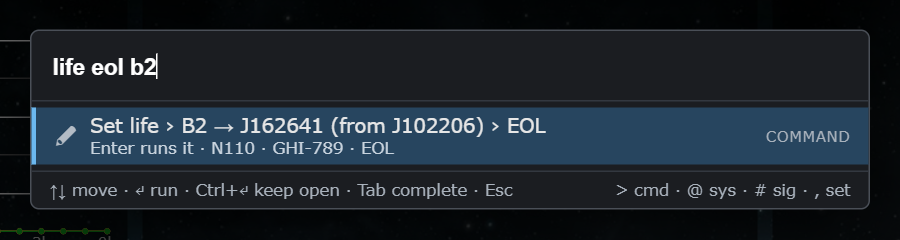
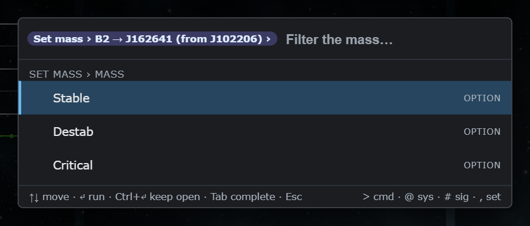

# Command palette: commands with arguments

**Date:** 2026-10-12

## Description

The palette (Ctrl+K) now runs the fork features' commands, with arguments typed on one line or asked for step by step.
Hole names work as arguments: "fight AA" fights at the system behind hole AA, "mark rolling A" marks hole A,
"preserve mass AB", "life eol B2", "mass crit B2". J-codes, system names and class/static keys work too; an ambiguous
word lists the candidates to pick from. Phase 3 of `reports/Command palette and inline edits spec.md`.

## Before / After

Typing "fight aa" resolves to the system behind hole AA (the viewed chain has J102206 -[A]-> J125903 -[AA]-> J134939):

"mark rolling a" lists hole A first, then the other holes that start with A (pick list):

"life eol b2" is one line; "Set mass" alone asks for the hole, then the value (Backspace on an empty box goes back a step):

## Settings

No new toggle: the commands are part of the palette, which already has one (Settings > General > Command palette). A
command whose feature is switched off in Settings is greyed with that reason. The panel commands flip the same
`options.<key>.enabled` as the feature's own Settings row.

## Change

- New: `app/js/fork/command-args.js` (`paletteArgs`, pure and tested: hole candidates, ranking, one-line parsing in any
  argument order, breadcrumb), `command-args.test.js`, `command-registrations.test.js`.
- Registry: `forkCommands.register` accepts `args` (`chainSystem`, `system`, `hole`, `signature`, `choice`, `text`;
  `optional`, `default`, `choices`, `filter`) and `hint`; new `forkCommands.panelToggle` (flips `options[key].enabled`,
  saves, runs `options.apply()`, as Settings > Save does).
- Palette: breadcrumb chip ("Set mass › B2 → J2 (from J1) ›"), step lists with the default first and "Skip" for optional
  arguments (an optional argument with no candidates is skipped), Backspace on an empty box takes back the last
  argument, Esc closes; one-line results above the normal ones ("Fight here › J134939", up to 5 alternatives for an
  ambiguous system/hole). `ctx.holes()` lists the chain's wormholes (wormhole id from the node markup, name from the
  hole's sig name). A hole name key was added to chain-system matching ("AA" finds the system behind AA).
- Commands, each registered from its own feature file (small `registerCommands` / block per file):
  Fight here ‹system› [comp] and Clear fight (asks first; same as the banner's clear) in `rally.js`; Mark rolling
  ‹hole› (opens the note dialog) and Stop rolling ‹hole› (asks first; same as the menu's "Stop rolling") in `rolling.js`;
  Preserve mass ‹hole› and Stop preserving mass ‹hole› (asks first) in `preserve-mass.js`; Set life ‹hole› ‹Stable|EOL› and
  Set mass ‹hole› ‹Stable|Destab|Critical› in `sig-inline.js` (call `sigInline.setWormhole`, so Ctrl+Z undo works, tested);
  Jump planner from ‹exit› in `jump-planner.js`; Open Skyhooks ‹exit› in `skyhooks-panel.js`; Open Destinations and
  Add destination ‹system› in `route-destinations.js`; Add favourite ‹system› in `favourites-panel.js`; Paste d-scan
  ‹system› in `intel-scans.js`; Show structures ‹system› and Show structure timers in `structure-timers.js`; Mute or unmute
  sounds in `sound-mute.js`; "Toggle ... panel" for Favourites, Chain kills, System kills, d-scan & local, Watchlist,
  Skyhooks, Structures and Jump planner. Nothing deletes: the only "stop" commands equal the existing Stop rolling /
  Stop preserving mass / Clear fight entries and each asks for confirmation.
- Review fixes: every hole row reads "AA → J222222 (from J111111)" so equally named holes on different parents are
  distinguishable; when the top two one-line candidates tie (two holes named AA), nothing is pre-selected and Enter does nothing
  until a row is picked (arrow keys); the panel toggles are disabled with "Close Settings first" while the Settings dialog is open.
- Set life / Set mass stay available from the palette even when "Edit life and mass in place" is switched off: the palette is
  a separate entry point to the same `sigInline.setWormhole` save path (undo included).
- Upstream files: none. Fork files edited, one small block each: the 11 feature files above plus `chain-killfeed.js`,
  `system-killfeed.js`, `watchlist.js` (panel toggle only), 14 in all.
- Deviations: "Set route in game" (autopilot picker) is not built; the Watchlist has only the panel toggle; "Jump planner from"
  only offers low/null-sec exits (the same set as the ring icons). When a one-line query is ambiguous the alternatives
  are separate result rows (nothing runs until Enter).
- Tests: `command-args.test.js` (hole names A / AA / AB / B2, J-codes, system names, ambiguity, any argument order, defaults,
  incomplete lines), `command-registrations.test.js` (every registration, confirmations, no delete commands, `setWormhole`
  payloads, `panelToggle`, argument validation). Browser-checked on the dev stack: "fight aa", "mark rolling a", "preserve mass
  ab", "life eol b2", the "Set mass" steps, Backspace stepping back, Ctrl+Z after a palette mass change, every panel toggle,
  Destinations, d-scan dialog, structures, favourites.
- Performance (Chrome, dev stack, 42 commands + 123 index items): worst keystroke 3.4 ms (first scoring of 8.5k EVE systems), typical 0.1 to 0.4 ms.
