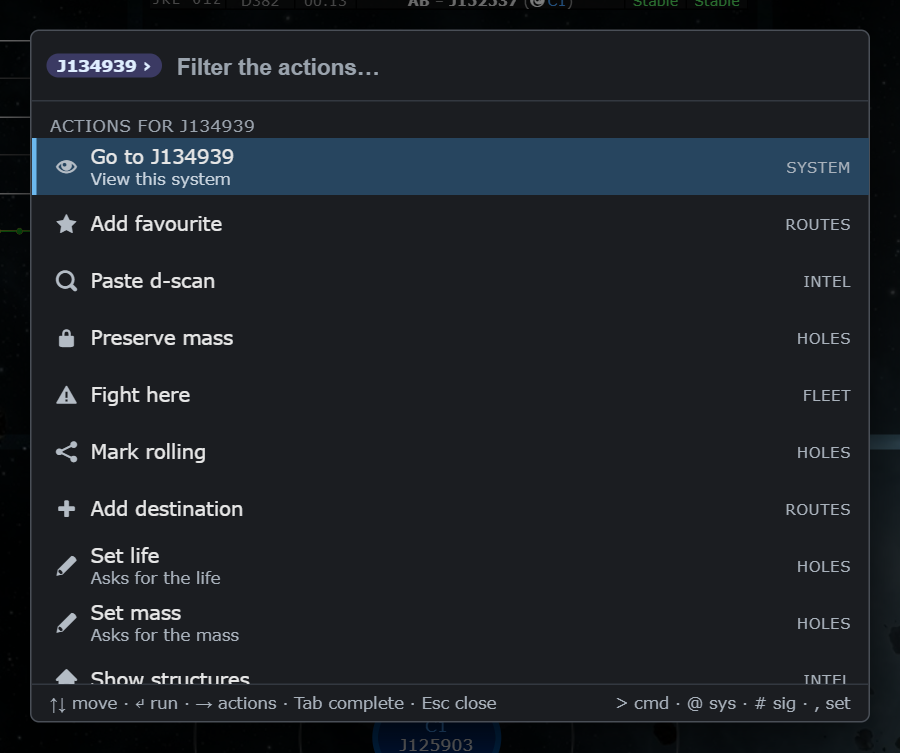
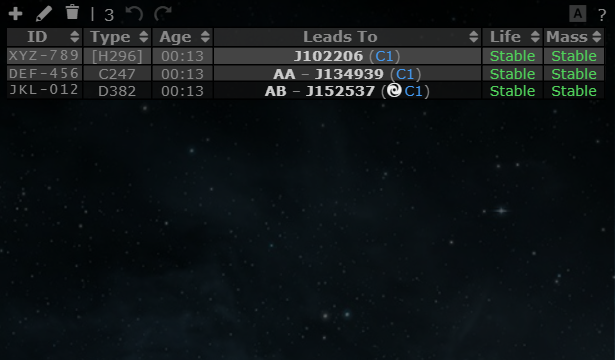

# Command palette: actions, keyboard walk through signatures, accessibility

**Date:** 2026-10-12

## Description

Phase 4 of `reports/Command palette and inline edits spec.md`. In the palette, the right arrow on a system or signature
result opens its actions ("noun, then verb"): go to it, fight there, mark the hole into it rolling, set its life, and so on.
In the signature table, with one row selected, the up and down arrows move the selection and Enter opens the edit dialog.
The palette got a screen-reader and contrast pass, a timing report, and a "Clear palette history" command.

## Before / After

New behaviour, so there is no before. The right arrow on J134939 lists what can be done with it (each action that needs
more input asks only for that, e.g. "Set life" asks for Stable or EOL because the hole is already known):

Signature table: click a row, then the arrows move the selection (the second row is selected here after one press of the down arrow):

## Settings

No new toggle. The palette actions belong to the palette (Settings > General > Command palette); the row navigation belongs
to the existing Settings > Signatures > "Edit life and mass in place" (`options.sigInline.enabled`), whose label now mentions
the arrows and Enter. Both are on by default.

## Change

- **Action lists.** `ArrowRight` at the end of the text, with a chain system, other EVE system or signature selected,
  opens `Actions for <noun>` (a chip shows the noun; ← at the start of the box or Backspace on an empty box goes back to the
  results with the text you had). Built in: Go to ‹system›, Select ‹sig›, Edit ‹sig›. Then every registered command whose
  first argument fits the noun: `chainSystem` (on the chain), `system` (any), `signature`, and `hole` (for a chain system the
  hole leading into it, for a signature its wormhole). A command that needs more continues with the argument steps with the
  noun already filled in; a disabled one stays greyed with its reason; typing filters the list. Actions are not recorded as
  recents. Pure helper `paletteArgs.finish`; `commandPalette.actionsFor / nounCandidate / openActions / leaveActions`.
- **Scope prefix alone** (`#`, `@`, `,`) now lists everything in that scope instead of "No match".
- **Signature table keys** (`sig-inline.js`): with exactly one row selected, no modifier, focus not in a text box, no dialog,
  no popover: Up/Down move the selection (stops at the first/last row; the page does not scroll), Enter presses the Edit
  button (`#edit-signature`; not when a button or link has the focus). Nothing happens with no or several rows selected.
- **Clear palette history**: removes `localStorage["tw-palette-frecency"]` (recents and ranking boost); disabled with
  "No palette history yet" when there is nothing; the hint shows how many items are remembered. It only touches this
  browser's palette history.
- **Timing**: `commandPalette.perfReport()` gives n / median / p95 / max ms per keystroke and the last open time
  (`commandPalette.state.perf`). Hot path: argument commands are listed once per open, candidates of a type are prepared
  once per open and shared by all commands, the action list is built only when opened.
- **Accessibility**: each option has an `aria-label` (title, kind, detail, shortcut, "unavailable: reason"); the search box's
  name follows the mode ("Fight here: choose the system", "Actions for J134939", "Search signatures") since the chip is
  visual only; `aria-expanded` follows whether there are results; the live region announces the mode and the count
  ("Actions for J134939. 9 actions", "Set mass: choose the hole. 4 results") after 300 ms; the dialog is described by the key
  hints; greyed (disabled) rows are 80 % opacity and italic instead of 55 % (contrast was 3.2 to 3.6, now 4.9 and up); every
  text/background pair in the stylesheet is at least 4.5:1 (checked: title 13.5, selected title 8.0, subtitle 7.9 / 6.6,
  tag on selected 4.65, group header 6.6, chips 8.5 / 9.0, disabled 4.9 to 9.1). Focus stays in the box, Esc restores it.
  Checked with Chrome's accessibility tree (dialog > combobox, listbox > options with names and `selected`).
- Footer now reads "↑↓ move · ↵ run · → actions · Tab complete · Esc close" (Ctrl+Enter still keeps the palette open).
- Files: `app/js/fork/command-palette.js`, `command-args.js`, `sig-inline.js` (keys; label), `app/css/fork/command-palette.css`;
  new test file `command-palette-actions.test.js`, additions to `sig-inline.test.js` and `command-args.test.js`.
  **No upstream files touched.**
- Deviations from the spec: Tab still completes the title (the spec also lists Tab for actions; the right arrow does it);
  no screen reader (NVDA/VoiceOver) was available, so the check is the browser accessibility tree plus the labels above.
- **Timing** (Chrome, dev stack, 303 commands + 82 chain/sig items, 150 queries typed character by character, 5 opens): median 0.3 ms,
  p95 0.8 ms, worst 1.2 ms per keystroke; open 1.8 ms cold, 1.1 ms warm. Mocha at spec scale (200 chain systems, 190 holes,
  300 commands of which 60 take arguments, each recomputed per keystroke): one-line parsing median 0.2 ms, worst 1.3 ms;
  building a system's action list median 0.4 ms, worst 0.6 ms. The budget is 16 ms.
