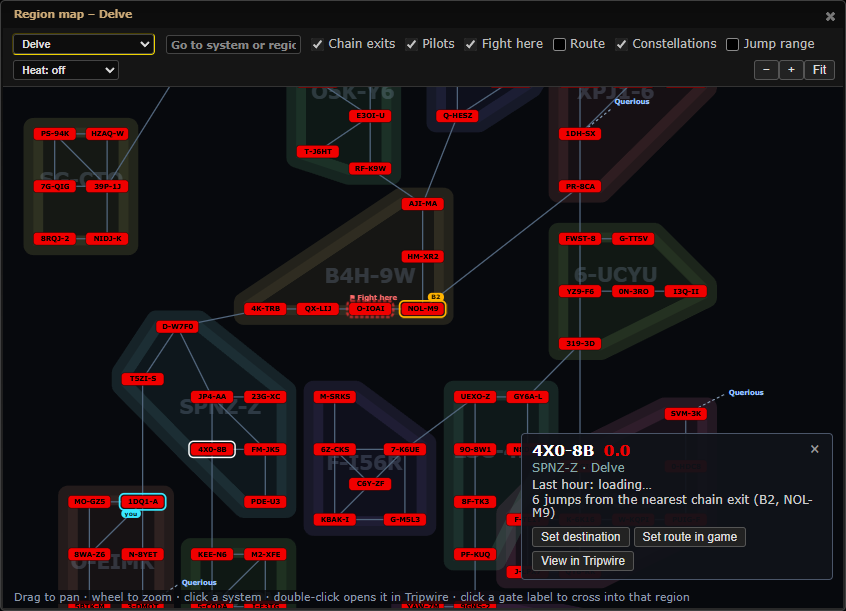
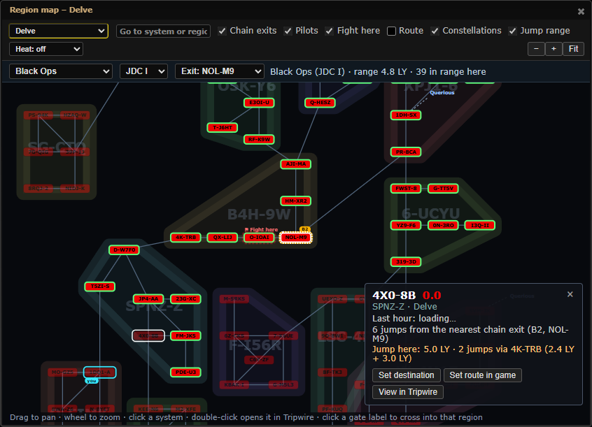

# Region map: jump range overlay

**Date:** 2026-10-12

## Description

The region map gets a "Jump range" overlay for jump ships, mainly Black Ops bridging: from an origin (the selected
system, you, or one of the chain's exits) every system of the region a jump drive can reach in one jump is ringed
green and the rest is dimmed, with the distance in light-years on hover and in the system card.

## Before / After

| Before | After |
| --- | --- |
|  |  |

Before: Delve on the region map. After: "Jump range" on, Black Ops with JDC I from the exit NOL-M9 (4.8 LY): systems in
range ringed green, out of range dimmed, and the card of 4X0-8B reading "5.0 LY, 2 jumps via 4K-TRB (2.4 LY + 3.0 LY)".

## Settings

Toggle: the overlay is a header checkbox on the map ("Jump range", off whenever the map is opened, so the map looks as
before); the existing Settings > Routes & Navigation > "Region map" switch still turns the whole map off. New row:
Settings > Routes & Navigation > "Region map jump ship" (Black Ops by default), stored with the JDC level and the origin
choice in `options.regionMap.jump` (the key `regionMap` is already on the mask-defaults allow-list, so no allow-list
change was needed; the parity test passes).

## Change

- Header: Jump range checkbox; a second row with ship (Black Ops, Jump Freighter, Rorqual, Carrier, Command Carrier,
  Dreadnought, Lancer, Force Auxiliary, Supercarrier, Titan), JDC level (V by default), origin (Selected / You / each
  chain exit) and a summary ("Black Ops (JDC V), range 8.0 LY, 86 in range here"; "from <origin> (<region>)" when the
  origin is in another region: distances are galactic, so the overlay works across regions).
- Systems: in range = a valid cyno target within range (green ring), out of range dimmed, no-cyno systems (high-sec,
  Pochven, wormhole space) dimmed more. Tooltip: "4.3 LY, in range for Black Ops (JDC V)". Card: "Jump here: ...", and for
  a system out of one jump "2 jumps via X (3.2 LY + 2.9 LY)" from the engine's two-jump search, or "out of range (max
  8.0 LY), not even in 2 jumps".
- Ctrl+K: "Region map jumps <system> [ship]" opens the map on the system with the overlay on.
- Reuse, read only: the Jump planner's engine `jumpRange` (`decode`, `buildIndex`, `maxRange`, `presets`, `preset`,
  `kind`, `canJumpFrom`, `isValidCynoTarget`, `distanceLy`, `reach`) and its data `public/jumprange/systems.json` and
  `ships.json` (same URLs and cache keys, fetched on first use of the overlay; nothing in those files changed). The rules
  (no cyno in high-sec, Pochven, Zarzakh or wormhole space; covert cynos for Black Ops; range = base x (1 + 0.2 x JDC))
  come from the engine. Cyno-jammed systems are not tracked here (the planner's live jammer/incursion data is not
  loaded), so an in-range system may be jammed for a normal cyno; Black Ops use covert cynos, which work there.
- Duplicated on purpose: the overlay decodes `systems.json` and builds its own spatial index (the planner's copy is private
  to `jump-planner.js`, which this change must not touch); the files come from the browser cache when the planner was used.
- Only the selected system's card asks the engine for a two-jump route (cached per origin, ship, JDC level and target);
  tooltips just say "out of range".
- An origin where no jump drive works (wormhole space, Zarzakh) is reported in the overlay's header and by the Ctrl+K
  command ("J123456 is wormhole space: no jump drive from there"); high-sec is a valid origin (only targets can't be
  high-sec).
- The Ctrl+K command applies its origin for this session only; the ship is remembered only if it was typed.
- No Setting turns the overlay itself on or off: it is opt-in per session (the header checkbox, or the command), so the
  map looks as before until someone asks for it. The "Region map jump ship" row only picks the starting ship.
- Files: new `app/js/fork/region-map-jumps.js` (pure logic), `app/js-test/fork/region-map-jumps.test.js`; edited
  `app/js/fork/region-map.js` (keeps the `jump` settings), `app/js/fork/region-map-view.js`, `app/css/fork/region-map.css`.
  No upstream file and none of the Jump planner's files.
