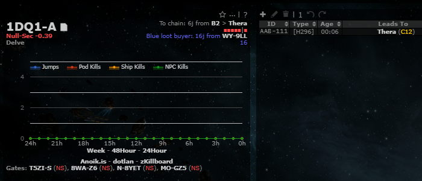
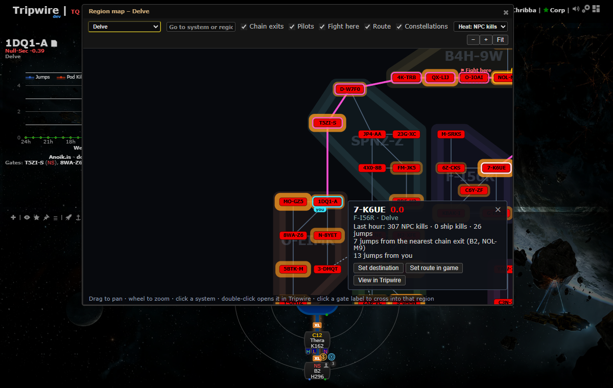

# Region map

**Date:** 2026-10-12

## Description

A Dotlan-style schematic of one k-space region (Tripwire issue #241, "null-sec map with tracking"): systems as boxes
coloured by security, gates, constellations, and gates into the neighbouring regions as clickable stubs. On top of it:
your chain's k-space exits (with the hole name, e.g. "B2"), your pilots, the Fight here system, the route to the
system you pick, and last-hour NPC kills / ship kills / jumps as heat.

## Before / After

| Before | After |
| --- | --- |
|  |  |

Before: the system panel of a k-space system has no region map. After: the map (Delve) with chain exits (amber,
"B2"), "you" (cyan), a pilot badge, Fight here (red), NPC-kill heat (orange) and the route (pink) to the picked system.

## Settings

Toggle: Settings > Routes & Navigation > "Region map" (on by default) and "Region map heat" (which heat the map opens
with, off by default). The map's header toggles (chain exits, pilots, fight here, route, constellations) and the heat
choice are saved per user in `options.regionMap` (a missing key means everything on, no heat). Routes & Navigation is
the section because the map is for getting somewhere: orientation, routes, destinations. `regionMap` is on the
mask-defaults allow-list (`app/js/fork/mask-defaults.js`, `maskadmin/maskadmin.inc.php`).

## Change

- Opening it: right-click a k-space system on the chain map > "Region map"; "Region map" link next to dotlan in the
  system panel of a k-space system; Ctrl+K > "Region map" (one line, e.g. "region map delve" or "region map 1dq":
  regions and k-space systems are the choices; the viewed system is the default). Opening on a system centres on it
  and selects it; a region opens fitted. The map's header also has a region list and a "go to" box.
- Layout data: `public/region-map/<regionID>.json` (70 regions, 5485 systems, about 390 KB in all) plus
  `index.json`, generated from CCP's SDE by `tools/fork/build-region-maps.mjs`. The SDE gives every system a
  `position2D` (the layout of the in-game universe map, uniform spacing); it is used as is (y flipped, 0.01 ly
  units). Nothing is scraped and nothing is called at run time. Regenerate with
  `node tools/fork/build-region-maps.mjs <dir with mapSolarSystems, mapRegions, mapConstellations, mapStargates .jsonl> <sdeBuild> <date> public/region-map`
  (this commit: SDE build 3586130, 2026-10-07).
- Overlays are drawn from data Tripwire already has: `chain.data.exits` / `systemsInChainMap` (exits and hole names),
  `chain.data.occupied` (pilots; the active character as "you"), `rally.state` (Fight here), the chain map's own
  `chain.data.activity` (last-hour jumps/kills from the public ESI calls the chain map already makes; if it has none,
  the same two calls `tripwire.esi.universeJumps/universeKills`, at most once an hour). No new third-party host.
  Routes use `guidance.findShortestPath` on `tripwire.map.shortest`, so the route preference and avoid list from
  Settings apply: from where you are (k-space), else from the nearest chain exit; the card also shows the jumps from
  the nearest exit.
- Selected system: "Set destination" (ESI waypoint, clears the others, like the chain map's menu), "Set route in game"
  (the existing `autopilotRoute.push` with the character picker) and "View in Tripwire" (also double-click).
- Not included: a sovereignty ticker. Tripwire has no sovereignty data cached (only an ETag allowance for
  `sovereignty/*` routes in `esi/esi.inc.php`), so it is left out rather than adding a new ESI feed.
- Files: new `app/js/fork/region-map.js` (pure logic), `app/js/fork/region-map-view.js` (panel),
  `app/css/fork/region-map.css`, `public/region-map/*`, `tools/fork/build-region-maps.mjs`, mocha tests
  `app/js-test/fork/region-map.test.js` and `region-map-generator.test.js`. Edited fork files (no upstream file):
  `app/js/fork/mask-defaults.js` and `maskadmin/maskadmin.inc.php` (one word each in the allow-list).
