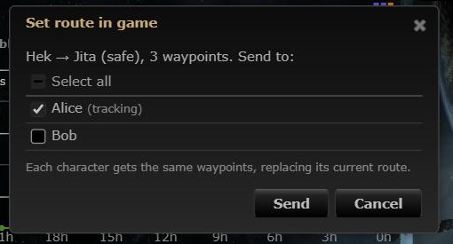
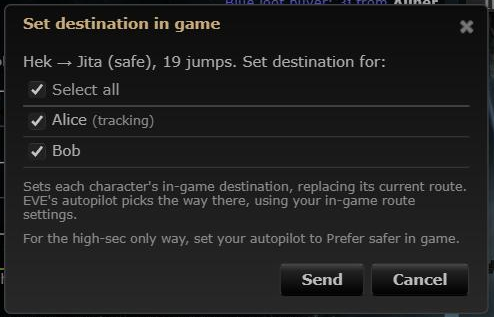

# Set route in game: set the destination only

**Date:** 2026-10-12

## Description

"Set route in game" used to send a whole route to EVE as autopilot waypoints, one ESI call per waypoint and
character. That was fragile and pointless: players already use EVE's own autopilot and waypoints. It now just sets
the end of the route's gate leg as each picked character's in-game destination (one ESI call per character) and
lets EVE's autopilot, with the player's in-game route settings, pick the way.

## Before / After

| Before | After |
| --- | --- |
|  |  |

After sending: 

## Settings

No toggle, because it is still a button the user clicks (nothing new is drawn or happens on its own); this is a
fix/simplification of an existing action.

## Change

- `app/js/fork/autopilot-route.js`: every entry point (`autopilotRoute.push`: Favourites panel, Destinations window,
  Thera/Turnur legs, skyhooks, loot buyers, region map, jump planner) sends one
  `tripwire.esi.setDestination(dest, character, clear=true)` per selected character, where `dest` is the last system
  of the route's k-space leg (still never wormhole space; "Nothing to set" when there are no gate jumps). Character
  picker, remembered selection, busy guard, per-character errors and the green/yellow/red summary stay; wording is
  now about the destination ("Hek → Jita (safe), 19 jumps. Set destination for:", "Destination set in game: Jita
  for Alice and Bob (19 jumps from Hek)"). Dialog title and tooltips say "Set destination in game"; the safe-route
  tooltip and the picker (for a safe route) say to set "Prefer safer" in game. The jump planner's target
  leaves out the jump count (a jump drive jump says nothing about EVE's gate route there); the region map card's
  second button is now "Set destination for..." (picks characters).
- Removed the waypoint machinery: `MAX_WAYPOINTS`, `reach`, `waypoints`, `limit`, `sendAll`, `partialText`,
  `characterProgressText` and the per-waypoint progress toast. New pure helper `destination(path, systems)`.
- Tooltips reworded in `thera-route.js` (`legTitle`), `skyhooks-panel.js`, `loot-buyers.js` and `region-map-view.js`
  ("as your in-game destination"); the ESI 401/403 text no longer mentions waypoints.
- `app/js/fork/jump-planner.js`: passes `{noJumps: true}` to `autopilotRoute.push`.
- Tests: `app/js-test/fork/autopilot-route.test.js` (waypoint tests replaced by destination / one-call-per-character
  / summary tests), `app/js-test/fork/thera-route.test.js` (leg titles).
- Upstream "Add Waypoint" menu items and the command palette's "Add waypoint" are unchanged.
- Upstream files touched: none.
