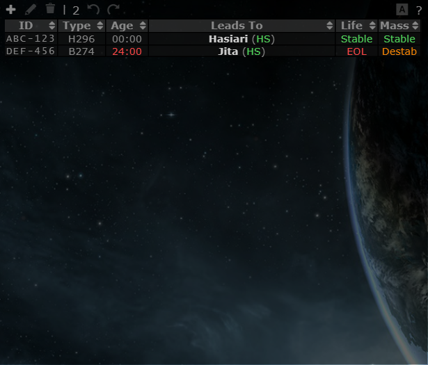
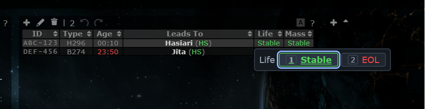
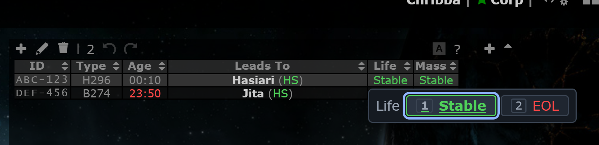
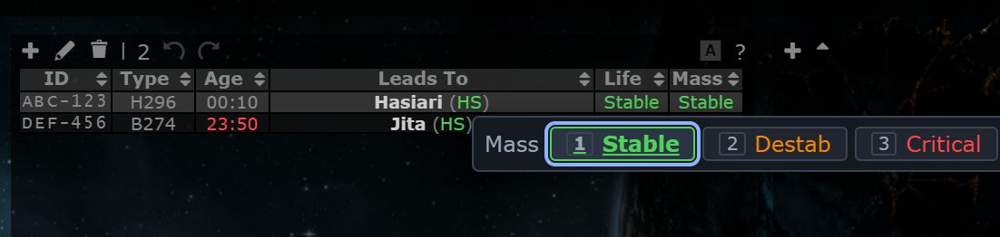

# Inline life and mass edits

**Date:** 2026-10-12

## Description

Click the Life or Mass cell of a wormhole in the signature table (or select one row and press L / M) to pick a new
value from a small pop-over, instead of opening the edit dialog. Double-click still opens the dialog. Ctrl+Z undoes an
inline change, like any other signature edit.

## Before / After

| Before | After |
| --- | --- |
|  |  |

Close-ups: Life pop-over (Stable / EOL) and Mass pop-over (Stable / Destab / Critical).

| Life | Mass |
| --- | --- |
|  |  |

## Settings

Toggle: Settings > Signatures > "Edit life and mass in place" (on by default, `options.sigInline.enabled`, a missing
key means on). Off means clicks on the cells and the L / M keys do nothing.

## Change

- New `app/js/fork/sig-inline.js` and `app/css/fork/sig-inline.css`; tests in `app/js-test/fork/sig-inline.test.js`.
  No upstream files are edited and there are no server changes.
- Click (no modifier) on column 5 (Life) or 6 (Mass) opens the pop-over under the cell; the row is still selected as
  before. Keys: `1`-`2` (Life) or `1`-`3` (Mass) pick, arrows move, Enter picks the focused chip, Esc or a click outside
  closes. L / M open it for the single selected row (not while typing in a field or with a dialog open).
- Life offers only Stable and EOL (EOL is one normal update; no "EOL ends in..." times). Hole type and Leads To
  are not editable inline.
- Only the changed field is sent (`{wormhole: {id, life|mass}, signatures: [{id}, {id}]}`), so a colleague's edit of
  another field is not overwritten. The cell changes at once and is restored with a red notice if the save fails.
- Undo: before sending, copies of the wormhole and both signatures are kept; on success the same
  `{action: "update"}` entry the dialog pushes goes on `tripwire.signatures.undo[viewingSystemID]` and into
  `sessionStorage`, and `#undo` is enabled. Ctrl+Z / Ctrl+Y therefore work, also after the 10 s refresh.
- While the pop-over is open `tripwire.activity.editSig` is set (others see the "editing" highlight). If the
  10 s refresh re-renders the row the pop-over follows the new cell; if somebody changed the value meanwhile it
  updates and says "Changed by <name>"; if the row is gone it closes.
- `sigInline.setWormhole(wormholeID, {life: ...} | {mass: ...})` is the save path and returns a Promise
  (`"saved"`, `"same"` or `"failed"`); the command palette will reuse it.
