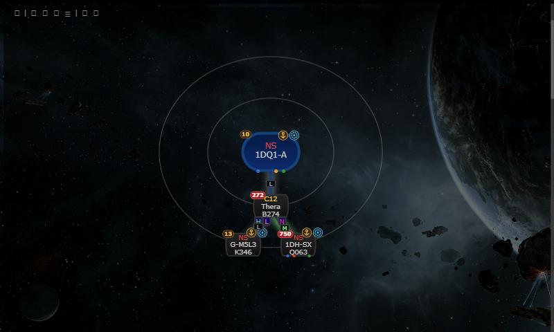
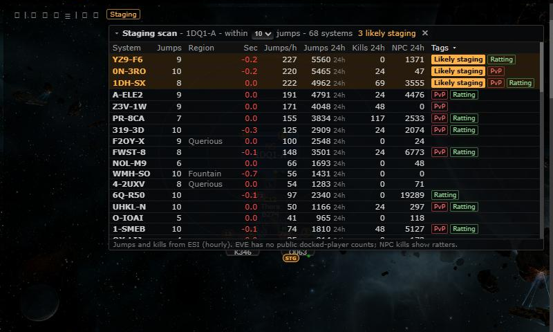
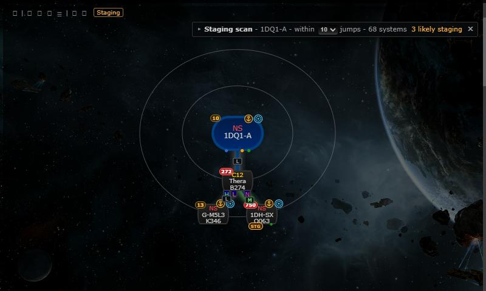

# Staging scan

**Date:** 2026-10-12

## Description

When you view a null-sec system (for example by clicking it on the chain map), a panel over the chain map lists the
systems within 5 / 10 / 15 gate jumps with their jumps, kills and NPC kills (last hour and last 24 hours) and flags the
likely staging systems; those also get an STG badge on the chain map. EVE has no public docked-player counts, so traffic
(ship jumps) and NPC kills (ratters undocked) stand in, and the panel says so.

## Before / After

| Before | After |
| --- | --- |
|  |  |

Collapsed panel with the STG badge on 1DH-SX, a likely staging system 8 jumps from 1DQ1-A:

The screenshots use the dev database: the current hour is real ESI data (`php system_activity.cron.php`), the 23 hours
before it were back-filled by copying that hour with random +-30% noise (dev only, not committed).

## Settings

Toggle: the "Staging" button in the chain map header, and Settings > Map Markers > Staging scan (same key,
`options.stagingScan.enabled`, on by default). The panel's radius and collapsed state are kept in `options.stagingScan`;
`stagingScan` is added to the mask defaults allow-list.

## Change

- `app/js/fork/staging-scan.js`, `app/css/fork/staging-scan.css`: gate BFS, scoring and tags (pure, tested in
  `app/js-test/fork/staging-scan.test.js`), the panel, the header button and the chain node badge. Hooks
  `tripwire.systemChange`, `chain.nodes` and `chain.activity` by wrapping them.
- `public/staging_activity.php` (new): 24 h sums per system from upstream's `system_activity` table (no new external
  calls, file cache per hour). Thresholds and the endpoint are documented in docker/README.md#staging-scan.
- `app/js/fork/mask-defaults.js`, `maskadmin/maskadmin.inc.php`: `stagingScan` in the mask defaults allow-list.
- No upstream files touched.
