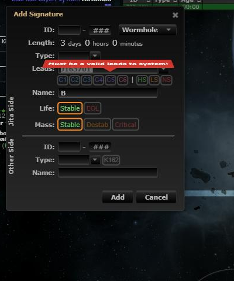
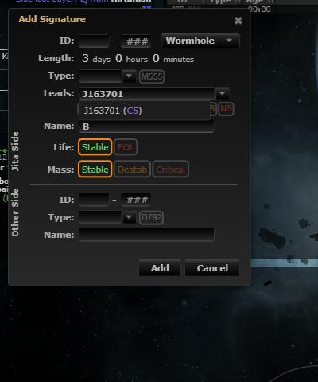

# Trim spaces from Leads To

**Date:** 2026-10-12

## Description

A system name copied from the game ("J163701 ") ends in a space, so pasting it into the signature dialog's
Leads field failed with "Must be a valid leads to system!". The field now drops leading/trailing spaces.

## Before / After

| Before | After |
| --- | --- |
|  |  |

## Settings

No toggle, because it's a bug fix: a name with surrounding spaces is never valid.

## Change

New `app/js/fork/leads-trim.js` trims the Leads field right after a paste (so the autocomplete matches the
system) and on change. Upstream `app/js/dialogs/signature-dialog.js` gets one line in the submit handler that
trims it again on Save (jQuery's `.submit()` fires no native submit event, so a fork listener can't catch it).
Tests: `app/js-test/fork/leads-trim.test.js`.
