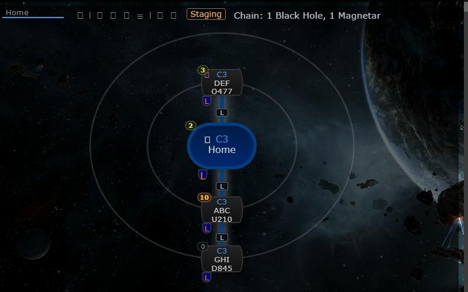
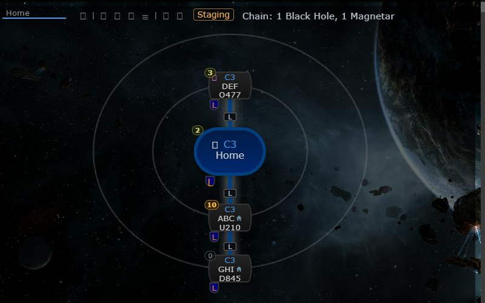

# Home region marker

**Date:** 2026-10-13

## Description

A small house mark next to the name of every chain map system in the same wormhole region as home (the system
the active chain tab starts from), so you can see at a glance which holes stay in your home region. Hovering it
says "Same region as home (region name)".

## Before / After

| Before | After |
| --- | --- |
|  |  |

## Settings

Toggle: Settings > Map Markers > Home region (on by default), stored as `options.homeRegion.enabled`. Also added
to the mask defaults allow-list so Mask Admin can set it for a mask.

## Change

- New `app/js/fork/home-region.js` wraps `chain.nodes` and adds the mark to the name line (`h4.nodeSystem`) of
  each node whose system shares home's `regionID`. Home is `options.chain.tabs[options.chain.active].systemID`
  and must be a single J-space system; no active tab, an all-systems tab or a multi-system tab shows nothing.
  Home itself, other regions, k-space and unidentified systems get no mark. Works on all four renderers, and
  updates on every redraw (tab change, Settings Save/Reset).
- The mark sits on the name line because the node's corners, edges and the class/type lines are already used by
  other markers and icons; it is inline and a few pixels wide, and the node height does not change.
- New `app/css/fork/home-region.css`, tests in `app/js-test/fork/home-region.test.js`.
- Fork files touched: `app/js/fork/mask-defaults.js` and `maskadmin/maskadmin.inc.php` (`homeRegion` added to
  the allow-list). No upstream files changed.
