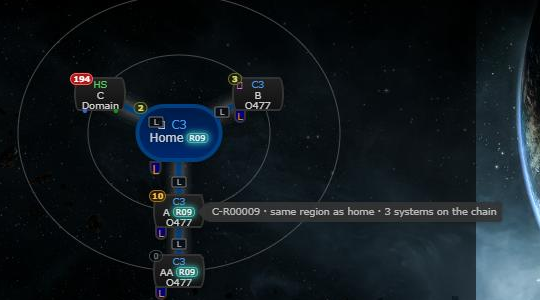
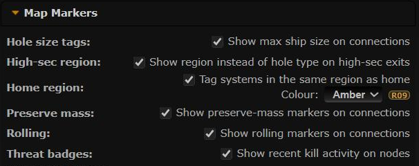

# Home region marker

**Date:** 2026-10-13

## Description

Home (the system the active chain tab starts from) and every chain map system in the same wormhole region get a
small region tag after their name, e.g. "R09" for C-R00009, so the matching tags show the group. Hovering a tag
shows the region and highlights every tag in the group. The colour is a per-user setting that mask admins can make
the mask default.

## Before / After

| Before | After |
| --- | --- |
|  |  |

Hover (tooltip and group highlight): 

## Settings

Toggle: Settings > Map Markers > Home region (on by default), with a colour choice (Teal default, Blue, Violet, Pink,
Amber, Green), stored as `options.homeRegion = { enabled, color }`.

Mask admins: set the colour in your own Settings, then Mask Admin > Admins & members > Mask default settings, tick
"Home region" and "Save current settings as mask defaults". Members who haven't chosen their own get it.

## Change

- New `app/js/fork/home-region.js` wraps `chain.nodes` and adds the tag to the name line (`h4.nodeSystem`) of home
  and of each node whose system shares home's `regionID`. Home is `options.chain.tabs[options.chain.active].systemID`
  and must be a single J-space system; no active tab, an all-systems tab or a multi-system tab shows nothing.
  Other regions, k-space and unidentified systems get no tag. Works on all four renderers and updates on every
  redraw (tab change, Settings Save/Reset).
- The region code comes from the region name (`-R0*(\d+)$`), else from the region id. The colour is only ever used
  as a palette key checked against the palette; a stored value never reaches the markup.
- Hover uses Tripwire's own jBox tooltips (`Tooltips`, `data-tooltip`, detached and re-attached after each draw):
  "C-R00009 · home's region / same region as home · N systems on the chain". While the pointer is on a tag,
  `#chainMap.home-region-hover` lights up every tag (colours and shadow only, no layout change).
- The tag sits on the name line because the node's corners, edges and the class/type lines are already used by
  other markers and icons. It is shorter than the line, so node heights don't change.
- New `app/css/fork/home-region.css`, tests in `app/js-test/fork/home-region.test.js`.
- Fix in `app/js/fork/mask-defaults.js`: `install()` marked `options` with an own `maskDefaultsWrapped` field,
  which `options.get()` saved, so after the first save the flag was loaded back on page load, `install()` skipped
  and no mask default was ever applied. The flag now lives on `maskDefaults` (non-enumerable on `options`) and
  `get()` drops stored copies. Regression test in `mask-defaults.test.js`.
- Fork files touched: `app/js/fork/mask-defaults.js` and `maskadmin/maskadmin.inc.php` (`homeRegion` added to the
  allow-list). No upstream files changed.
