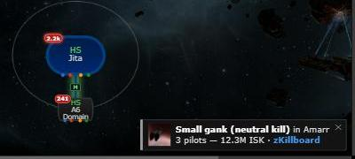
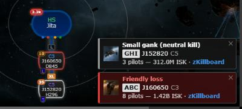

# Kill notifications: which system in the chain

**Date:** 2026-10-13

## Description

Kill Reporting pop-ups only said "in J123456", vanished after 12 seconds even while you were in the game,
and nothing pointed at the system on the map. Now each pop-up names the system the way the chain map does,
waits for you to come back, and finds the system on the map; a desktop notification covers the time
Tripwire is in the background.

## Before / After

| Before | After |
| --- | --- |
|  |  |

## Settings

- Settings > Kill Reporting > Desktop alerts (on by default; the browser asks for permission on Save, or from a
  link on the first pop-up).
- Settings > Map Markers > Kill markers (on by default).
- The pop-up text, click-to-find and the hidden-tab timer have no toggle: they fix the existing pop-ups.

## Change

- Pop-up: hole label (as on the chain map) + system name + class on its own line; click it to scroll to the
  node and flash it; it counts down only while the page is visible and not hovered (20 s).
- Chain map: a node gets a pulsing ring (colour by kill type) for 10 minutes after a reported kill.
- Desktop notification (browser Notification API) when the tab is hidden; clicking it focuses Tripwire and the node.
- Fork-owned files only: `app/js/fork/kill-reporting.js`, `app/css/fork/kill-reporting.css`, tests.
