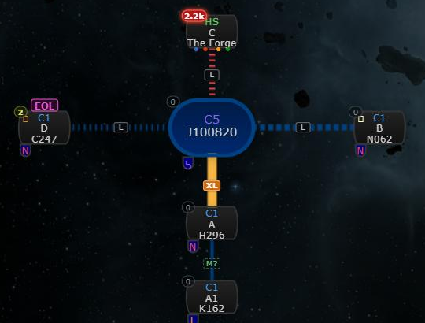
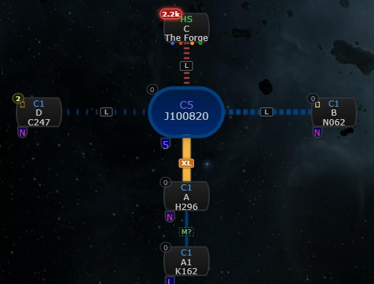

# Life states: no EOL text on the chain map

**Date:** 2026-10-13

## Description

The magenta "EOL" tag that #104 put above systems behind an EOL hole was too loud on a busy chain. The map now shows
the life state through the connection line only, like upstream's EOL line: <4h dashed, <1h dotted, EOL sparse dots.

## Before / After

| Before | After |
| --- | --- |
|  |  |

## Settings

No new toggle: part of Settings > Signatures > "Wormhole life states" (off = upstream's dashed EOL line).

## Change

- `app/js/fork/life-states.js`: the node tag (`tagNode`, `life-tagged`, `life-map-tag`) is gone; the map legend's EOL
  row has no tag either.
- `app/css/fork/life-states.css`: EOL lines (`life-map-eol`) use `border-style: double`; the tag styles are removed.
- Upstream `app/js/chain-map-renderer-base.js` (the line #104 already touched): the canvas dash table also maps
  `double` to sparse dots (`[1.5, 9]`).
