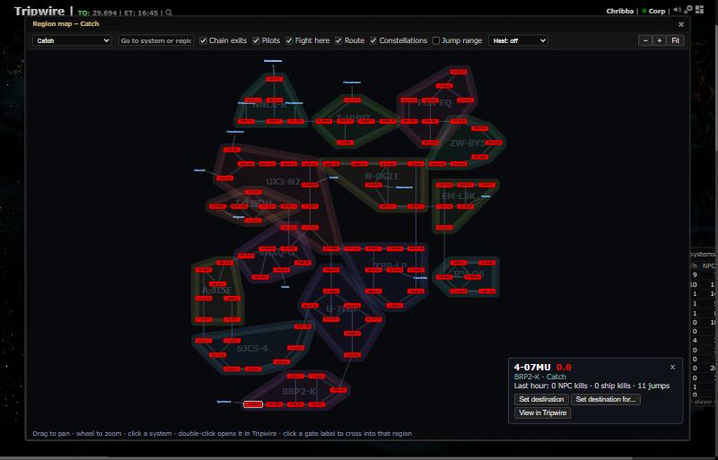
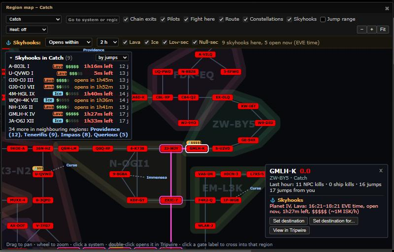
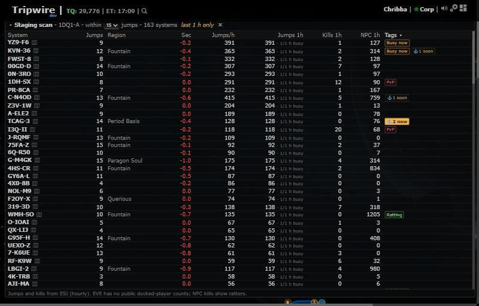

# Region map: skyhooks (floating box retired)

**Date:** 2026-10-13

## Description

Raidable skyhooks move onto the region map (the "null-sec map"): a Skyhooks overlay marks every system with a raidable
skyhook (bright when vulnerable now, dim when its window opens later, value as $ to $$$$$), the system card lists them,
and a side list shows the region's skyhooks sorted by jumps, window or value. The floating "Raidable skyhooks" box is
retired; the chain map's skyhook icon now opens the region map on that system with Skyhooks on. The staging scan tags
systems with "⚓2 now" / "⚓1 soon".

## Before / After

| Before | After |
| --- | --- |
|  |  |

Before: Catch on the region map, no skyhook information (they were only in the separate floating box). After: Skyhooks
overlay on: gold pills on systems with a raidable skyhook (count and value), the filters row under the header, the
"Skyhooks in Catch" list (jumps from you) with links to the neighbouring regions, and the card of GMLH-K with its skyhook.

Staging scan with skyhook tags: 

## Settings

- Region map header: "Skyhooks" overlay checkbox (on by default, saved in `options.regionMap.overlays.skyhooks`); its
  filters row (Vulnerable now / Opens within N h / All windows, Lava, Ice, Low-sec, Null-sec) and the list's sort keep
  using `options.skyhooksPanel` (window, soonHours, lava, ice, low, null, sort), so users keep the choices they made in
  the box. The list can be collapsed (`options.regionMap.collapsed.skyhooks`).
- Settings > Routes & Navigation: "Skyhook icon" stays; "Raidable skyhooks: Also open the region map when I click a
  low-sec or null-sec system's name" (reworded). That one is now **off by default** (a missing key means off): opening
  a large dialog on every system-name click is much more intrusive than the old grid box; users who saved it on keep it.
- "Skyhooks within N jumps" was removed: the map is one region and the list sorts by jumps, so a jump limit would only
  hide systems that are drawn on the map. `maxJumps` is ignored.

## Change

- Data: unchanged sources, `public/skyhooks.php` (server-side ESI copy) and `public/skyhooks-data/planets.json`. New
  shared loader `skyhooksPanel.store` (skyhooks-panel.js): one request per 5 minutes at most, only while the region map
  shows the overlay or the staging scan's table is shown; planets.json once. The map polls its overlays every 3 s; its
  repaint key includes each system's skyhook state (now/soon), count and value, so a window opening redraws the marker;
  countdowns in tooltips, card and list are rewritten every 30 s without redrawing the map.
- Side list jumps: one multi-source search (the box's `skyhooksPanel.distances`, guidance's costs: route security
  preference and avoid list) from you when you are in k-space, else from the chain's k-space exits.
- Neighbouring regions (the regions the region's gates lead to) are not listed, only counted, with links that open them.
- Retired: the gridster widget (`#skyhooksWidget`), its CSS, placement code and `options.skyhooksPanel.position`; the
  widget's entry in `options.grid` (and its saved position) is dropped on load and after every `options.apply()`.
  Ctrl+K "Open Skyhooks" is replaced by "Skyhooks <system>" (opens the region map on it with Skyhooks on); "Toggle
  Skyhooks panel" is now "Toggle skyhook icon" (same key, `options.skyhooksPanel.enabled`).
- Opening from the icon, Ctrl+K or a staging scan tag switches the Skyhooks overlay on as the saved choice (so the header
  checkbox and the next opening agree). The icon opens the region map even when Settings > "Region map" is off (that row
  governs the map's own entry points: right-click menu, system panel, Ctrl+K "Region map").
- Files: new `app/js/fork/region-map-skyhooks.js` (pure logic) and `app/js-test/fork/region-map-skyhooks.test.js`;
  edited fork files `skyhooks-panel.js` (box removed, loader added), `region-map.js`, `region-map-view.js`,
  `staging-scan.js`, `autopilot-route.js` and `loot-buyers.js` (comments only), `skyhooks-panel.css`, `region-map.css`,
  `staging-scan.css`, tests `skyhooks-panel.test.js`, `region-map.test.js`; `docker/README.md`. No upstream file.
