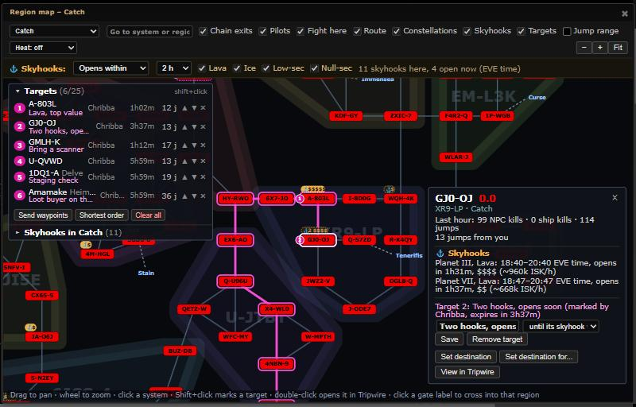
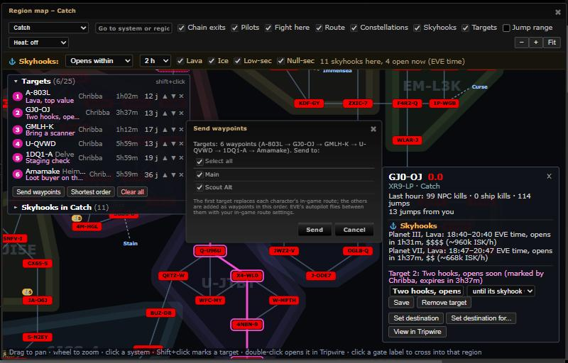

# Region map: mask-wide targets and multi-stop waypoints

**Date:** 2026-10-13

## Description

Pilots can mark up to 25 k-space systems as targets for the whole mask (with a short note and an expiry), see them on
the region map as numbered magenta rings and on the chain map as numbered badges, and send them to their characters as
in-game waypoints in list order (first stop replaces the route, the rest are added), so a raid plan reaches everyone's
autopilot.

## Before / After

| Before | After |
| --- | --- |
|  |  |

Before: the region map with skyhooks only. After: six targets (one in Delve, one in Heimatar: targets are mask-wide and
the list shows every region), numbered rings on A-803L and GJ0-OJ, the Targets list (who marked it, expires in, jumps from
you, reorder and remove), and the card of GJ0-OJ with its target block (note, expiry, Save / Remove target).

Sending waypoints (the existing character picker of "Set destination for..."): 

Chain map badge (target 5 on 1DQ1-A): 

## Settings

- Region map header: "Targets" overlay checkbox (on by default, `options.regionMap.overlays.targets`); the Targets list
  can be collapsed (`options.regionMap.collapsed.targets`). With the overlay off the map neither draws nor polls targets
  and Shift+click just selects the system.
- Settings > Map Markers > "Target badges" (on by default, `options.mapTargets.enabled`): the numbered badges on the
  chain map. Map Markers because it is drawn on the map. `mapTargets` is on the mask-defaults allow-list
  (`app/js/fork/mask-defaults.js`, `maskadmin/maskadmin.inc.php`).
- The targets themselves are mask data, not settings (shared by everyone on the mask).

## Change

- Server: new table `fork_map_targets` (maskID, systemID, note, ord, createdByID, createdByName, created, expires; unix
  seconds), `map_targets.inc.php`, reference DDL `docker/sql/map-targets.sql`, created on first use. Endpoint
  `public/map_targets.php`: GET (expired rows purged first), POST mode=add (also changes note / expiry of an existing
  target; new ones go last) / remove / clear / reorder. Same rules as `rally.php` / `jump_jammed.php`: logged-in session
  with a mask (canonicalised; the mask guard in `db.inc.php` already checked access), `X-Requested-With` on changes,
  system IDs validated against the k-space list of `public/jumprange/systems.json`, note cleaned (control characters,
  60 characters), expiry 1/3/6/24 h or "until" at most 7 days ahead, 25 per mask (409 when full). Audit log: add,
  update, delete and clear as entity `target` (Mask Admin > Audit shows them, filter "Region map targets").
- Region map: Shift+click toggles a target; the card has a note field, an expiry choice ("until its skyhook window ends"
  first when the system has one) and Mark as target / Save / Remove target. Rings and numbered discs on the map, the
  number and note in the tooltip. The side panel's "Targets (N/25)" list: order, system (region when elsewhere: click
  opens that region), note, who marked it, expires in, jumps from you (else from the nearest chain exit); drag, or the
  up/down arrows, to reorder; remove; "Clear all" (asks first); "Shortest order" (nearest neighbour by gate jumps with
  your route preferences, from you in k-space, else from the chain's k-space exits; it reorders the mask's list);
  "Send waypoints". The Skyhooks list has "Mark all listed as targets" (the filtered systems, as many as fit, asks first).
- Waypoints: the picker of `autopilot-route.js` (`autopilotRoute.pickCharacters`, now exported, with its own title and
  hint); then per character the first target with `clear_other_waypoints=true`, the rest appended
  (`add_to_beginning=false`) via `tripwire.esi.setDestination`, one call after another, a character stops at its first
  error (a character paused by `esiLimits` counts as an error), progress in the list and a result line ("Sent 5
  waypoints to 2 pilots"). Only the target systems are waypoints; EVE's autopilot routes between them.
- Others see changes on the next poll: every 30 s while the region map is open with Targets on, every 5 minutes
  otherwise (chain badges). No new sync channel.
- Ctrl+K: "Target <system> [note]" adds (or updates) a target, "Send target waypoints" opens the picker.
- Security: notes and names are escaped wherever they are shown (map, list, card, tooltips, badges); no new third-party
  host; ESI calls use each character's own token from the browser, as "Set destination" already does.
- Files: new `map_targets.inc.php`, `public/map_targets.php`, `docker/sql/map-targets.sql`, `app/js/fork/map-targets.js`,
  `app/css/fork/map-targets.css`, tests `tests/map_targets_endpoint_test.php` (+ `tests/map_targets_runner.php`) and
  `app/js-test/fork/map-targets.test.js`; edited fork files `region-map.js`, `region-map-view.js`, `region-map.css`,
  `autopilot-route.js` (exports the picker, optional title/hint), `audit-log-tab.js` (+ test), `audit/audit.inc.php`
  (entity `target`, action `clear`), `mask-defaults.js`, `maskadmin/maskadmin.inc.php` (allow-list), `region-map.test.js`,
  `docker/README.md`. No upstream file.
