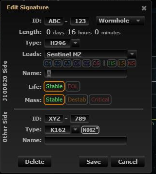
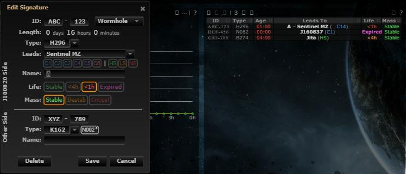

# Wormhole life states: Stable, <4h, <1h, Expired

**Date:** 2026-10-13

## Description

A hole's life can now be set to Stable, <4h, <1h or Expired instead of only Stable or EOL. These are the four states
the game's Wormhole Information shows since the Catalyst update ("Reliable lifetime", "less than 4 hours", "less than
1 hour", "Expired"). You can set them in the signature dialog, in the sig list's Life cell (L, then 1-4) and with Ctrl+K "Set life".

## Before / After

| Before | After |
| --- | --- |
|  |  |

## Settings

Toggle: Settings > Signatures > "Wormhole life states" (`options.lifeStates.enabled`, on by default; added to the
mask-defaults allow-list). Off: upstream's Stable / EOL buttons and behaviour everywhere.

## Change

- No schema change. `wormholes.life` stays `stable` / `critical`. The three critical states come from the hole's
  signature timer (`lifeLeft`), which upstream already counts down for EOL holes. More than 1 h left (or no timer) is
  <4h, 0-1 h is <1h, and past the timer is Expired. Picking a state keeps the timer if it is already inside that state's band;
  otherwise the timer is set to now + 4 h, now + 1 h or now, on both signatures, in the same request as the life change. So
  states move on with time like in game. The server deletes an Expired hole a tenth of its life length after
  expiry (upstream's `wormholeClean` event). "Never expires" signatures (life length 0) get a timer too, but the server
  never deletes them.
- New `app/js/fork/life-states.js` (pure logic, dialog buttons, sig list Life text and colours, settings row) and
  `app/css/fork/life-states.css` (<4h orange, <1h red, Expired magenta). The dialog's two extra buttons are added from JS;
  upstream's EOL button becomes "<4h".
- `app/js/fork/sig-inline.js`: four choices (keys 1-4), state-aware payload, cell text/colour and popover sync; undo
  restores the life and the timer. `command-args.js` / `command-palette.js`: Ctrl+K "Set life" takes stable / eol / 4h /
  1h / expired; the hole list shows the state instead of EOL. `life-wording.js`: tooltips for the four buttons.
- Undo/redo send whole signatures, and the server applies `lifeLength` after `lifeLeft`, which reset the timer.
  `lifeLeft` is now sent after `lifeLength` (a `tripwire.refresh` wrapper), so undo restores the exact timer.
- Upstream files touched (small, local): `app/js/dialogs/signature-dialog.js` (two hook lines: prefill and payload),
  `signatures.php` (a change to EOL keeps a timer the request sent instead of forcing now + 4 h). Also `docs/eve-wormhole-primer.md`.
