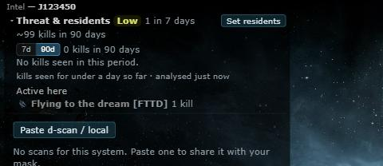
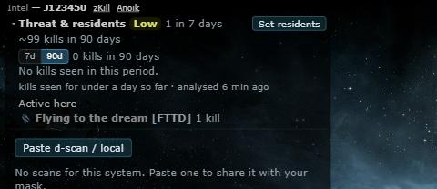

# Intel panel: zKillboard and Anoik.is links

**Date:** 2026-10-17

## Description

The Intel panel header now has zKillboard and Anoik.is links right next to the system name, so you can open
the system on either site without scrolling the system info panel down to its link row. Anoik.is is only shown
for wormhole systems (it doesn't cover k-space).

## Before / After

| Before | After |
| --- | --- |
|  |  |

## Settings

Toggle: Settings > Kills & Intel > D-scan & local intel > "Show zKillboard and Anoik.is links next to the system
name in the Intel panel" (`options.intelScans.links`, on by default).

## Change

Fork files only: `app/js/fork/intel-scans.js` (`showLinks`, `systemLinks`, `linksHtml`, header span, settings
checkbox), `app/css/fork/intel-scans.css`, tests in `app/js-test/fork/intel-scans.test.js`. Plain links, no new
requests to either site.
