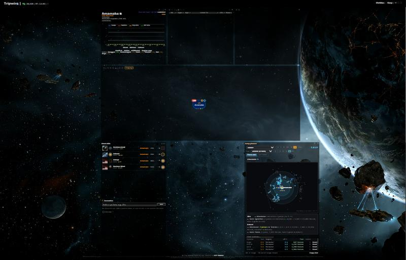
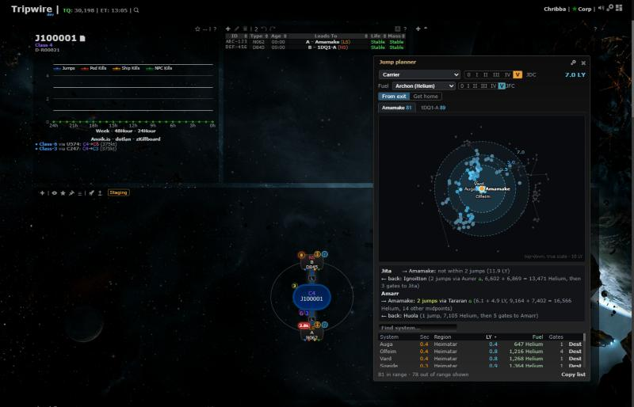

# Jump planner: floating window

**Date:** 2026-10-17

## Description

The Jump planner is now a floating window like the Region map, instead of a panel in the page layout. You can drag
and resize it anywhere over the chain map, and it no longer pushes the layout around or opens below the fold.

## Before / After

| Before | After |
| --- | --- |
|  |  |

Before: the planner is a layout tile, placed under the chain map (partly off-screen at 1400x900). After: a floating
window over the layout, next to a chain with two k-space exits.

## Settings

No new toggle. This changes how an existing feature is shown, and it keeps its existing on/off switch (Settings >
Routes & Navigation > Jump planner). The existing "Dock side" setting now picks which edge the window first opens
against.

## Change

- `app/js/fork/jump-planner.js`: the planner is a jQuery UI dialog (`.dialog-jumpPlanner`), not a gridster widget.
  Its place and size are saved per user in `options.jumpRange.window`, and kept inside the browser window on open
  (`jumpPlanner.windowPlacement`, tested). Without a saved place (first open, after Settings > Reset), it opens at
  the Dock side edge. The settings cog sits in the title bar. The dialog's X and Escape close it like the old close
  icon did, and Escape in the search boxes still only clears the search.
- Migration: the old layout entry (`jumpPlannerWidget` in `options.grid`) and `options.jumpRange.position` are
  removed once, on the first load.
- Removed the grid code (`defaultPlacement`, `savedPlacement`, `gridEntry`, `SIZE`/`MIN_SIZE`/`COL_PX`).
- `app/css/fork/jump-planner.css`: dialog styles; the body scrolls when the window is short.
- `app/js/fork/floating-windows.js` (new): non-modal windows that can stay open (`dialog-floating`: the Jump planner
  and the Region map) no longer count as "a dialog is open". It clears the page blur that
  `app/js/dialogs/base-dialog.js` leaves when Settings closes over one. `sig-inline.js` keeps the signature table's
  keys working while one is open.
- Upstream file touched: `app/js/tripwire/eve.js` (one line): Follow skips `.dialog-floating` windows, so it keeps
  following while the planner is open.
