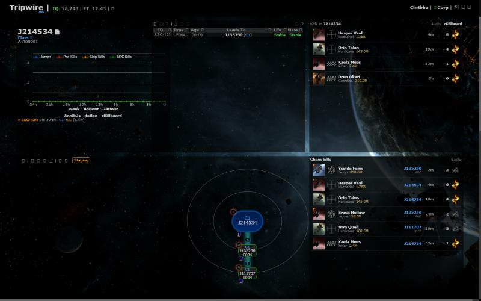
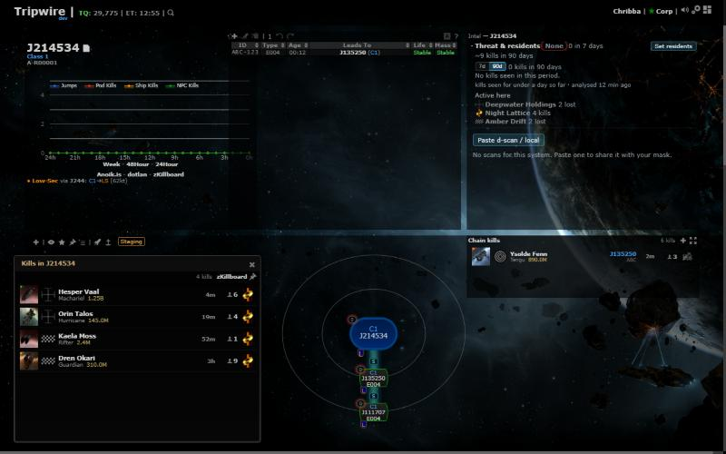
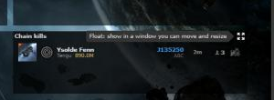
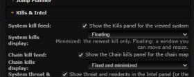

# Kill panel display modes

**Date:** 2026-10-17

## Description

The System kills and Chain kills panels can each be shown three ways: Fixed (in the layout, as before), Fixed and
minimized (the panel shrinks to its header and the most recent kill) or Floating (a window you can move and resize
over the map, like the Region map). Users asked to keep kill intel visible without giving it a big slot in the layout.

## Before / After

| Before | After |
| --- | --- |
|  |  |

After: System kills floating over the chain map, Chain kills minimized to its newest kill (top right).

| Minimized panel header (Restore / Float) | Settings > Kills & Intel |
| --- | --- |
|  |  |

## Settings

The existing on/off checkboxes (Settings > Kills & Intel > System kill feed / Chain kill feed) stay the toggle. New
selects under each: "System kills display" and "Chain kills display" (Fixed / Fixed and minimized / Floating), default
Fixed, so nothing changes for existing users. Stored per user in `options.systemKillFeed.mode` /
`options.chainKillFeed.mode`; Settings > Reset deletes them (Fixed). Same keys as before, so the mask-defaults
allow-list needs no change.

## Change

- New `app/js/fork/killfeed-modes.js` (+ `app/css/fork/killfeed-modes.css`, tests in
  `app/js-test/fork/killfeed-modes.test.js`): one module for both panels that builds the panel as a gridster widget
  or a jQuery UI dialog, sets up the shared parts (image fallback, header buttons, tooltips, width classes), and
  switches modes. Switching keeps the feed's data and timers; only the panel element is replaced.
- Header buttons: Minimize / Restore (layout modes) and Float / Dock. Command palette: "Float or dock ..." and
  "Minimize or restore ..." for each panel.
- Minimized = 2 gridster rows (header + one kill row); the full height is remembered in `options.<key>.fullSizeY`, and
  a fixed panel whose saved layout height is below its minimum gets it back on load.
- Floating: not in the layout (panels below move up), non-modal, draggable and resizable; place and size saved in
  `options.<key>.float` when a move/resize settles, clamped into the viewport on open. **Closing the window (X) docks
  it back to Fixed**; it doesn't turn the panel off (that stays the Settings checkbox).
- `system-killfeed.js` and `chain-killfeed.js` (fork-owned) use the shared module; their Settings checkboxes now merge
  into `options.<key>` instead of replacing it, so `mode` survives turning a panel off and on.
- No upstream files touched.
