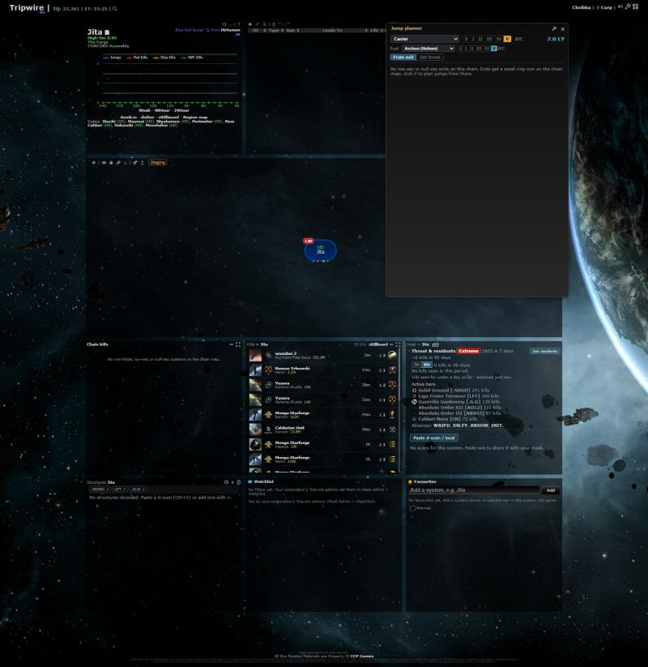
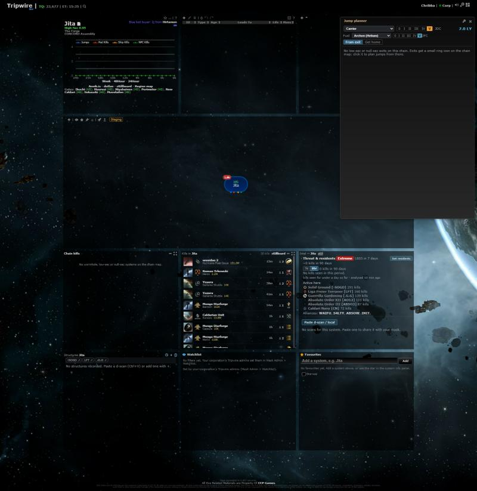

# Shared panel host

**Date:** 2026-10-17

## Description

The fork's panels shared their layout plumbing by copy: each one placed, added and removed its own gridster widget.
That code now lives in one fork file, `app/js/fork/panel-host.js`, with a list of the panels, ready for every panel
to get the same display modes (fixed / floating / minimized) in a later change. Nothing users see changes.

## Before / After

Full layout with every fork panel on: the same before and after (the Jump planner window has no saved place, so it
opens against the right edge of the viewport it was opened in).

| Before | After |
| --- | --- |
|  |  |

## Settings

No toggle, because nothing users see changes (internal refactor).

## Change

- New `panelHost` (`app/js/fork/panel-host.js`): saved / remembered / default places, layout entry helpers
  (`gridEntry`, `withoutEntry`, `hasEntry`, reading layouts through `layoutGrid.entries`), floating geometry
  (`defaultFloat`, `clampFloat`, `viewport`, `zoom`, `chrome`), `addGridWidget` / `removeGridWidget` (saved place,
  min size, resize handle, `-removed` rename, tooltips, remembering the place on remove) and a panel registry
  (`register`, `get`, `list`) holding the seven fork panels.
- System kills, Chain kills (via `killfeed-modes.js`), Intel, Structures, Watchlist, Favourites and the Jump planner
  use it. Each keeps its own content, timers, requests and settings, and its own default place and placement order.
- Moved, not copied: `systemKillFeed.savedPosition / defaultPosition / gridster / COL_PX`, `killfeedModes.FLOAT /
  defaultFloat / clampFloat / viewport / zoom / chrome / gridster`, `favouritesPanel.gridEntry / savedPlacement` and the
  watchlist's copy, `intelScans` / `structures` `rememberedPosition / gridster`, `structures.availableCols`,
  `jumpPlanner.withoutGridEntry / hasGridEntry`, `regionMapSkyhooks.withoutOldWidget / hasOldWidget`. Their tests moved
  to `app/js-test/fork/panel-host.test.js`.
- Same option keys, layout entries, panel ids, sizes and default places. No upstream files touched.
