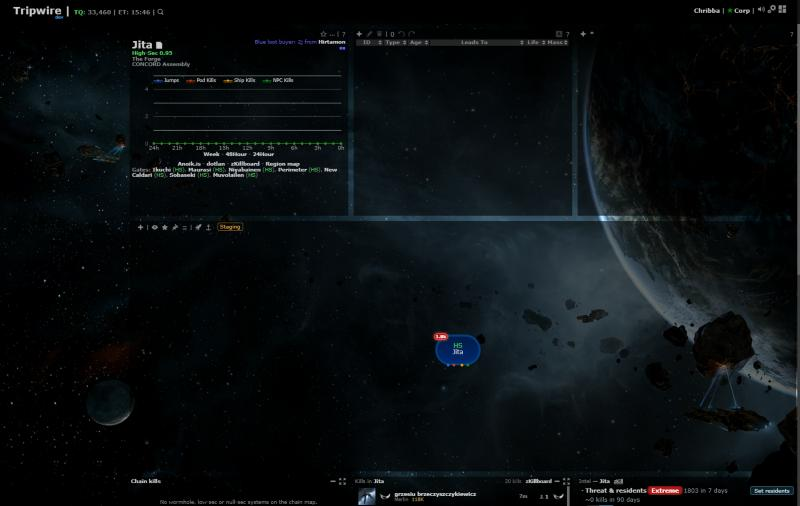
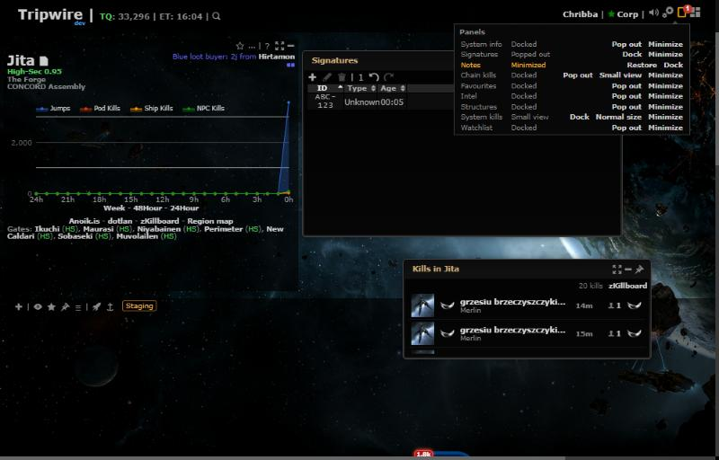

# Panel display modes

**Date:** 2026-10-17

## Description

Every panel except the chain map can now be docked in the layout (as before), popped out into a window you can move
and resize, shown as a small view (the kill panels: just the newest kills) or minimized out of sight. Buttons at the
top right of each panel switch it; a Panels menu next to Customize layout lists every panel with its mode and brings
minimized ones back. This generalises the kill panels' display modes (#115) to all panels.

## Before / After

Before: the default layout. After: Signatures popped out, System kills in its small view, Notes minimized (badge on
the Panels icon) and the Panels menu open.

| Before | After |
| --- | --- |
|  |  |

Close-ups: [header buttons](after-header-buttons.jpg) (docked System info; Signatures and System kills windows) and
[Panels menu](after-panels-menu.jpg).

## Settings

No toggle, by the user's explicit choice: the modes are a built-in feature of every panel (it overrides AGENTS.md's
default-toggle rule). Docked stays the default, so nothing changes until a panel is popped out. #115's two Settings
selects ("System kills display", "Chain kills display") are removed; their values carry over (below).
Settings > Reset leaves the panel modes alone: forkSettings has no reset-only hook and the modes have no Settings row.

## Change

- New `app/js/fork/panel-modes.js` (`panelModes`) and `app/css/fork/panel-modes.css`. Modes per user in
  `options.panels.<id>.mode` (`fixed` / `floating` / `small` / `minimized`, missing = docked; the Jump planner defaults
  to popped out), window places in `options.panelPlaces.<id>` (`float`, `small`, `restore`). Neither is a Settings row,
  so mask defaults never carry them.
- The panel's own element moves (its id, children, data and event handlers): out of gridster into a non-modal jQuery UI
  dialog (`dialog-floating`) and back to its saved layout place, which stays in `options.grid` while it is popped out.
  Upstream's System info, Signatures and Notes work this way without edits; notes being edited (CKEditor) are written
  restarted around a move with their unsaved text (Cancel still gives back the saved note); the activity graph redraws after a resize. Windows are UI-scale aware, clamped on
  screen (also after a window resize or a UI scale change) and cascade so they don't cover each other exactly.
- Minimized = the window is hidden, the panel keeps running; it comes back from the Panels menu (or, for the Jump
  planner, by opening it again from the map) in the popped-out mode it had. A panel turned off (or the planner closed)
  while minimized comes back in that mode, not invisible.
- Controls: header buttons (Pop out / Small view / Minimize when docked; Small view or Normal size / Minimize / Dock in
  a window's title bar, replacing its X), the Panels menu (badge = minimized panels) and palette commands
  "Pop out / Dock / Minimize / Restore / Small view <panel>" (group Panels).
- `panelHost.addGridWidget` / `removeGridWidget` hand a popped-out panel to `panelModes`, so the fork panels' own
  add/remove code works in every mode; `defaultFloat` cascades and `clampFloat` takes a size (the small view) and a
  fallback place.
- Kill panels: `killfeed-modes.js` / `.css` (and its tests) are gone; the panels use `panelHost` directly and show the
  small view under `.ph-small`. Migration (once, on load, idempotent): `options.<systemKillFeed|chainKillFeed>.mode`
  floating -> popped out, minimized -> small view, fixed -> docked; `options.killPanelPlaces.<key>.float` ->
  `options.panelPlaces.<id>.float`; a layout entry left at 2 rows by #115's minimize gets its old full height
  (`fullSizeY`) back; the old keys are deleted.
- Jump planner: a panel like the others (docked while open, popped out by default, small view not offered); its own
  close and settings icons sit in its header; its old `options.jumpRange.window` and the Dock side setting give the
  first window place; its window keeps its old minimum size (380x360) and Escape in it still closes it (other panels'
  windows don't close on Escape); Settings > Reset also forgets its window place.
- `app/js/fork/floating-windows.js`: upstream's base-dialog.js decides the grey overlay under a second modal by
  counting every visible dialog, so popped-out windows (and the Region map) threw it off; a fork handler running after
  it sets the overlay again counting only dialogs that aren't floating.
- Upstream files touched: none.
