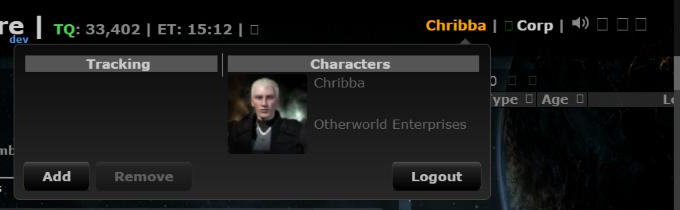
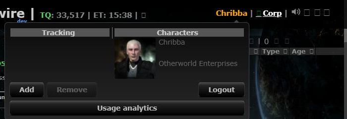
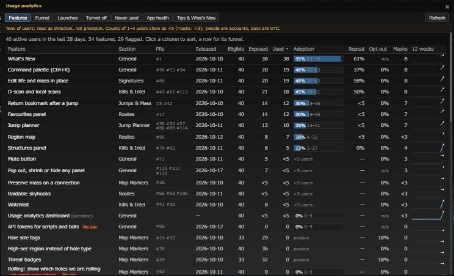

# Usage analytics dashboard

**Date:** 2026-10-18

## Description

A dashboard for the people who run this Tripwire, showing which fork features are used, by how many people, how often
and how often they are turned off, from the first-party usage counters (#120). Only characters listed in
`ANALYTICS_ADMINS` see it; nobody else gets the menu item, the palette command or any data.

## Before / After

| Before | After |
| --- | --- |
|  |  |
| |  |

Before: the user menu (character name, top right). After: the new "Usage analytics" button there opens the dashboard,
here its Features tab with made-up dev data (`docker/dev-seed-analytics.php`).

## Settings

No toggle, because it is an operator tool, not a user feature: it is off unless the server lists the character in
`ANALYTICS_ADMINS` (empty by default = nobody). No What's New entry for the same reason.

## Change

- **Views** (one dialog, seven tabs): Features (every catalog feature, also unused ones: eligible, exposed, used,
  adoption with a Wilson 95% interval, repeat, opt-out, masks, 12-week sparkline, flags for "no events since release"
  and active features nobody used), Funnel (eligible -> exposed -> tried -> repeat -> retained, median time from first
  seen to first use; each step names its base), Launches (last 15 What's New PRs, tried by day 1/7/14/28, flag under 10%
  at day 14, "no data" before the first data day), Turned off (after using it vs without trying it), Never used (prune
  candidates older than 60 days; passive features judged by how many saw them), App health (daily / weekly / 28-day
  active users, new users, masks, active-hours heatmap) and Tips & What's New (per feature: tip shown, acted on, used
  within 7 days; tip outcomes for all tips together, since outcome events don't name the tip; "Show feature tips" off
  rate; What's New opens per release). The tips part stays empty until feature tips ship.
- **Salt replacement.** Every view shows a banner when the pseudonym salt was replaced inside its window (people count
  twice until one window length later) and new users aren't counted across it. Repeat and retained keep all data (a
  person then has two ids: a slight undercount); time to first use of a feature released before the replacement only
  uses milestones from before it (noted in the funnel).
- **Heatmap.** The daily table keeps the minute of each feature/action's first event of the day (`firstMinute`), so the
  heatmap counts user-days by the UTC hour things first happened; activity late in a long session is under-counted (said
  on the page).
- **Server** `public/fork_analytics.php` (GET, JSON) + `analytics/dashboard.inc.php`: login required, the session's
  character must be in `ANALYTICS_ADMINS` on every request (403 otherwise, no detail; `mode=access` answers
  `{admin: false}` to other logged-in users so the page can hide the entry points). Read only; missing tables read as no
  data and are never created. Aggregates only, never a uid or per-user row; user counts of 1-4 come back as "<5", mask
  counts of 1-2 as "<3", percentages of suppressed counts are left out and the after/without split is hidden when one
  part is small. Suppression is per cell (differences between cells aren't prevented: operator-only, no per-user rows).
  2-minute file cache in `cache/` per view (aggregates only), files older than a day cleaned up.
- **Client** `app/js/fork/analytics-dashboard.js` + `app/css/fork/analytics-dashboard.css`: plain tables, CSS bars and
  inline-SVG sparklines, sortable columns, a row opens its funnel. No chart library, CDN or third-party host. Entry points:
  a "Usage analytics" button in the user menu and Ctrl+K "Usage analytics" (`analytics.open`), both added only after the
  server says this character is an analytics admin.
- **Its own use** is counted like any feature: catalog entry `analyticsDashboard` (new audience `operator`, no What's New
  PR), `forkUsage.track("analyticsDashboard", "opened")`.
- **Dev tool** `docker/dev-seed-analytics.php`: 40 made-up users over 35 days for trying the dashboard (`--clear` removes them).
- Docs: docker/README.md "Product analytics" (enabling the dashboard, what each view means).
- Tests: `app/js-test/fork/analytics-dashboard.test.js` (Wilson interval, suppressed counts, sparkline path, sorting),
  `tests/analytics_dashboard_test.php` (every view's numbers on seeded rows, suppression, fresh install, 403 for
  non-admins); the catalog test accepts audience `operator`.
- Upstream files touched: none.
